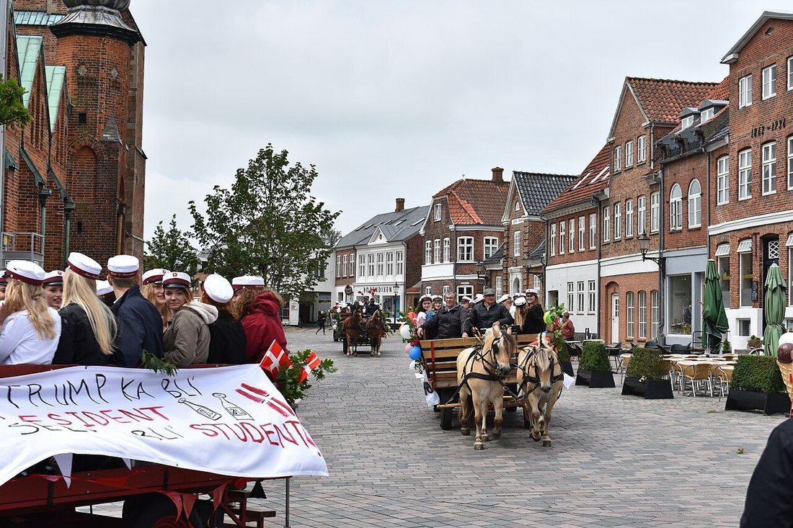
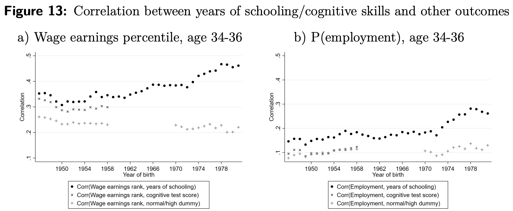
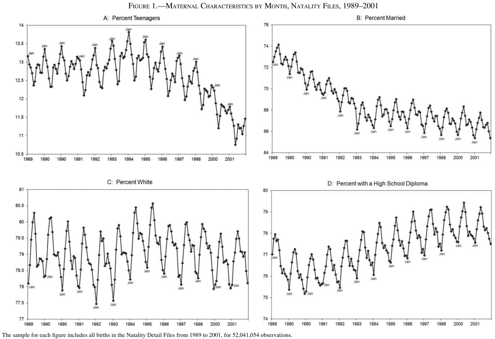

```{r setup, include = FALSE}
library(RefManageR)
library(knitr)

options(htmltools.preserve.raw = FALSE,
        htmltools.dir.version = FALSE, servr.interval = 0.5, width = 115, digits = 3)
knitr::opts_chunk$set(
  collapse = TRUE, message = FALSE, fig.retina = 3, error = TRUE,
  warning = FALSE, cache = FALSE, fig.align = 'center',
  comment = "#", strip.white = TRUE, tidy = FALSE)

BibOptions(check.entries = FALSE,
           bib.style = "authoryear",
           style = "markdown",
           hyperlink = FALSE,
           no.print.fields = c("doi", "url", "ISSN", "urldate", "language", "note", "isbn", "volume"))
myBib <- ReadBib("../Stats_II.bib", check = FALSE)

# modelsummary prepends a stray &nbsp; to some column headers (shows as a literal "&nbsp;").
# Strip it from every chunk's output, so the code students see stays a plain modelsummary().
local({
  chunk_hook <- knit_hooks$get("chunk")
  knit_hooks$set(chunk = function(x, options)
    chunk_hook(gsub("&amp;nbsp;", "", x, fixed = TRUE), options))
})
```

## By the end of today you can … {.inverse background-color="#901A1E"}

1. explain **two-stage least squares (2-SLS)**: how it isolates the *predicted* part of the treatment, why that is the mirror image of controlling, and why it generalises Wald;

2. interrogate an instrument's **exclusion restriction** and say what happens to your estimate when it fails.

::: {.notes}
Two weeks ago they met IV and the Wald ratio; last week they learned what controlling does. Today those two threads meet. Be explicit that goal 2 is the technical core and goal 3 is the one that matters when they read a paper — most published IV work lives or dies on the exclusion restriction, and it is the assumption nobody can test.
:::

## Where we are

```{tikz design-map, echo = FALSE, out.width='66%', fig.align='center'}
\usetikzlibrary{arrows.meta}
\definecolor{kured}{HTML}{901A1E}
\begin{tikzpicture}[
  box/.style = {draw, rounded corners = 3pt, align = center, inner sep = 4pt,
                font = \sffamily\small, minimum height = 0.9cm},
  today/.style = {box, draw = kured, very thick, text = kured},
  level distance = 1.6cm,
  level 1/.style = {sibling distance = 5.6cm},
  level 2/.style = {sibling distance = 3.0cm},
  edge from parent/.style = {draw, -{Latex}, semithick}]
\node[box, font = \sffamily\bfseries] {Who decided who got treated?}
  child {node[box] {A researcher\\randomised (L6)}
    child {node[box] {RCT:\\bivariate OLS}
      child {node[box] {$\kappa$: the average\\causal effect}}}}
  child {node[box] {Nature randomised,\\as if (L7)}
    child {node[box] {ITT: bivariate\\OLS on $Z$}
      child {node[box] {$\rho$: effect of\\the assignment}}}
    child {node[today] {IV: Wald (L7),\\2SLS (today)}
      child {node[today] {$\lambda$: LATE for\\the compliers}
        edge from parent [draw = kured, very thick]}
      edge from parent [draw = kured, very thick]}}
  child {node[box] {Nobody randomised\\(L8, L9)}
    child {node[box] {measure $C$:\\multiple OLS}
      child {node[box] {$\kappa$, \emph{if} every\\confounder is measured}}}};
\end{tikzpicture}
```

::: {.content-box-green}
2SLS does not replace Wald. With a single instrument and no controls the two give the same result. 2SLS is what you need the moment you want controls or more than one instrument.
:::

::: {.notes}
The same map as in Lecture 8, now with the instrument branch in red. Locate the day precisely, because they will otherwise think 2SLS is a new and unrelated tool. Say the punchline now rather than saving it: 2SLS *contains* Wald as a special case, and we will verify that to four decimal places later. What it buys you is the ability to add controls and extra instruments, which is why every published IV paper uses it. And it borrows the Frisch–Waugh idea from Lecture 8, which is why we did that first.
:::

## First Research Question: Does education pay off? {.inverse background-color="#901A1E"}

[Part 1 of 3]{.part-pill}

::: {.lead}
A selective university doesn't pay off; but does education itsel?
:::

```{r, echo = FALSE, out.width='46%'}

```

::: {.backgrnote .center}
Studenterkørsel; was it worth it? *Photo:* [Thomas Dahlstrøm Nielsen](https://commons.wikimedia.org/wiki/File:2017_Studenterfejring_-_6.jpg).
:::

::: {.notes}
Most of them were on a truck like this three or four years ago. Ask it straight: did those extra years of school make you more productive, or did they mostly sort people who were going to do well anyway? Keep the question hanging; the whole lecture is about how you could possibly tell.
:::

## A question rife with confounders

::: {.push-left}
People with more education earn more.

```{r, echo = FALSE, out.width='100%'}

```

::: {.backgrnote}
Denmark: correlation of years of schooling with earnings rank at age 34–36, by birth year. *Source:* `r Citet(myBib, "karlson_making_2021")`
:::
:::

::: {.push-right}
```{tikz dag-naive, echo = FALSE, out.width='95%'}
\usetikzlibrary{shapes.geometric, arrows.meta, positioning}
\definecolor{kured}{HTML}{901A1E}
\begin{tikzpicture}[>=Latex, semithick]
\sffamily
\node[ellipse, draw] (D) at (0,0) {Education};
\node[ellipse, draw] (Y) at (3.6,0) {Earnings};
\node[ellipse, draw=kured, thick, dashed, align=center] (C1) at (1.8,2.3) {C};
\draw[->, kured, very thick] (D) -- node[above]{?} (Y);
\draw[->, kured, dashed] (C1) -- (D);
\draw[->, kured, dashed] (C1) -- (Y);
\end{tikzpicture}
```
:::

::: {.notes}
Start with the correlation everybody already believes, then make the causal question sharp: is it the schooling, or the kind of person who stays in school? Note the stakes — this is not an academic puzzle, it is the justification for a large share of public spending. Ask them to predict which way the bias runs before the next slide.
:::

## A question rife with confounders

::: {.push-left}
The people who stay in school longer differ *systematically*:

- Cognitive ability,  
- Parental education and money
- Ambition, health, networks ...
:::

::: {.push-right}
```{tikz dag-conf, echo = FALSE, out.width='78%'}
\usetikzlibrary{shapes.geometric, arrows.meta, positioning}
\definecolor{kured}{HTML}{901A1E}
\begin{tikzpicture}[>=Latex, semithick]
\sffamily
\node[ellipse, draw] (D) at (0,0) {Education};
\node[ellipse, draw] (Y) at (4.6,0) {Earnings};
\node[ellipse, draw=kured, thick, dashed, align=center] (C1) at (2.3,2.3) {Cognitive\\ability};
\node[ellipse, draw=kured, thick, dashed, align=center] (C2) at (2.3,-2.3) {Parental\\education};
\draw[->] (D) -- (Y);
\draw[->, kured, dashed] (C1) -- (D);
\draw[->, kured, dashed] (C1) -- (Y);
\draw[->, kured, dashed] (C2) -- (D);
\draw[->, kured, dashed] (C2) -- (Y);
\end{tikzpicture}
```
:::

::: {.notes}
Use last week's sign rule out loud: both arrows into education are positive, both arrows into earnings are positive, so the omitted variable bias is positive and OLS should **overstate** the return. Get them to commit to that prediction — it makes the actual result later genuinely surprising, and the surprise is where the real teaching happens.
:::

## Why not just control for ability?

::: {.push-left}
::: {.content-box-blue}
**Discuss:** what will likely go wrong if we try that here?
:::
:::

::: {.push-right}
::: {.content-box-red .fragment}
"Ability" is not in the data and no test score fully captures it. Ambition, family connections, health are worse still. Multiple OLS can only close the backdoors you measured.

$\rightarrow$ We need as-if random variation in schooling that has nothing to do with who the person is.
:::
:::

::: {.notes}
This is the hinge between L8 and today, so let them try the obvious answer first. The point to land: controlling is not wrong here, it is *insufficient* — the decisive confounders were never recorded, and no amount of regression conjures them back. That is precisely the situation an instrument is built for.
:::

## `r Citet(myBib, "angrist_does_1991")` had an idea

::: {.push-left}
In the US (at the time):

- The school year starts in September; children enter in the calendar year they turn 6.
- School is compulsory until the 16th birthday.

$\rightarrow$ Children born **late** in the year start school **younger**, so they have completed **more** schooling by the time they may legally drop out.
:::

::: {.push-right}
```{tikz dag-iv, echo = FALSE, out.width='84%'}
\usetikzlibrary{shapes.geometric, arrows.meta, positioning, quotes}
\definecolor{kured}{HTML}{901A1E}
\begin{tikzpicture}[>=Latex, semithick]
\sffamily
\node[ellipse, draw=kured, thick, align=center] (Z) at (0,0) {Quarter\\of birth};
\node[ellipse, draw] (D) at (3.4,0) {Education};
\node[ellipse, draw=gray, dashed] (C) at (3.4,2.3) {$C$};
\node[ellipse, draw] (Y) at (7.2,0) {Earnings};
\draw[->, kured, thick] (Z) -- node[above]{$\phi$} (D);
\draw[->] (D) -- node[above]{$\lambda$} (Y);
\draw[->, gray, dashed] (C) -- (D);
\draw[->, gray, dashed] (C) -- (Y);
\end{tikzpicture}
```

:::

::: {.notes}
Two economists noticed that a school calendar can do what no ethics board would allow: hand some children an extra year of school for reasons that have nothing to do with who they are. Read the three rules slowly; the next slide shows what they mean for two boys.
:::

## Carl and Luis

```{r carl-luis, echo = FALSE, out.width='80%', fig.height = 3.4, fig.width = 11}
suppressMessages(library(tidyverse))
kids <- tibble(
  name  = factor(c("Luis, born 31 December 1930", "Carl, born 1 January 1930"),
                 levels = c("Luis, born 31 December 1930", "Carl, born 1 January 1930")),
  start = as.Date(c("1936-09-01", "1936-09-01")),
  leave = as.Date(c("1946-12-31", "1946-01-01")),
  years = c("10 years of school", "9 years of school"))

ggplot(kids, aes(y = name)) +
  geom_segment(aes(x = start, xend = leave, yend = name, colour = name), linewidth = 14) +
  geom_text(aes(x = start + (leave - start) / 2, label = years), colour = "white", size = 6) +
  geom_point(aes(x = leave), shape = 25, size = 6, fill = "black") +
  annotate("text", x = as.Date("1936-09-01"), y = 2.55, hjust = 0, size = 5,
           label = "Both start school in September 1936") +
  annotate("text", x = as.Date("1947-02-01"), y = 2.55, hjust = 1, size = 5,
           label = "16th birthday: free to leave") +
  scale_colour_manual(values = c("#901A1E", "#425570"), guide = "none") +
  scale_x_date(date_breaks = "2 years", date_labels = "%Y") +
  scale_y_discrete(expand = expansion(add = 0.8)) +
  labs(x = NULL, y = NULL) +
  theme_minimal(base_size = 18)
```

::: {.push-left}
Same school, same law, same year of entry. Luis gets **one more year** of school only because his birthday falls late in the year: the start of school depends on the *calendar year*, the right to leave on the *birthday*.
:::

::: {.push-right}
::: {.content-box-blue}
**Discuss:** is quarter of birth a valid instrument? Check all **three** requirements from Lecture 7.
:::
:::

::: {.notes}
Tell the Carl and Luis story properly. It is what makes the design click, and students remember the two boys long after they forget the algebra. Both enter school in the same September, because both turn six in 1936. Carl may leave on 1 January 1946, Luis only on 31 December 1946, almost a full school year later. Then run the three requirements as a genuine check, not a recital: first stage (plausible, and we will measure it), as-if random (nobody chooses their birth quarter, or do they? hold that thought for Part 3), exclusion restriction (the one that will occupy the rest of the lecture).
:::

## Would it work in Denmark?

::: {.push-left}
In Denmark, children also start school in the calendar year they turn six. So the December children are the youngest in their class.

::: {.content-box-blue}
**Discuss:** would quarter of birth be a useful instrument for schooling in Denmark?
:::

::: {.content-box-red .fragment}
The first stage: Danish compulsory schooling lasts ten school years, not until a birthday. $\rightarrow \phi \approx 0$.
:::
:::

::: {.push-right}
```{r, echo = FALSE, out.width='72%'}

```

::: {.backgrnote .center}
Prince Christian on his first school day.<br> *Photo:* [VisitCopenhagen](https://commons.wikimedia.org/wiki/File:Prince_Christian_of_Denmark_on_his_first_day_of_school.jpg).
:::
:::

::: {.notes}
A Danish check of the design, and a good test of whether they understood where the extra year comes from. The start rule is the same as in the US: the calendar year you turn six. The leaving rule is different: in Denmark, compulsory schooling is ten years of school, not a birthday. So there is no Carl and Luis in Denmark, only a younger and an older classmate who leave together. No first stage, no instrument. The prince is a nice example of a late-year child: born in October, he started school at five.
:::

## Preparation

::: {.panel-tabset}

### Packages
```{r libs}
pacman::p_load(
  tidyverse,        # Data manipulation and visualization
  estimatr,         # OLS with robust standard errors
  modelr,           # Predictions and residuals from a model
  ivreg,            # IV / two-stage least squares
  modelsummary,     # Nicely formatted regression tables
  masteringmetrics  # The data behind Mastering 'Metrics
)
```

### The data
```{r ak-data}
# 329,509 US men born 1930-1939, from the 1980 Census
data("ak91", package = "masteringmetrics")

ak91 %>%
  select(lnw, s, yob, qob) %>%
  head(4)
```

::: {.backgrnote}
`lnw` = log weekly wage · `s` = years of schooling · `yob` = year of birth · `qob` = quarter of birth.
:::

### Why logged wages?
::: {.small}
The outcome is the **log** of the wage, so a coefficient reads as an approximate **percentage** change:
a coefficient of $0.07$ means an extra year of schooling goes with about **7% higher** earnings. This is the standard convention in the returns-to-education literature.
:::

:::

::: {.notes}
Keep this brief. Two things they must carry forward: the outcome is *logged*, so coefficients read as percentages, and the sample is large — 330,000 men — which will matter when we discuss how a tiny effect can still be statistically significant. Do not dwell; the payoff is next.
:::

## The naïve answer

::: {.push-left}
```{r ols-naive, results = 'hide'}
# Just regress log wage on years of schooling
ols <- lm_robust(lnw ~ s, data = ak91)

modelsummary(
  list("log wage" = ols),
  coef_rename = c("s" = "Years of schooling"),
  stars = TRUE, gof_map = c("nobs", "r.squared"),
  output = "kableExtra"
)
```

:::

::: {.push-right}
::: {.small}
```{r ols-tab, ref.label = "ols-naive", echo = FALSE, results = 'asis'}
```
:::
:::

::: {.notes}
Read the number in words and in percent. Remind them of their own prediction — ability bias means this 7.1% should be an *over*statement, so the honest causal effect ought to come out lower. Write "7.1%" on the board; the whole rest of the lecture is a test of that prediction, and it will not go the way they expect.
:::

## The first stage, drawn

```{r sawtooth, echo = FALSE, out.width='74%', fig.height = 4.2, fig.width = 12}
ak91 %>%
  group_by(yob, qob) %>%
  summarise(s = mean(s), .groups = "drop") %>%
  mutate(cohort = yob + (qob - 1) / 4) %>%
  ggplot(aes(x = cohort, y = s)) +
  geom_line(colour = "grey55") +
  geom_point(aes(colour = factor(qob)), size = 3) +
  scale_colour_manual(values = c("grey45", "grey45", "grey45", "#901A1E"),
                      labels = c("Q1", "Q2", "Q3", "Q4 (born late)"),
                      name = NULL) +
  labs(x = "Year and quarter of birth", y = "Average years of schooling") +
  theme_minimal(base_size = 15) +
  theme(legend.position = "top")
```

::: {.content-box-blue}
**Discuss:** What is systematically different about the **red** points and is that a pattern a confounder could produce?
:::

::: {.notes}
This is the single most persuasive slide in the lecture, so let them look before you talk. Within almost every birth year the Q4 men have *more* schooling than the Q1 men born a few months later — a regular sawtooth, repeated across a decade. Then the rhetorical move: what confounder could possibly generate a pattern that resets every January? That regularity is the argument for as-if randomness. Also flag how *small* the steps are on the y-axis; that comes back in Part 3.
:::

## The reduced form (ITT), drawn

```{r sawtooth-wage, echo = FALSE, out.width='74%', fig.height = 4.2, fig.width = 12}
ak91 %>%
  group_by(yob, qob) %>%
  summarise(lnw = mean(lnw), .groups = "drop") %>%
  mutate(cohort = yob + (qob - 1) / 4) %>%
  ggplot(aes(x = cohort, y = lnw)) +
  geom_line(colour = "grey55") +
  geom_point(aes(colour = factor(qob)), size = 3) +
  scale_colour_manual(values = c("grey45", "grey45", "grey45", "#901A1E"),
                      labels = c("Q1", "Q2", "Q3", "Q4 (born late)"),
                      name = NULL) +
  labs(x = "Year and quarter of birth", y = "Average log weekly wage") +
  theme_minimal(base_size = 15) +
  theme(legend.position = "top")
```


::: {.notes}
The partner of the previous slide, recovered from the old deck, which plotted both the first stage and the reduced form. Let them compare the two pictures: the schooling sawtooth is clean, the wage sawtooth is noisier, but within most years the later-born men earn a little more. Do not compute anything yet. Just plant the idea that IV compares the size of two sets of steps; the next slide puts numbers on both.
:::

## Recap: first stage, reduced form (ITT), & Wald

::: {.panel-tabset}

### The three quantities
::: {.push-left}
::: {.small}
**First stage:** does the instrument move the treatment?
$$\phi = \text{Avg}[D \mid Z = 1] - \text{Avg}[D \mid Z = 0]$$

**Reduced form:** does the instrument move the outcome?
$$\rho = \text{Avg}[Y \mid Z = 1] - \text{Avg}[Y \mid Z = 0]$$

**Wald IV estimator:** the effect of the treatment itself:
$$\lambda = \frac{\rho}{\phi}$$
:::
:::

::: {.push-right}
```{tikz dag-recap, echo = FALSE, out.width='88%'}
\usetikzlibrary{shapes.geometric, arrows.meta, positioning}
\definecolor{kured}{HTML}{901A1E}
\begin{tikzpicture}[>=Latex, semithick]
\sffamily
\node[ellipse, draw, align=center] (Z) at (0,0) {$Z$};
\node[ellipse, draw, align=center] (D) at (3.4,0) {$D$};
\node[ellipse, draw=gray, dashed, align=center] (C) at (5.1,2.4) {$C$};
\node[ellipse, draw, align=center] (Y) at (6.8,0) {$Y$};
\draw[->] (Z) -- node[above]{$\phi$} (D);
\draw[->] (D) -- node[above]{$\lambda$} (Y);
\draw[->, gray, dashed] (C) -- (D);
\draw[->, gray, dashed] (C) -- (Y);
\draw[->, dashed] (Z) to[bend right=35] node[below]{$\rho$} (Y);
\end{tikzpicture}
```
:::

::: {.content-box-green style="clear: both;"}
The same logic from Lecture 7's Moving to Opportunity study; only the application is different.
:::

### First stage in R
```{r fs, results = 'hide'}
# Does quarter of birth move schooling?
first_stage <- lm_robust(s ~ qob, data = ak91)

modelsummary(list("Years of schooling" = first_stage),
             coef_rename = c("qob" = "Quarter of birth"),
             stars = TRUE, gof_map = c("nobs"), output = "kableExtra")
```

::: {.push-left}
::: {.small}
```{r fs-tab, ref.label = "fs", echo = FALSE, results = 'asis'}
```
:::
:::

::: {.push-right}
```{tikz dag-recap-fs, echo = FALSE, out.width='92%'}
\usetikzlibrary{shapes.geometric, arrows.meta, positioning}
\definecolor{kured}{HTML}{901A1E}
\begin{tikzpicture}[>=Latex, semithick]
\sffamily
\node[ellipse, draw=kured, very thick, align=center] (Z) at (0,0) {Quarter\\of birth};
\node[ellipse, draw=kured, very thick, align=center] (D) at (3.4,0) {Years of\\schooling};
\node[ellipse, draw=gray, dashed, align=center] (C) at (5.1,2.4) {Ability};
\node[ellipse, draw=gray, align=center] (Y) at (6.8,0) {Log\\wage};
\draw[->, kured, very thick] (Z) -- node[above]{\textcolor{kured}{$\phi$}} (D);
\draw[->, gray] (D) -- node[above]{\textcolor{gray}{$\lambda$}} (Y);
\draw[->, gray, dashed] (C) -- (D);
\draw[->, gray, dashed] (C) -- (Y);
\draw[->, gray!60, dashed] (Z) to[bend right=35] node[below]{\textcolor{gray!60}{$\rho$}} (Y);
\end{tikzpicture}
```
:::

### Reduced form in R
```{r rf, results = 'hide'}
# Does quarter of birth move wages?
reduced_form <- lm_robust(lnw ~ qob, data = ak91)

modelsummary(list("log wage" = reduced_form),
             coef_rename = c("qob" = "Quarter of birth"),
             stars = TRUE, gof_map = c("nobs"), output = "kableExtra")
```

::: {.push-left}
::: {.small}
```{r rf-tab, ref.label = "rf", echo = FALSE, results = 'asis'}
```
:::
:::

::: {.push-right}
```{tikz dag-recap-rf, echo = FALSE, out.width='92%'}
\usetikzlibrary{shapes.geometric, arrows.meta, positioning}
\definecolor{kured}{HTML}{901A1E}
\begin{tikzpicture}[>=Latex, semithick]
\sffamily
\node[ellipse, draw=kured, very thick, align=center] (Z) at (0,0) {Quarter\\of birth};
\node[ellipse, draw=kured, very thick, align=center] (D) at (3.4,0) {Years of\\schooling};
\node[ellipse, draw=gray, dashed, align=center] (C) at (5.1,2.4) {Ability};
\node[ellipse, draw=kured, very thick, align=center] (Y) at (6.8,0) {Log\\wage};
\draw[->, kured, very thick] (Z) -- node[above]{\textcolor{kured}{$\phi$}} (D);
\draw[->, kured, very thick] (D) -- node[above]{\textcolor{kured}{$\lambda$}} (Y);
\draw[->, gray, dashed] (C) -- (D);
\draw[->, gray, dashed] (C) -- (Y);
\draw[->, kured, very thick, dashed] (Z) to[bend right=35] node[below]{\textcolor{kured}{$\rho$}} (Y);
\end{tikzpicture}
```
:::

:::

::: {.notes}
Deliberate repetition from Lecture 7 — say so, so they know it is a recap and not something new. Have them read both coefficients aloud with units: a quarter later in the year buys about 0.05 extra years of schooling and about half a percent more in wages. Both are tiny; the ratio is not. Stress the order of operations, because students reliably invert the fraction.
:::

## The Wald answer

```{r wald-nums, include = FALSE}
phi <- coef(lm_robust(s ~ qob, data = ak91))["qob"]
rho <- coef(lm_robust(lnw ~ qob, data = ak91))["qob"]
wald <- rho / phi
b_ols <- coef(lm_robust(lnw ~ s, data = ak91))["s"]
```

::: {.push-left}
$$\lambda = \frac{\rho}{\phi} = \frac{`r sprintf("%.5f", rho)`}{`r sprintf("%.4f", phi)`} = \mathbf{`r sprintf("%.4f", wald)`}$$

The return to a year of schooling is about **`r round(wald * 100, 1)`%**.

::: {.content-box-blue}
**Discuss:** we predicted ability bias would make OLS **too large**. OLS gave `r round(b_ols * 100, 1)`%, IV gives `r round(wald * 100, 1)`%. That is the **wrong way round**. What could explain it?
:::
:::

::: {.push-right}
::: {.content-box-red .fragment}
Two possibilities:

1. **LATE, not ATE** (L7) — IV identifies the effect among **compliers**: men who left school the moment they legally could. Returns may be higher for them.

2. The instrument is **weak**, which we come back to in Part 3.
:::
:::

::: {.notes}
The surprise, and it is a gift — do not smooth it over. Their sign prediction was reasonable and the data contradicted it, which is exactly what a real research finding feels like. Give them a minute on the blue box before revealing. All three explanations are live in the literature; the complier story is the one they can already reason about from Lecture 7, so lead with it.
:::

## Two-stage least squares (2-SLS) {.inverse background-color="#901A1E"}

[Part 2 of 3]{.part-pill}

::: {.push-left}
::: {.content-box-red}
Wald breaks down as soon as you want to:

- control for something (year of birth, state of birth);
- use more than one instrument;
- instrument a continuous treatment properly.
:::
:::

::: {.push-right}
::: {.content-box-green}
2SLS can do all three. With a single instrument and no controls, 2-SLS returns the Wald number.
:::
:::

::: {.notes}
Motivate the new tool by the limitation, not by novelty. Ask why controls might matter here even with a good instrument — year and state of birth are the obvious answers, since schooling laws and economic conditions differ across both. Then promise the reassurance: switching to 2SLS costs them nothing, because it reproduces Wald exactly in the simple case.
:::

## Stage one: keep the *predicted* part

::: {.push-left}
Regress the treatment on the instrument, then keep the **predictions** (not the residuals):

```{r stage1}
first_stage <- lm_robust(s ~ qob, data = ak91)

ak91 <- ak91 %>%
  add_predictions(first_stage, var = "pred_s") %>%
  add_residuals(first_stage,  var = "e_s")

ak91 %>% select(s, qob, pred_s, e_s) %>% head(4)
```

::: {.content-box-blue}
**Discuss:** in Lecture 8 we kept the **residuals**, now the **predictions**. Why? Which of the two is unconfounded here?
:::
:::

::: {.push-right}
```{r stage1-plot, echo = FALSE, out.width='92%', fig.height = 4, fig.width = 6.4}
set.seed(10)
some_men <- ak91 %>%
  slice_sample(n = 300) %>%
  mutate(qob_jit = qob + runif(n(), min = -0.3, max = 0.3))

# A few men whose residual we draw explicitly
shown <- some_men %>%
  group_by(qob) %>%
  slice_head(n = 3) %>%
  ungroup()

preds <- ak91 %>%
  group_by(qob) %>%
  summarise(pred_s = mean(pred_s))

ggplot() +
  geom_point(data = some_men, aes(x = qob_jit, y = s),
             colour = "grey60", alpha = 0.4, size = 1.6) +
  geom_segment(data = shown, aes(x = qob_jit, xend = qob_jit, y = pred_s, yend = s),
               colour = "grey20", linewidth = 0.6) +
  geom_point(data = shown, aes(x = qob_jit, y = s), colour = "grey20", size = 2.4) +
  geom_segment(data = preds, aes(x = qob - 0.3, xend = qob + 0.3, y = pred_s, yend = pred_s),
               colour = "#901A1E", linewidth = 0.8) +
  geom_line(data = preds, aes(x = qob, y = pred_s), colour = "#901A1E", linewidth = 1.2) +
  geom_point(data = preds, aes(x = qob, y = pred_s), colour = "#901A1E", size = 5, shape = 18) +
  labs(x = "Quarter of birth", y = "Years of schooling",
       caption = "Grey dots: 300 random men (s). Black lines: some of their residuals (e_s).\nRed: the first-stage prediction (pred_s), only four values.") +
  theme_minimal(base_size = 16)
```

::: {.content-box-red .fragment}
`pred_s` is the part of schooling driven by quarter of birth. `e_s` is everything else about a person's schooling, ability and family included. Last week the confounder was the *nuisance*, so we threw its part away. Today the instrument is the *only trustworthy part*, so we throw everything **else** away.
:::
:::

::: {.notes}
The conceptual heart of the lecture, and the payoff of Lecture 8's Frisch–Waugh. Point at the printout first: two new columns, as in Lecture 8. Then at the plot: the predicted schooling takes only four values, one per birth quarter, because quarter of birth is all the first stage knows about a person. Make them answer before revealing. The inversion is what confuses people: with a control we discard the predicted part and keep the residuals; with an instrument we discard the residuals and keep the predicted part. Same machinery, opposite half retained, because a confounder is contamination whereas an instrument is the only clean variation in the room.
:::

## Stage two: use it as the predictor

::: {.push-left}
Now regress the outcome on those predictions:

$$\text{Stage 1:}\quad D_i = \alpha_1 + \phi Z_i + e_i$$
$$\text{Stage 2:}\quad Y_i = \alpha_2 + \lambda_{\text{2SLS}} \widehat{D}_i + e_i$$

```{r stage2, results = 'hide'}
second_stage <- lm_robust(lnw ~ pred_s, data = ak91)
```
:::

::: {.push-right}
```{r iv-compare, results = 'hide'}
#| code-line-numbers: "2"
# The same thing, done properly, in one line
iv <- ivreg(lnw ~ s | qob, data = ak91)

modelsummary(
  list("OLS" = ols,
       "2nd stage by hand" = second_stage,
       "ivreg (2SLS)" = iv),
  coef_map = c("s" = "Years of schooling",
               "pred_s" = "Years of schooling (predicted)"),
  stars = TRUE, gof_map = c("nobs"), output = "kableExtra"
)
```

::: {.small}
```{r iv-tab, ref.label = "iv-compare", echo = FALSE, results = 'asis'}
```
:::
:::

::: {.notes}
Walk the two equations, then show that the hand-rolled second stage and `ivreg()` give the same coefficient. Do not skip the warning in the margin — students love doing 2SLS manually and then report standard errors that are too small, because the second stage treats the predicted values as if they were data rather than estimates. `ivreg()` fixes that for them.
:::

## The second stage, drawn

```{r stage2-plot, echo = FALSE, out.width='54%', fig.height = 4.4, fig.width = 7.4}
q_means <- ak91 %>%
  group_by(qob) %>%
  summarise(pred_s = mean(pred_s), lnw = mean(lnw), n = n())
s2 <- coef(lm(lnw ~ pred_s, data = ak91))

ggplot(q_means, aes(x = pred_s, y = lnw)) +
  geom_abline(intercept = s2[1], slope = s2[2], colour = "#901A1E", linewidth = 1.2) +
  geom_point(size = 5, colour = "grey30") +
  geom_text(aes(label = paste0("Q", qob)), nudge_y = 0.0025, size = 5) +
  labs(x = "Predicted years of schooling (pred_s)",
       y = "Average log weekly wage") +
  theme_minimal(base_size = 15)
```

The slope of the red line is the IV estimate: **`r sprintf("%.4f", s2[2])`**, about `r round(s2[2] * 100)`% per year of school.

::: {.notes}
A picture of what the second stage does, and a good way to demystify 2SLS. Each dot is one birth quarter: how much schooling the first stage predicts for it, and how much those men actually earn. The red line is the second-stage regression. Its slope is the IV estimate. All the information IV uses is in these four dots, which is also why the estimate is so sensitive to anything else that differs between birth quarters. That thought leads straight into Part 3.
:::

## 2SLS *is* Wald

::: {.push-left}
::: {.lead}
$$\underbrace{`r sprintf("%.4f", wald)`}_{\text{Wald: } \rho/\phi} \;=\; \underbrace{`r sprintf("%.4f", coef(ivreg::ivreg(lnw ~ s | qob, data = ak91))["s"])`}_{\texttt{ivreg()}}$$
:::
:::

::: {.push-right}
```{tikz dag-2sls, echo = FALSE, out.width='68%'}
\usetikzlibrary{shapes.geometric, arrows.meta, positioning, quotes}
\definecolor{kured}{HTML}{901A1E}
\begin{tikzpicture}[>=Latex, semithick]
\sffamily
\node[ellipse, draw=kured, thick] (Z) at (0,0) {$Z$};
\node[ellipse, draw] (D) at (2.8,0) {$D$};
\node[ellipse, draw=gray, dashed] (C) at (2.8,2.2) {$C$};
\node[ellipse, draw] (Y) at (6,0) {$Y$};
\draw[->, kured, thick] (Z) -- node[above]{$\phi$} (D);
\draw[->] (D) -- node[above]{$\lambda$} (Y);
\draw[->, gray, dashed] (C) -- (D);
\draw[->, gray, dashed] (C) -- (Y);
\end{tikzpicture}
```
:::

::: {.notes}
Put the two numbers side by side and let the identity land — this is the slide that answers "why did we bother learning Wald then?". They bothered because Wald is where the intuition lives: a ratio of two things you can see. 2SLS is the same quantity computed in a way that scales. Nothing they learned in Lecture 7 has been discarded.
:::

## Control variables vs. instrument variables

::: {.push-left}
::: {.content-box-red}
**A control** $C$ is a *confounder*.

```{tikz dag-control, echo = FALSE, out.width='42%'}
\usetikzlibrary{shapes.geometric, arrows.meta, positioning}
\definecolor{kured}{HTML}{901A1E}
\begin{tikzpicture}[>=Latex, semithick]
\sffamily
\node[ellipse, draw] (D) at (0,0) {$D$};
\node[ellipse, draw=gray, double] (C) at (0,1.9) {$C$};
\node[ellipse, draw] (Y) at (3,0) {$Y$};
\draw[->] (D) -- (Y);
\draw[->, gray, dashed] (C) -- (D);
\draw[->, gray, dashed] (C) -- (Y);
\end{tikzpicture}
```

Controlling keeps the **residuals** of $D$, the part that does **not** correlate with $C$.
:::
:::

::: {.push-right}
::: {.content-box-blue}
**An instrument** $Z$ is a *source of random variation* (the good stuff).

```{tikz dag-instr, echo = FALSE, out.width='52%'}
\usetikzlibrary{shapes.geometric, arrows.meta, positioning}
\definecolor{kured}{HTML}{901A1E}
\begin{tikzpicture}[>=Latex, semithick]
\sffamily
\node[ellipse, draw=kured, thick] (Z) at (0,0) {$Z$};
\node[ellipse, draw] (D) at (2.4,0) {$D$};
\node[ellipse, draw=gray, dashed] (C) at (2.4,1.9) {$C$};
\node[ellipse, draw] (Y) at (5,0) {$Y$};
\draw[->, kured, thick] (Z) -- (D);
\draw[->] (D) -- (Y);
\draw[->, gray, dashed] (C) -- (D);
\draw[->, gray, dashed] (C) -- (Y);
\end{tikzpicture}
```

Instrumenting keeps the **predicted values** of $D$, the part that **does** correlate with $Z$.
:::
:::

::: {.notes}
The summary slide for the whole IV/controls block — worth a full minute. Two variables, both causes of the treatment, and the correct response to each is the exact opposite. Say it as a couplet: throw the confounder's part away, keep only the instrument's part. If they can state that contrast cleanly they have understood both Lecture 8 and today.
:::

## Break {.inverse background-color="#901A1E"}

<div class="ku-timer" data-min="15"></div>

## Your turn: exercise 1

::: {.left-column}
You replicate **Acemoglu & Angrist**: US child-labour laws as an instrument for schooling — first stage, reduced form, Wald, then 2SLS with controls.

[**Open exercise 1 in a new tab ↗**](10-exercise1.html){target="_blank"}

<div class="ku-timer" data-min="25"></div>
:::

::: {.right-column}
<iframe src='10-exercise1.html' width='100%' height='620' frameborder='0' scrolling='yes' style="border:1px solid #ddd; border-radius:6px;"></iframe>
:::

## The exclusion restriction {.inverse background-color="#901A1E"}

[Part 3 of 3]{.part-pill}

::: {.lead}
The requirement you cannot test, and that has been used to demolish this very study.
:::

## Is being born in December really random?

::: {.push-left}
The exclusion restriction says quarter of birth may affect earnings **only** through schooling. `r Citet(myBib, "buckles_season_2013")` checked who actually gives birth when and found that **season of birth is not random at all**.
:::

::: {.push-right}
```{tikz dag-excl, echo = FALSE, out.width='82%'}
\usetikzlibrary{shapes.geometric, arrows.meta, positioning}
\definecolor{kured}{HTML}{901A1E}
\begin{tikzpicture}[>=Latex, semithick]
\sffamily
\node[ellipse, draw=kured, thick, align=center] (Z) at (0,0) {Quarter\\of birth};
\node[ellipse, draw] (D) at (3.4,0) {Education};
\node[ellipse, draw=kured, thick, dashed, align=center] (C) at (3.4,2.4) {Family\\background};
\node[ellipse, draw] (Y) at (7,0) {Earnings};
\draw[->, kured, thick] (Z) -- (D);
\draw[->] (D) -- (Y);
\draw[->, kured, dashed] (C) -- (Z);
\draw[->, kured, dashed] (C) to[bend left=22] (Y);
\end{tikzpicture}
```

::: {.backgrnote .center}
If family background causes **both** birth timing and earnings, the red path bypasses education entirely.
:::
:::

::: {.notes}
The best critique in the course, and worth teaching as a model of how scholarship actually works: a famous design, taken apart a decade later by people who simply looked at who gives birth in which month. Trace the red path with your finger — it runs from family background to birth timing to earnings *without passing through education*, which is precisely what the exclusion restriction forbids. Note that this is an argument, not a test; nobody can prove the path is there.
:::

## Who is born in winter?

```{r, echo = FALSE, out.width='70%'}

```

::: {.backgrnote .center}
All 52 million US births, 1989–2001, month by month.<br> *Source:* `r Citet(myBib, "buckles_season_2013")`
:::

::: {.notes}
Show them the evidence behind the previous slide rather than asking them to take it on trust. Let them find the rhythm themselves: the spikes line up with the "Jan" labels, and they recur for thirteen years. Then connect it back to the red path in the DAG — this is what family background driving birth timing looks like in the data.
:::

## When the exclusion restriction fails

```{r amp, include = FALSE}
amp <- 1 / phi
```

::: {.push-left}
An instrument that violates the exclusion restriction is not only a weak instrument, **it is a confounder**. And IV makes it worse, as you understand thanks to knowing Wald:

$$\text{bias} \;\propto\; \frac{1}{\phi}$$

::: {.content-box-red}
Here $\phi = `r sprintf("%.4f", phi)`$ quarter of birth shifts schooling by about **`r round(phi * 365)` days**. So $1/\phi \approx `r round(amp)`$: **any** path of birth timing on earnings is magnified roughly **`r round(amp)`-fold** in the IV estimate.
:::
:::

::: {.push-right}
This is the **weak instrument** problem. A small $\phi$ means a large $1/\phi$, and a large $1/\phi$ means even a trivial violation of the exclusion restriction can swamp your estimate. Weak instruments are not merely imprecise, they are *fragile*.

::: {.content-box-blue}
**Discuss:** with such a tiny first stage, would you rather have this instrument, or no instrument at all?
:::
:::

::: {.notes}
The quantitative punchline, and it is genuinely sobering. Quarter of birth moves schooling by about nineteen days, so dividing by that number multiplies everything — including any bias — roughly nineteen-fold. Make them feel the arithmetic: a violation too small to detect in the reduced form becomes a large error in the IV estimate. This is why the returns-to-education literature has argued about this instrument for thirty years, and it is the honest note to end the technical material on.
:::

## Your turn: exercise 2

::: {.left-column}
You put a number on the fragility: measure the first stage, compute the amplification, and see what a *hypothetical* small exclusion violation would do to the estimate.

[**Open exercise 2 in a new tab ↗**](10-exercise2.html){target="_blank"}

<div class="ku-timer" data-min="20"></div>
:::

::: {.right-column}
<iframe src='10-exercise2.html' width='100%' height='620' frameborder='0' scrolling='yes' style="border:1px solid #ddd; border-radius:6px;"></iframe>
:::

## Today's general lessons {.inverse background-color="#901A1E"}

1. **2SLS** runs IV in two steps: regress the treatment on the instrument, keep the **predicted values**, then use those to predict the outcome. `ivreg(y ~ d | z)` does both properly.

2. With **one instrument and no controls, 2SLS equals the Wald ratio**. But 2SLS can handle **controls** and **several instruments**.

3. **Instrument vs. control** — the mirror image: a control is contamination, so you keep the **residuals**; an instrument is the trustworthy variation, so you keep the **predictions**.

4. The **exclusion restriction** cannot be tested, only argued. If it fails, the instrument becomes a **confounder**.

5. A **weak instrument** (small $\phi$) is dangerous, not just imprecise: dividing by $\phi$ magnifies any violation by $1/\phi$.

::: {.notes}
Recap briskly. If one sentence survives, make it point five paired with point four: an instrument's credibility rests on an untestable assumption, and the weaker the first stage the more damage a violation does. That is why good IV papers spend most of their pages defending the instrument rather than reporting coefficients.
:::

## Check yourself: today's goals

::: {.checklist}
- Compute a Wald estimate from a first stage and a reduced form — and say which goes on top.
- Explain what `ivreg(y ~ d | z)` does in two stages, and why we keep the **predicted** treatment rather than the residuals.
- State the exclusion restriction for quarter of birth, give one reason it might fail, and say why a small first stage makes that failure worse.
:::

::: {.content-box-green}
Shaky on any of these? That is what this week's **Absalon quiz** and the **Friday exercise class** are for.
:::

## Today's important functions

::: {.small}
- `ivreg::ivreg(y ~ d | z)`: two-stage least squares — treatment before the `|`, instrument after it.
- `ivreg(y ~ d + c | z + c)`: 2SLS **with controls** — note the controls appear on **both** sides.
- `modelr::add_predictions(model, var = ...)`: keep the fitted values (the first stage of 2SLS by hand).
- `modelr::add_residuals(model, var = ...)`: keep the residuals (what *controlling* keeps instead).
- `lm_robust(d ~ z)` / `lm_robust(y ~ z)`: the first stage and the reduced form.
:::

## References

::: {.small}
```{r ref, results = 'asis', echo = FALSE}
PrintBibliography(myBib)
```
:::

```{=html}
<script>
(function () {
  function fmt(s) { var m = Math.floor(s / 60), ss = s % 60; return m + ":" + (ss < 10 ? "0" : "") + ss; }
  function build(el) {
    var total = (parseInt(el.getAttribute("data-min"), 10) || 5) * 60, rem = total, id = null;
    el.innerHTML =
      '<div class="kt-display">' + fmt(rem) + '</div>' +
      '<div class="kt-btns">' +
        '<button class="kt-start" type="button">Start</button>' +
        '<button class="kt-pause" type="button">Pause</button>' +
        '<button class="kt-reset" type="button">Reset</button>' +
      '</div>';
    var disp = el.querySelector(".kt-display");
    function render() { disp.textContent = fmt(rem); el.classList.toggle("kt-done", rem <= 0); }
    function start() { if (id) return; id = setInterval(function () { if (rem > 0) { rem--; render(); } else { stop(); } }, 1000); }
    function stop() { clearInterval(id); id = null; }
    function reset() { stop(); rem = total; render(); }
    el.querySelector(".kt-start").onclick = start;
    el.querySelector(".kt-pause").onclick = stop;
    el.querySelector(".kt-reset").onclick = reset;
    el._start = start; el._reset = reset; render();
  }
  function init() {
    document.querySelectorAll(".ku-timer").forEach(build);
    if (window.Reveal && Reveal.on) {
      Reveal.on("slidechanged", function (e) {
        document.querySelectorAll(".ku-timer").forEach(function (t) { if (t._reset) t._reset(); });
        var here = e.currentSlide ? e.currentSlide.querySelectorAll(".ku-timer") : [];
        here.forEach(function (t) { if (t._start) setTimeout(t._start, 250); });
      });
    }
  }
  if (document.readyState !== "loading") init();
  else document.addEventListener("DOMContentLoaded", init);
})();
</script>
```
