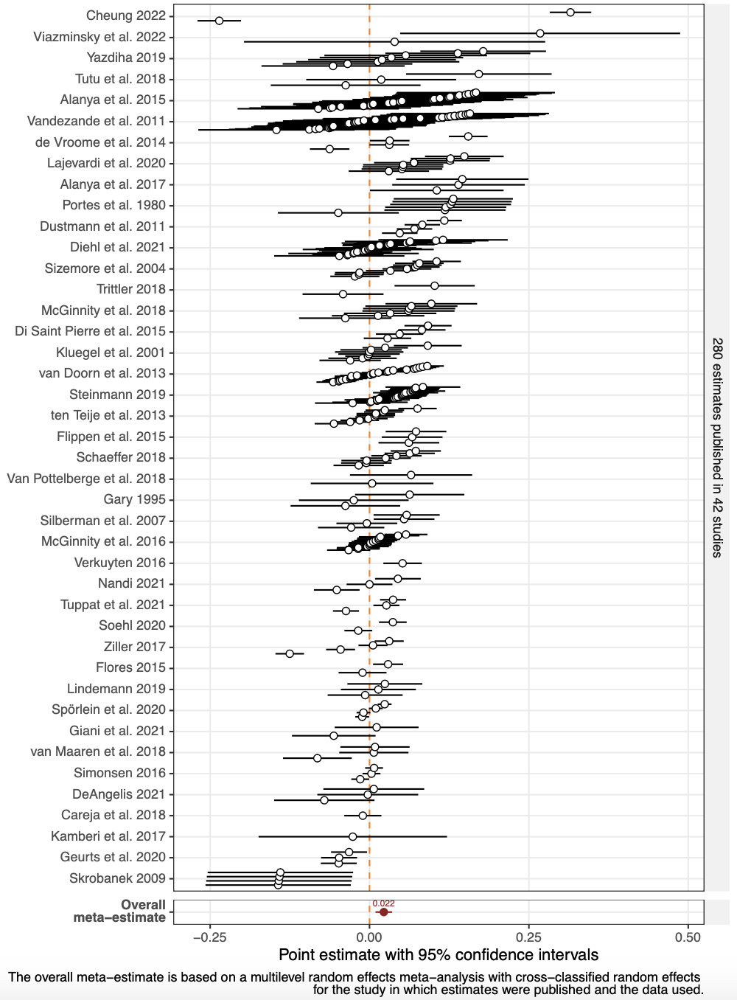
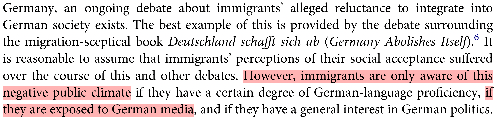
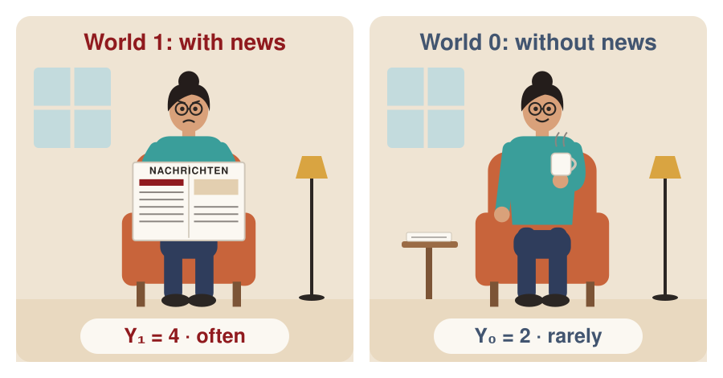
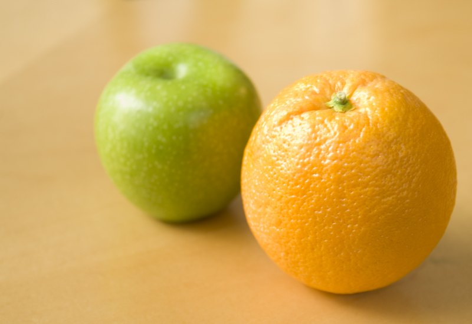
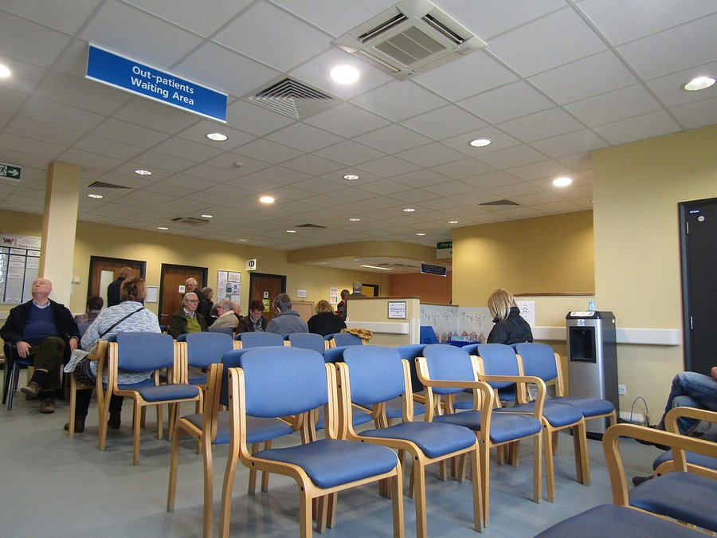
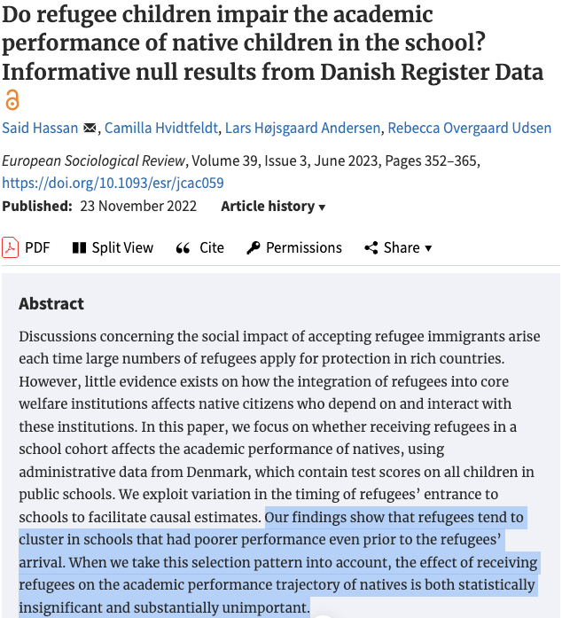
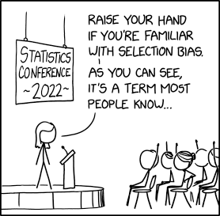

```{r setup, include = FALSE}
library(RefManageR)
library(knitr)
library(ggrepel) # Nicely placed labels in figures

options(htmltools.preserve.raw = FALSE,
        htmltools.dir.version = FALSE, servr.interval = 0.5, width = 115, digits = 3)
knitr::opts_chunk$set(
  collapse = TRUE, message = FALSE, fig.retina = 3, error = TRUE,
  warning = FALSE, cache = FALSE, fig.align = 'center',
  comment = "#", strip.white = TRUE, tidy = FALSE)

BibOptions(check.entries = FALSE,
           bib.style = "authoryear",
           style = "markdown",
           hyperlink = FALSE,
           no.print.fields = c("doi", "url", "ISSN", "urldate", "language", "note", "isbn", "volume"))
myBib <- ReadBib("../Stats_II.bib", check = FALSE)
```

## By the end of today you can … {.inverse background-color="#901A1E"}

1. state a causal hypothesis as a **counterfactual comparison**: the **potential-outcomes** framework, its **fundamental problem of causality** and **average causal effects**.
3. explain why a **naïve comparison of two groups** is usually *not* the **average causal effect**: **selection bias**;
4. read a **DAG**, spot a **confounder** on a **backdoor path**, and use a **balance test** to expose it.

::: {.notes}
Frame the day: our goal is not describing patterns but *explaining* them — and today is about avoiding **false** explanations. Walk the arc once: a real-world puzzle, then a simple but flawed analysis, then the theory that fixes it (potential outcomes), then the tool that draws it (DAGs).
:::

## The research question of the day {.inverse background-color="#901A1E"}

::: {.push-left}
The **integration paradox**: immigrants and their descendants who are *better* integrated (more educated, longer resident) often report *more* discrimination, not less `r Citep(myBib, "schaeffer_integration_2024")`.

One proposed mechanism: the better integrated *consume more news*, become more *aware* of discrimination, and so report it more often.

::: {.content-box-blue}
**Research question:** does consuming **news** *increase* how often immigrant minorities **report discrimination**?
:::
:::

::: {.push-right}
::: {.r-stack}
::: {.fragment .fade-out fragment-index=1 style="width: 100%;"}
```{r, echo = FALSE, out.width='88%'}

```

::: {style="display: flex; gap: 1.2rem; align-items: center; margin-top: 0.4em;"}
::: {style="flex: 0 0 34%;"}
```{r, echo = FALSE, out.width='100%'}

```
:::
::: {style="flex: 1;"}
[**Mesut Özil**, world champion in 2014, quit Germany's national team in 2018: *"I am German when we win, but an immigrant when we lose."*]{.small}

::: {.backgrnote}
*Photo:* Steindy, [CC BY-SA 3.0](https://commons.wikimedia.org/wiki/File:Mesut_%C3%96zil,_Germany_national_football_team_(05).jpg).
:::
:::
:::
:::

::: {.fragment .fade-in-then-out fragment-index=1 style="width: 100%;"}
```{r, echo = FALSE, out.width='58%'}

```

::: {.backgrnote .center}
280 estimates from 42 studies. *Source:* `r Citep(myBib, "schaeffer_integration_2024")`
:::
:::

::: {.fragment fragment-index=2 style="width: 100%;"}
```{r, echo = FALSE, out.width='100%'}

```

```{r, echo = FALSE, out.width='100%'}
knitr::include_graphics(c('img/L5/Steinmann1.png', 'img/L5/Steinmann2.png'))
```

::: {.backgrnote .center}
*Source:* `r Citet(myBib, "steinmann_paradox_2019")`
:::
:::
:::
:::

::: {.notes}
Start with the pictures, before any numbers. Özil is the paradox in one person: born in Gelsenkirchen, world champion with Germany, as "integrated" as anyone could be, and the one who said publicly that he was only German when Germany won. Ask whether that is an exception — then click: it is the rule. Say the paradox out loud, because it is genuinely counterintuitive: the *better* integrated report *more* discrimination, not less. Point at the forest plot — 280 estimates from 42 studies, so this is a robust pattern, not one odd survey.

Click once more for one proposed mechanism: awareness. Steinmann argues that people only notice a hostile public climate if they follow German media. In his regression, those who read German newspapers report more discrimination (0.09, significant). Ask: is that a causal effect of the newspapers? Hold the question. Today we test the mechanism with our own data, and we will see that our data do not even agree with his.
:::

## From hypothesis to comparison {.inverse background-color="#901A1E"}

[Part 1 of 3]{.part-pill}

::: {.lead}
Every causal claim is a **comparison**.
:::

## A hypothesis is a comparison

A causal claim implies a [counterfactual]{.alert}: things would have been different had $X$ (not) happened.

$H_1:$ news consumption **increases** how often minorities report discrimination:

. . .

$$0 < \text{Avg}_n[\text{Discr.} \mid \text{news} = 1] - \text{Avg}_n[\text{Discr.} \mid \text{news} = 0]$$

. . .

::: {.backgrnote}
$H_0:$ news consumption does **not** change it: the difference of the two group averages is $\leq 0$:

$0 \leq \text{Avg}_n[\text{Discr.} \mid \text{news} = 1] - \text{Avg}_n[\text{Discr.} \mid \text{news} = 0]$
:::

. . .

::: {.content-box-blue}
**Discuss:** what comparison is implied by each classic claim? **Marx**: capitalist labour alienates people and *reduces* mental health. **Simmel**: city life *increases* nervous stimulation and makes residents distant.
:::

::: {.notes}
The key idea: testing a hypothesis *always* implies a comparison — causality is a counterfactual, a "what if". Give them two minutes on Marx and Simmel, then collect: Marx compares capitalist against non-capitalist labour, Simmel urban against rural life. Every causal claim names two worlds, even when it doesn't say so.
:::

## Why not just ask people?

::: {.push-left}
The obvious "study": ask people *"How does reading the news affect you?"*

```{r, echo = FALSE, out.width='62%'}

```

::: {.backgrnote .center}
*Image:* [UZH News](https://www.news.uzh.ch)
:::

::: {.content-box-blue}
**Discuss:** why is simply *asking* a bad way to test our hypothesis?
:::
:::

::: {.push-right}
::: {.content-box-red .fragment}
People have **inaccurate perceptions** of what shapes them because of social desirability, faulty memory, little self-insight. Statements by research subjects are valuable, but they are **not credible causal evidence**. 

We need a comparison, not an introspection.
:::
:::

::: {.notes}
Ask first — give them two minutes before you click the reveal. Expect: social desirability, poor memory, lack of self-awareness. The line to land: people tell interesting stories about their lives, they do not record causal facts about themselves. So we need a comparison, not an introspection.
:::

## Preparation

::: {.panel-tabset}

### Packages
```{r libs}
pacman::p_load(
  tidyverse,    # Data manipulation and visualization
  estimatr,     # OLS with robust / weighted standard errors
  modelsummary  # Regression AND balance tables
)
```

### The APAD survey
::: {.push-left}
::: {.small}
`r Citet(myBib, "schaeffer_association_2023")`: **1,093** immigrants and children of immigrants in Berlin, Hamburg, Munich, Frankfurt & Cologne, interviewed August-September 2021.

1. *"On a typical day, about how much time do you spend watching, reading, or listening to **news** about politics and current affairs?"* (hours + minutes)

2. *"How often were you personally **discriminated** in the following situations here in Germany?"* When looking for work, at work, in education, looking for housing, with officials, out in public. (1) Never … (5) Very often

::: {.backgrnote}
Discrimination means that a person is treated worse than others including specific reasons for this behavior and no factual justification. People use different modes of discrimination like insult, ostracism, or sexual harassment. Rules and laws disadvantaging people are also discrimination.
:::

:::
:::

::: {.push-right}
```{r, echo = FALSE, out.width='90%'}

```
:::

### Get & prepare the data

```{r results = FALSE, echo = FALSE}
# Read APAD data,
load("../assets/APAD.RData")
```

```{r eval = FALSE}
load("APAD.RData") # Load APAD dataset
```
```{r apad-data}
APAD <- APAD %>%
  mutate(
    news    = news_hrs * 60 + news_mins,          # total daily minutes
    news_yn = case_when(                          # binary reads news?
      news < 5 ~ 0,                               # 0 if less than 5 minutes
      news >= 5 ~ 1),                             # 1 if 5 minutes or more
    dis_index = rowMeans(                         # average across the 6 domains of discrimination
      select(., dis_trainee, dis_job, dis_school,
             dis_house, dis_gov, dis_public),
      na.rm = TRUE
    )
  )
```

:::

::: {.notes}
Keep this short — it is scaffolding, not the point. Two things only: the outcome `dis_index` averages the six discrimination domains into one index, and the cause comes in two forms, total daily minutes and a "reads news" dummy: at least 5 minutes a day. Then move on; the payoff is the next slide.
:::

## The naïve comparison

::: {.panel-tabset}

### The picture
::: {.push-left}
```{r ref.label = "naive-plot", echo = FALSE, out.width='100%', fig.height = 4.4, fig.width = 7}
```
:::

::: {.push-right}
```{r, echo = FALSE, out.width='92%'}

```
:::

### … its R code
```{r naive-plot, fig.show = 'hide'}
ggplot(APAD, aes(y = dis_index, x = news)) +        # Discrimination (Y) by news minutes (X)
  geom_point(aes(size = gewFAKT), alpha = 1/3) +    # One dot per respondent; larger weight = bigger dot
  geom_smooth(aes(weight = gewFAKT), method = "lm", # Weighted OLS regression line ...
              color = "#901A1E") +                # ... in KU red, with its 95% confidence band
  scale_y_continuous(breaks = 1:5,                  # Label the 1-5 answer scale
    labels = c("Never", "Rarely", "Sometimes", "Often", "Very often")) +
  labs(y = "Reported discrimination",               # Axis titles
       x = "Daily minutes of news consumption") +
  theme_minimal(base_size = 14) +                   # Clean look, larger font
  theme(legend.position = "none")                   # No legend for the dot sizes
```

### OLS estimation
```{r naive-ols, results = 'hide'}
# Weighted OLS: the discrimination index on the news dummy (1 = reads 5+ minutes a day)
ols <- lm_robust(dis_index ~ news_yn, # Outcome ~ predictor
                 weights = gewFAKT,   # Survey weights: the sample mirrors the population
                 data = APAD)         # Robust standard errors are lm_robust()'s default

# Show the result as a formatted regression table
modelsummary(list("Reported Discrimination" = ols),     # Column title = model name
             stars = TRUE,                              # Significance stars
             coef_rename = c("news_yn" = "Reads news"), # Readable label for the coefficient
             gof_map = c("nobs", "r.squared"),          # Report only N and R²
             output = "kableExtra")                     # Table format for the slides
```

### OLS table
::: .font80
```{r naive-tab, ref.label = "naive-ols", echo = FALSE, results = 'asis'}
```
:::

::: {.content-box-red}
News readers report, if anything, **`r abs(round(coef(ols)["news_yn"], 2))` points *less*** discrimination, and the difference is **not significant** ($t \approx `r round(coef(ols)["news_yn"] / sqrt(diag(vcov(ols)))["news_yn"], 1)`$). Taken at face value, $H_1$ looks *wrong*. **But is this a fair comparison?**
:::

:::

::: {.notes}
Ask them to interpret the scatter *before* you show the table — two minutes with a neighbour. The line is flat, if anything slightly negative, so visually it does not support our hypothesis. Then the regression: about −0.24, not significant. Let them draw the obvious conclusion that the hypothesis is wrong — and then ask whether this is a *fair* comparison. That question is the rest of the lecture.
:::

## Small recap: hypothesis tests, $t$- and $p$-values

```{r test-plot, include = FALSE}
# The Lecture 3 test drawing, reused. `step` = how many layers to show:
#   1 H0 · 2 SE ruler · 3 t-curve if H0 were true · 4 95% test interval
#   5 our estimate · 6 area closer to 0 than ours · 7 p-value (both tails)
test_plot <- function(b, se, df, step = 7, xmax = 3.6 * se) {
  crit <- qt(0.975, df); t <- b / se; p <- 2 * pt(-abs(t), df)
  ymax <- dt(0, df) / se                                  # height of the curve's peak
  curve <- tibble(x = seq(-xmax, xmax, length.out = 1001), y = dt(x / se, df) / se)
  area  <- function(lo, hi) bind_rows(tibble(x = lo, y = 0),
                                      filter(curve, x >= lo, x <= hi), tibble(x = hi, y = 0))
  k <- -3:3; ry <- -0.13 * ymax                           # the SE ruler below the curve
  red <- "#901A1E"; blue <- "#425570"; gold <- "#b5892c"

  g <- ggplot() +
    scale_x_continuous(limits = c(-xmax, xmax), expand = c(0, 0)) +
    scale_y_continuous(limits = c(-0.25, 1.38) * ymax, expand = c(0, 0)) +
    labs(x = expression("Possible estimates of "*beta), y = NULL) +
    theme_minimal(base_size = 15) +
    theme(axis.text.y = element_blank(), panel.grid = element_blank(),
          axis.line.x = element_line(colour = "grey70"),
          plot.background = element_rect(fill = "white", colour = NA)) # opaque: layers stack

  if (step >= 7) g <- g +
    geom_polygon(data = area(-xmax, -abs(b)), aes(x, y), fill = red, alpha = 0.85) +
    geom_polygon(data = area(abs(b), xmax),  aes(x, y), fill = red, alpha = 0.85)
  if (step >= 6) g <- g +
    geom_polygon(data = area(-abs(b), abs(b)), aes(x, y), fill = blue, alpha = 0.2)
  if (step >= 4) g <- g +
    annotate("segment", x = c(-1, 1) * crit * se, xend = c(-1, 1) * crit * se, y = 0,
             yend = 1.08 * ymax, colour = gold, linetype = "longdash", linewidth = 1) +
    annotate("segment", x = -crit * se, xend = crit * se, y = 1.08 * ymax, yend = 1.08 * ymax,
             colour = gold, linewidth = 0.8,
             arrow = arrow(ends = "both", length = unit(0.1, "inches"), type = "closed")) +
    annotate("text", x = crit * se, y = 1.08 * ymax, hjust = -0.06, colour = "#8a6a1f",
             size = 4.6, fontface = "bold", label = "95% test interval")
  if (step >= 3) g <- g + geom_line(data = curve, aes(x, y), colour = "grey15", linewidth = 1)
  if (step >= 2) g <- g +
    annotate("segment", x = -3 * se, xend = 3 * se, y = ry, yend = ry, colour = "grey40") +
    annotate("segment", x = k * se, xend = k * se, y = ry - 0.025 * ymax,
             yend = ry + 0.025 * ymax, colour = "grey40") +
    annotate("text", x = k * se, y = ry - 0.07 * ymax, size = 3.9, colour = "grey40",
             label = case_when(k == 0 ~ "0",
                               k > 0  ~ sprintf("+%d SE", k),
                               k < 0  ~ sprintf("−%d SE", abs(k)))) +
    annotate("text", x = 0.5 * se, y = ry + 0.065 * ymax, size = 3.9, colour = "grey20",
             fontface = "bold", label = sprintf("1 SE = %.3f", se))
  g <- g +
    annotate("segment", x = 0, xend = 0, y = 0, yend = 1.24 * ymax, colour = blue, linewidth = 1.3) +
    annotate("text", x = 0, y = 1.31 * ymax, label = "H[0]:~beta == 0", parse = TRUE,
             colour = blue, size = 6)
  if (step >= 5) g <- g +
    annotate("segment", x = b, xend = b, y = 0, yend = 1.17 * ymax, colour = red, linewidth = 1.3) +
    annotate("text", x = b, y = 1.2 * ymax, hjust = case_when(b < 0 ~ 1, TRUE ~ 0), vjust = 0,
             colour = red, size = 4.8, fontface = "bold",
             lineheight = 0.9, label = sprintf(" our estimate %.3f \n (t = %.2f) ", b, t))
  if (step >= 6) g <- g +
    annotate("segment", x = -b, xend = -b, y = 0, yend = dt(t, df) / se,
             colour = red, linewidth = 0.8, linetype = "dashed") +
    annotate("label", x = 0, y = 0.45 * ymax, label = sprintf("%.0f%%", 100 * (1 - p)),
             colour = blue, fill = "white", size = 6.5, fontface = "bold", linewidth = 0)
  if (step >= 7) g <- g +
    annotate("text", x = c(-1, 1) * (abs(b) + crit * se) / 2, y = 0.12 * ymax, colour = "white",
             size = 4.6, fontface = "bold", label = sprintf("%.1f%%", 100 * p / 2)) +
    annotate("label", x = 0.97 * xmax, y = 0.72 * ymax, hjust = 1, colour = "white", fill = red,
             size = 7, fontface = "bold", linewidth = 0, label = sprintf("p = %s", signif(p, 2)))
  g
}

# The naive comparison from the previous slide
ht <- tidy(ols) %>% filter(term == "news_yn")
```

::: {.left-column .small}
[1]{.alert} **The sceptic's claim:** reading news makes **no** difference, $H_0: \beta = 0$.

::: {.fragment fragment-index=1}
[2]{.alert} **The sampling distribution:** if $H_0$ were true, samples like ours would still scatter around 0 by chance. With our standard error $\hat\sigma = `r round(ht$std.error, 3)`$, 95% of them land within $0 \pm `r round(qt(0.975, ht$df), 2)` \times \hat\sigma$.
:::

::: {.fragment fragment-index=2}
[3]{.alert} **Our estimate:** $\hat\beta = `r round(ht$estimate, 3)`$ is $t = `r round(ht$statistic, 2)`$ standard errors from 0; *inside* the test interval.
:::

::: {.fragment fragment-index=3}
[4]{.alert} **The $p$-value:** `r round(100 * (1 - ht$p.value))`% of chance estimates are *closer* to 0 than ours; $p = `r round(ht$p.value, 2)`$ are at least as far out. Not surprising if $H_0$ were true → we **can't reject** $H_0$.
:::

:::

::: {.right-column}
```{r test-build, echo = FALSE, results = 'asis', out.width = '100%', fig.width = 9, fig.height = 6.1}
# Four stacked pictures; each click fades in the next (fragment-index matches the text)
steps <- c(1, 4, 5, 7) # H0 · distribution + 95% interval · our estimate · p-value
cat("::: {.r-stack}\n\n")
for (i in 1:4) {
  if (i > 1) cat(sprintf("::: {.fragment fragment-index=%d}\n\n", i - 1))
  print(test_plot(ht$estimate, ht$std.error, ht$df, step = steps[i], xmax = 4.2 * ht$std.error))
  cat(if (i > 1) "\n\n:::\n\n" else "\n\n")
}
cat(":::\n")
```
:::

::: {.notes}
A two-minute recap of Lecture 3, on today's number, so "not significant" on the previous slide means something. Click one idea at a time. (1) Start from the sceptic: news makes no difference. (2) If the sceptic were right, samples like ours would still scatter around 0; the standard error is the ruler, and 95% of chance estimates fall inside the gold interval. (3) Only now bring in our −0.24: about one and a half standard errors out, still inside. (4) The red tails are the chance estimates at least as extreme as ours, in both directions: that share *is* the $p$-value. About one sample in eight would look like ours even if news made no difference, so we cannot reject $H_0$. Then back to the real question: is this comparison even fair?
:::

## Break {.inverse background-color="#901A1E"}

<div class="ku-timer" data-min="15"></div>

## Your turn: exercise 1

::: {.left-column}
Run the naïve analysis yourself, on a *different* outcome: support for an anti-discrimination law.

[**Open exercise 1 in a new tab ↗**](5-exercise1.html){target="_blank"}

<div class="ku-timer" data-min="20"></div>
:::

::: {.right-column}
<iframe src='5-exercise1.html' width='100%' height='620' frameborder='0' scrolling='yes' style="border:1px solid #ddd; border-radius:6px;"></iframe>
:::

## Potential outcomes & selection bias {.inverse background-color="#901A1E"}

[Part 2 of 3]{.part-pill}

::: {.lead}
To see *why* the comparison can mislead, we need the language of **potential outcomes**.
:::

## Two potential futures for one person

::: {.push-left}
For **Ferda**, two *potential outcomes* :

$$\text{Effect}_{\text{Ferda}} = Y_{1,\text{Ferda}} - Y_{0,\text{Ferda}}$$

| Ferda | |
|---|:--:|
| $Y_0$: discrimination *without* news | 2 (rarely) |
| $Y_1$: discrimination *with* news | 4 (often) |
| **Personal causal effect** | **+2** |
:::

::: {.push-right}
::: {.r-stack}
::: {.fragment .fade-out fragment-index=1 style="width: 100%;"}
```{r, echo = FALSE, out.width='100%'}

```
:::

::: {.fragment .fade-in fragment-index=1 style="width: 100%;"}
::: {.content-box-green}
**The fundamental problem of causal inference:** we only ever see **one** of Ferda's two futures. The other potential outcome is **always missing** — so a personal causal effect can never be observed directly.
:::

```{r, echo = FALSE, out.width='52%'}

```
:::
:::
:::

::: {.notes}
Point at the two pictures: the *same* Ferda, same armchair, same evening — the only thing that differs is the newspaper. Ferda makes it concrete: 4 with news, 2 without, so her personal causal effect is +2. Then click. Now the hard part — in reality we see only *one* of those two rows; the other is gone forever. That is the fundamental problem of causal inference, and it is exactly why we cannot fix this by asking people to imagine the other path.
:::

## Goal: The average causal effect (ATE)

$$\text{ATE} = \text{Avg}_n[Y_{1i} - Y_{0i}] = \frac{1}{n}\sum_{i=1}^{n} Y_{1i} - \frac{1}{n}\sum_{i=1}^{n} Y_{0i}$$

::: {.push-left}
The **average treatment effect (ATE)** is just the average of **everyone's** *personal* causal effects.
:::

::: {.push-right}
It compares both potential worlds: one where **everyone** reads the news, against one where **no one** does. Neither world is ever fully observed! But under the right conditions, we can *estimate* the average.
:::

::: {.notes}
We give up on personal effects and aim for the average instead. Conceptually it compares two whole worlds — everyone reads the news, nobody does — and neither is ever observed. But the average *is* estimable under the right conditions, and what those conditions are is essentially the rest of this course.
:::

## Apples and oranges: Ferda vs. Tuki

::: {.push-left}
We can't see Ferda's missing future. So what if we compare her to **Tuki**, who doesn't read news?

::: {.small}
| | Ferda | Tuki |
|---|:--:|:--:|
| $Y_0$: without news | [(2)]{.gray} | 5 |
| $Y_1$: with news | 4 | [(5)]{.gray} |
| true effect | [(+2)]{.gray} | [(0)]{.gray} |
:::

Grey = the counterfactual we *never* see.
:::

::: {.push-right}
$$\underbrace{Y_{1,\text{Ferda}}}_{4} - \underbrace{Y_{0,\text{Tuki}}}_{5} = -1$$

::: {.r-stack}
::: {.fragment .fade-out fragment-index=1 style="width: 100%;"}
```{r, echo = FALSE, out.width='62%'}

```

::: {.backgrnote .center}
*They do not compare.* Photo: Michael Johnson, [CC BY 2.0](https://commons.wikimedia.org/wiki/File:Apple_and_Orange_-_they_do_not_compare.jpg).
:::
:::

::: {.fragment .fade-in fragment-index=1 style="width: 100%;"}
::: {.content-box-blue}
**Discuss:** Ferda's true effect is $+2$, yet comparing her to Tuki gives $-1$. 

Why is comparing *different people* so misleading here?
:::
:::
:::
:::

::: {.notes}
Since we cannot see Ferda's missing future, we substitute a different person — that is what every observational comparison does. The result is −1, a terrible estimate of either person's true effect. Give them two minutes on "why is this so wrong?"; the answer you are steering to is that they were different people **to begin with**.
:::

## Observed vs. potential outcomes

$$D_i = \begin{cases} 1, & \text{if } i \text{ reads news (like Ferda)} \\ 0, & \text{otherwise (like Tuki)} \end{cases}$$

::: {.push-left}
::: {.content-box-blue .fragment fragment-index=1}
**Observed outcomes**: what the data show.

- $Y_{1i} \mid D_i = 1$: outcome of those who read news, **with** news. [Ferda: 4]{.alert2}
- $Y_{0i} \mid D_i = 0$: outcome of those who don't, **without** news. [Tuki: 5]{.alert2}
:::
:::

::: {.push-right}
::: {.content-box-red .fragment fragment-index=2}
**Potential outcomes we never observe** (counterfactuals).

- $Y_{0i} \mid D_i = 1$: news readers, **had they not** read news. [Ferda: (2)]{.gray}
- $Y_{1i} \mid D_i = 0$: non-readers, **had they** read news. [Tuki: (5)]{.gray}
:::
:::

::: {.content-box-green .fragment fragment-index=3 style="clear: both;"}
Everyone *has* both potential outcomes, $Y_{1i}$ and $Y_{0i}$. The data reveal only the one that matches what the person actually did. A naïve comparison uses the **blue** box only.
:::

::: {.notes}
Introduce the notation slowly, one click per box. $D_i$ is simply who reads news. Blue first: these are the two numbers we can actually compute from data, one per group — Ferda's 4, Tuki's 5. Then red: the two missing pieces of the puzzle, what each group *would* have reported in the other world — Ferda's grey 2, Tuki's grey 5. Land the green sentence: everyone has both potential outcomes, we only ever see one, and the naïve comparison works with the blue box alone.
:::

## The hidden term: selection bias

::: {.left-column}
```{r, echo = FALSE, out.width='100%'}

```

::: {.backgrnote .center}
Same staircase, different paths. *Photo:* Massimo Strazzeri, "Diverging paths" (Flickr).
:::

::: {.small}
| | Ferda | Tuki |
|---|:--:|:--:|
| $Y_0$: without news | [(2)]{.gray} | 5 |
| $Y_1$: with news | 4 | [(5)]{.gray} |
| true effect | [(+2)]{.gray} | [(0)]{.gray} |
:::
:::

::: {.right-column}
What we can compare:
$$\underbrace{Y_{1,\text{Ferda}}}_{4} - \underbrace{Y_{0,\text{Tuki}}}_{5} = -1$$

::: {.fragment fragment-index=1}
**Step 1:** add *and* subtract Ferda's **unobserved** $Y_{0,\text{Ferda}}$. That changes nothing, because $-2 + 2 = 0$:
$$= Y_{1,\text{Ferda}} \; \color{gray}{- \; Y_{0,\text{Ferda}} \; + \; Y_{0,\text{Ferda}}} \; - \; Y_{0,\text{Tuki}}$$
:::

::: {.fragment fragment-index=2}
**Step 2:** regroup the four terms into two pairs:
$$= \underbrace{Y_{1,\text{Ferda}} - Y_{0,\text{Ferda}}}_{\text{Ferda's true effect: } 4 - 2 \, = \, +2} \; + \; \underbrace{Y_{0,\text{Ferda}} - Y_{0,\text{Tuki}}}_{\text{Selection bias: } 2 - 5 \, = \, -3}$$
:::

::: {.content-box-red .fragment fragment-index=3}
**Selection bias:** $Y_{0,\text{Ferda}} \neq Y_{0,\text{Tuki}}$. Even *without* any news, Tuki would report more discrimination than Ferda. They took different paths **before** anyone read a newspaper.
:::
:::

::: {.notes}
Go slowly; this is the key move of the lecture, and it is only arithmetic. Start from the one comparison we can make: Ferda's 4 minus Tuki's 5, −1. Click: we add and subtract the same thing, Ferda's unobserved Y₀ — overall zero, so nothing changed, but it lets us split the −1. Click: regroup into two pairs — Ferda's true effect, +2, plus something else worth −3. Click: name it. Selection bias — the two were different before the treatment, like two people who took different branches of the staircase long before we met them.
:::

## Selection is everywhere

::: {.push-left}
::: {.content-box-blue}
**Discuss:** people *choose* their "treatments": a dating app, a hospital, the gym, a private school, therapy ...

Find examples where those who **select in** or **select out** of treatment already differ in the outcome *before* any treatment ($Y_0$). Which way would a naïve comparison go wrong?
:::

:::

::: {.push-right}
::: {style="display: flex; gap: 1.2rem; align-items: flex-end;"}
::: {style="flex: 0 0 38%; text-align: center;"}
```{r, echo = FALSE, out.width='100%'}

```
::: {.backgrnote}
Who makes a dating profile?
:::
:::
::: {style="flex: 1; text-align: center;"}
```{r, echo = FALSE, out.width='100%'}

```
::: {.backgrnote}
Who sits in a hospital waiting room? *Photo:* Kolforn, [CC BY-SA 4.0](https://commons.wikimedia.org/wiki/File:-2020-02-03_Out_patients_waiting_room_inside_Cromer_and_District_Hospital.JPG).
:::
:::
:::
:::

::: {.notes}
Give them three minutes in pairs to collect examples before you reveal anything; the best ones come from their own lives (dating apps, the gym, a private school, therapy). For each, push with one question: would the people who chose it have differed on the outcome anyway? Then the reveal, and point at the two pictures: whoever makes a dating profile was already keen to meet someone before downloading the app; the hospital patients were ill before they ever arrived. Same mechanism, opposite signs — selection bias can make a treatment look better, worse, or harmful.
:::

## From two persons to two groups

The same trick, now with group averages. What we can compare:
$$\underbrace{\text{Avg}_n[Y_{1i} \mid D_i = 1] - \text{Avg}_n[Y_{0i} \mid D_i = 0]}_{\text{Difference in observed group means}}$$

::: {.fragment fragment-index=1}
**Step 1:** add *and* subtract the **unobserved** $\text{Avg}_n[Y_{0i} \mid D_i = 1]$, news readers had they *not* read news:
$$= \text{Avg}_n[Y_{1i} \mid D_i = 1] \; \color{gray}{- \; \text{Avg}_n[Y_{0i} \mid D_i = 1] \; + \; \text{Avg}_n[Y_{0i} \mid D_i = 1]} \; - \; \text{Avg}_n[Y_{0i} \mid D_i = 0]$$
:::

::: {.fragment fragment-index=2}
**Step 2:** regroup into two pairs:
$$= \underbrace{\text{Avg}_n[Y_{1i} \mid D_i = 1] - \text{Avg}_n[Y_{0i} \mid D_i = 1]}_{\text{ATT: average effect on the treated}} \; + \; \underbrace{\text{Avg}_n[Y_{0i} \mid D_i = 1] - \text{Avg}_n[Y_{0i} \mid D_i = 0]}_{\text{Selection bias: the gap in the baseline } Y_0}$$
:::

::: {.notes}
Same arithmetic as for Ferda and Tuki, now for whole groups: nothing new, only averages instead of persons. Start with what we compute: the difference in observed group means. Click: add and subtract the unobserved average, news readers had they not read news. Click: regroup. The second pair is selection bias, the baseline gap. The first pair is the ATT. The next slide puts numbers into this formula.
:::

## The group split, with numbers

::: {.push-left}
Two news readers, two non-readers. [Grey]{.gray} = never observed.

::: {.small}
| | Ferda | Ali | Tuki | Lina |
|---|:--:|:--:|:--:|:--:|
| reads news? | $D = 1$ | $D = 1$ | $D = 0$ | $D = 0$ |
| $Y_0$: without news | [(2)]{.gray} | [(1)]{.gray} | 5 | 4 |
| $Y_1$: with news | 4 | 3 | [(5)]{.gray} | [(4)]{.gray} |
| true effect | [(+2)]{.gray} | [(+2)]{.gray} | [(0)]{.gray} | [(0)]{.gray} |
:::

::: {.content-box-blue}
**Discuss:** which number can a researcher compute from survey data alone?
:::
:::

::: {.push-right}
::: {.fragment fragment-index=1}
**What the data show:** readers average $\frac{4 + 3}{2} = 3.5$, non-readers $\frac{5 + 4}{2} = 4.5$. Difference: $3.5 - 4.5 = -1$.
:::

::: {.fragment fragment-index=2}
**ATT:** the readers' true effects, $\frac{(+2) + (+2)}{2} = +2$.
:::

::: {.fragment fragment-index=3}
**Selection bias:** readers' baseline $\frac{2 + 1}{2} = 1.5$ against non-readers' $4.5$. Gap: $1.5 - 4.5 = -3$.
:::

::: {.content-box-green .fragment fragment-index=4}
$\underbrace{-1}_{\text{observed}} = \underbrace{+2}_{\text{ATT}} + \underbrace{(-3)}_{\text{selection bias}}$

Only the $-1$ comes from data. The $+2$ and the $-3$ need the grey cells.
:::
:::

::: {.notes}
The formula on the last slide looks abstract, so plug in four people. Ferda and Tuki keep their numbers; Ali and Lina just join them. Ask the Discuss question first and let them look at the table: only the non-grey cells are in a data set. Click: the observed difference, −1, the same as for Ferda and Tuki. Click: the ATT uses the readers' grey Y₀, so we could only compute it with a time machine. Click: the selection bias also needs those grey cells. Click: the split adds up. The point to land: data give us −1, and that one number hides a positive effect and a larger negative baseline gap.
:::

## The ATT is not the ATE

::: {.push-left}
The first pair of the group split is the **average effect on the treated (ATT)**:

$$\text{ATT} = \text{Avg}_n[Y_{1i} - Y_{0i} \mid D_i = 1]$$

It averages the effect only over those who **chose** the treatment.

::: {.fragment fragment-index=1}
The **average treatment effect (ATE)** from slide 14 averages over **everyone**:

$$\text{ATE} = \text{Avg}_n[Y_{1i} - Y_{0i}]$$
:::
:::

::: {.push-right}
::: {.fragment fragment-index=2}
::: {.small}
| | Ferda | Tuki |
|---|:--:|:--:|
| reads news? | $D = 1$ | $D = 0$ |
| true effect $Y_1 - Y_0$ | $+2$ | $0$ |
:::

- ATT: if only Ferda chose news $\rightarrow$ ATT $= +2$
- ATT: if only Tuki chose news $\rightarrow$ ATT $= 0$
- ATE: both of them $\rightarrow$ ATE $= \frac{+2 + 0}{2} = +1$
:::

::: {.content-box-green .fragment fragment-index=3}
**Observed difference = ATT + selection bias.** So even *if* selection bias were zero, comparing groups tells us the effect for the kind of people who **selected in**, not for everyone.
:::
:::

::: {.notes}
Slow down here; students routinely treat "the effect" as one number. Start from the ATT, the first pair of the group split: the effect averaged over those who actually read news. Click: contrast it with the ATE from slide 14, averaged over everyone. Click: Ferda and Tuki make the gap concrete — only Ferda chose the news, so the ATT is her +2, while the ATE averages her +2 with Tuki's 0. Click: the moral. A naïve group comparison is ATT plus selection bias, so even with no selection bias at all it answers a narrower question: what does news do to the people who choose to read it? Ask them whether that could differ from the effect on people who avoid the news.
:::

## Selection bias in Danish schools

::: {.push-left}
::: {.content-box-blue}
**Discuss:** in Danish schools that receive refugee children, native pupils score lower on national tests. Do refugee classmates lower natives' grades?
:::

::: {.content-box-red .fragment}
Refugees were placed in schools that were doing worse **before** they arrived. The baseline $Y_0$ of the "treated" schools was lower: selection bias.

Once the authors take this into account, the effect on natives' grades is close to zero and not significant.
:::
:::

::: {.push-right}
```{r, echo = FALSE, out.width='74%'}

```

::: {.backgrnote .center}
*Source:* Hassan et al. (2023), *European Sociological Review*.
:::
:::

::: {.notes}
A real study from Denmark, with register data on all pupils in public schools. Read the Discuss question and let them answer. Most will say yes, or say "it depends". Then click: the schools that took refugees were already behind. Their baseline was different, exactly like Ferda and Tuki. When the authors compare each school's path over time, the gap disappears. Selection bias can produce an effect that is not there. It can also hide an effect that is there. That may be what happens in our news data.
:::

## Selection bias and the integration paradox

::: {.push-left}
::: {.content-box-blue}
**Think:** if minorities who read the news had *not* read them, would they report discrimination as often as those who never read news? If not, the selection bias is not zero.
:::
:::

::: {.push-right}
::: {style="display: flex; align-items: flex-end; gap: 0.8em;"}
{style="width: 610px; margin: 0;"}

:::
:::

::: {.notes}
Back to our own case. Let the comic sit while they think about the blue box: why might news readers differ at baseline? Collect answers: education, age, language, citizenship. The next slide checks some of them in the data.
:::

## (Im)balance of *observed* variables

::: {.panel-tabset}

### The idea
::: {.left-column}
We can never see the *unobserved* baseline $Y_0$. But if the two groups differ on things we **can** measure (age, citizenship, generation) that is a strong hint they differ on $Y_0$ too. Balance on covariates indicates but does *not* prove that a naive comparison gives us a causal effect. 

A **balance test** compares the groups on those background variables.
:::

::: {.right-column}
```{r balance, results = 'hide'}
APAD %>%
  select(news_yn, age, german, imor,
         nbh_exposed, gewFAKT) %>%
  rename(weights = gewFAKT) %>% # so it is used as a weight
  datasummary_balance(~ news_yn, data = .,
                      output = "kableExtra")
```
:::

### The table
::: {.small}
```{r balance-tab, ref.label = "balance", echo = FALSE, results = 'asis'}
```
:::

::: {.content-box-red}
The groups are **not** balanced. News readers are markedly **older** (≈ 43 vs. 37) and more often German citizens. Our naïve comparison is confounded, and these are only the *observed* differences.
:::

:::

::: {.notes}
The move here: we can never compare the *unobserved* baseline, but we can compare observed characteristics — and if the groups differ on those, they almost certainly differ on $Y_0$ too. Walk the code briefly, then read the table: readers are around 43 versus 37 and more often German citizens. State the conclusion flatly — the groups are imbalanced, so the naïve comparison is definitely biased. And stress: these are only the differences we can *see*.
:::

## DAGs {.inverse background-color="#901A1E"}

[Part 3 of 3]{.part-pill}

::: {.lead}
A **directed acyclic graph** (DAG) draws our causal assumptions.
:::

## Reading a DAG

::: {.push-left}
- **Nodes** = variables; **arrows** = causal effects.
- A [backdoor path]{.alert} links $D$ and $Y$ starting with an arrow *into* $D$ `r Citep(myBib, c("pearl_causal_2016", "gerxhani_causal_2022"))`.
- A [confounder]{.alert} $C$ sits on a backdoor path; it makes $D$ and $Y$ correlate **without any causal arrow between them**. 
  + Confounder bias *is* selection bias!
:::

::: {.push-right}
```{tikz dag-generic, echo = FALSE, out.width='58%'}
\usetikzlibrary{shapes.geometric, arrows.meta, positioning}
\definecolor{kured}{HTML}{901A1E}
\begin{tikzpicture}[>=Latex, semithick]
\sffamily
\node[ellipse, draw, minimum width=0.9cm] (C) at (0,2) {$C$};
\node[ellipse, draw, minimum width=0.9cm] (D) at (0,0) {$D$};
\node[ellipse, draw, minimum width=0.9cm] (Y) at (3.2,0) {$Y$};
\draw[->] (C) -- (D);
\draw[->] (C) -- (Y);
\draw[<->, kured, dashed, bend right=45] (D) to (Y);
\end{tikzpicture}
```

::: {.backgrnote}
The red dashed arrow is not really part of the DAG. It just marks the **spurious** $D$–$Y$ correlation that the backdoor path through $C$ produces.
:::
:::

::: {.notes}
A DAG maps your causal *assumptions*, not your data. The puppet metaphor works well: grab a node, shake it, and the movement travels along the arrows. Shake $C$ and both $D$ and $Y$ move together — that is the spurious correlation. Shake $D$ and $Y$ does not move at all, because there is no arrow between them. A confounder is just a variable sitting on such a backdoor path.
:::

## Our case: a confounded correlation

::: {.push-left}
Plausibly, **German citizenship** shapes *both* whether people follow German news *and* how much discrimination they encounter.

It opens a **backdoor path**, so the raw news–discrimination correlation is (at least partly) **spurious**, as the selection bias the balance table revealed.
:::

::: {.push-right}
```{tikz dag-apad, echo = FALSE, out.width='86%'}
\usetikzlibrary{shapes.geometric, arrows.meta, positioning}
\definecolor{kured}{HTML}{901A1E}
\begin{tikzpicture}[>=Latex, semithick]
\sffamily
\node[ellipse, draw, align=center] (C) at (0,2) {German\\citizen};
\node[ellipse, draw, align=center] (D) at (0,0) {Reads\\news};
\node[ellipse, draw, align=center] (Y) at (3.6,0) {Discrimination};
\draw[->] (C) -- (D);
\draw[->] (C) -- (Y);
\draw[<->, kured, dashed, bend right=42] (D) to (Y);
\end{tikzpicture}
```
:::

::: {.notes}
Now make it concrete with our own case. German citizenship plausibly drives *both* whether people follow German news *and* how much discrimination they actually encounter. Trace the backdoor path with your finger: reads news ← German citizen → discrimination. That path on its own could produce the negative correlation we saw — no causal arrow required. And this is exactly the imbalance the balance table found.
:::

## The verdict: correlation ≠ causation

::: {.push-left}
```{r ref.label = "naive-plot", echo = FALSE, out.width='100%', fig.height = 4, fig.width = 7}
```
:::

::: {.push-right}
::: {.content-box-green}
**Correlation ≠ causation.** 

The baseline $Y_0$ differs between the groups we compare, because **confounders** sort people *into* and *out of* how much they read the news.

::: {.backgrnote}
Ice-cream sales and shark attacks correlate, but *temperature* drives both.
:::
:::
:::

::: {.notes}
Close the loop: they now know *why* this flat line cannot be read causally — confounders sort people into and out of reading the news, so the baselines differ. Ice cream and shark attacks is the throwaway example if anyone still resists. Then bridge to next week: if the problem is that the groups differ to begin with, the fix is to *make* them comparable — which is what randomisation does.
:::

## Your turn: exercise 2

::: {.left-column}
You draw the DAG and run a balance test yourself — is **racial appearance** balanced across news readers?

[**Open exercise 2 in a new tab ↗**](5-exercise2.html){target="_blank"}

<div class="ku-timer" data-min="20"></div>
:::

::: {.right-column}
<iframe src='5-exercise2.html' width='100%' height='620' frameborder='0' scrolling='yes' style="border:1px solid #ddd; border-radius:6px;"></iframe>
:::

## Today's general lessons {.inverse background-color="#901A1E"}

1. A causal claim is a **counterfactual** claim. It compares an outcome *with* a treatment to the same outcome *without* it.

2. **Potential outcomes** ($Y_0$, $Y_1$) make this precise; a personal causal effect is $Y_1 - Y_0$. The **fundamental problem**: one of them is always missing.

3. The **average causal effect** is the average of those personal effects.

4. A **naïve comparison of groups** usually is *not* the causal effect, because it adds **selection bias**: the groups differ in their baseline $Y_0$.

5. A **balance test** exposes *observed* imbalance; a **DAG** shows *why*: a **confounder** on a **backdoor path**. Confounder bias *is* selection bias.

::: {.notes}
Run through this fast — they are tired by now. If only one sentence survives the day, make it this one: an observed difference in means is a causal effect **plus** selection bias, and everything we do from here on is about forcing that second term to zero.
:::

## Check yourself: today's goals

::: {.checklist}
- Write a causal hypothesis as a difference of two potential-outcome averages, and say which term is never observed.
- Explain, using Ferda & Tuki, how an observed group difference splits into a causal effect **plus** selection bias.
- Draw the news → discrimination DAG with a confounder, and say what a balance test would show.
:::

::: {.content-box-green}
Shaky on any of these? That is what this week's **Absalon quiz** and the **Friday exercise class** are for.
:::

## Today's important functions

::: {.small}
- `rowMeans(select(., ...))`: average several items into one index (same units).
- `estimatr::lm_robust(y ~ d, weights = ...)`: weighted OLS with robust standard errors.
- `modelsummary::datasummary_balance(~ group, data = ...)`: a balance table across two groups (rename your weight column to `weights`).
:::

## References

::: {.small}
```{r ref, results = 'asis', echo = FALSE}
PrintBibliography(myBib)
```
:::

```{=html}
<script>
(function () {
  function fmt(s) { var m = Math.floor(s / 60), ss = s % 60; return m + ":" + (ss < 10 ? "0" : "") + ss; }
  function build(el) {
    var total = (parseInt(el.getAttribute("data-min"), 10) || 5) * 60, rem = total, id = null;
    el.innerHTML =
      '<div class="kt-display">' + fmt(rem) + '</div>' +
      '<div class="kt-btns">' +
        '<button class="kt-start" type="button">Start</button>' +
        '<button class="kt-pause" type="button">Pause</button>' +
        '<button class="kt-reset" type="button">Reset</button>' +
      '</div>';
    var disp = el.querySelector(".kt-display");
    function render() { disp.textContent = fmt(rem); el.classList.toggle("kt-done", rem <= 0); }
    function start() { if (id) return; id = setInterval(function () { if (rem > 0) { rem--; render(); } else { stop(); } }, 1000); }
    function stop() { clearInterval(id); id = null; }
    function reset() { stop(); rem = total; render(); }
    el.querySelector(".kt-start").onclick = start;
    el.querySelector(".kt-pause").onclick = stop;
    el.querySelector(".kt-reset").onclick = reset;
    el._start = start; el._reset = reset; render();
  }
  function init() {
    document.querySelectorAll(".ku-timer").forEach(build);
    if (window.Reveal && Reveal.on) {
      Reveal.on("slidechanged", function (e) {
        document.querySelectorAll(".ku-timer").forEach(function (t) { if (t._reset) t._reset(); });
        var here = e.currentSlide ? e.currentSlide.querySelectorAll(".ku-timer") : [];
        here.forEach(function (t) { if (t._start) setTimeout(t._start, 250); });
      });
    }
  }
  if (document.readyState !== "loading") init();
  else document.addEventListener("DOMContentLoaded", init);
})();
</script>
```
