```{r setup, include = FALSE}
library(RefManageR)
library(knitr)

options(htmltools.preserve.raw = FALSE,
        htmltools.dir.version = FALSE, servr.interval = 0.5, width = 115, digits = 3)
knitr::opts_chunk$set(
  collapse = TRUE, message = FALSE, fig.retina = 3, error = TRUE,
  warning = FALSE, cache = FALSE, fig.align = 'center',
  comment = "#", strip.white = TRUE, tidy = FALSE)

BibOptions(check.entries = FALSE,
           bib.style = "authoryear",
           style = "markdown",
           hyperlink = FALSE,
           no.print.fields = c("doi", "url", "ISSN", "urldate", "language", "note", "isbn", "volume"))
myBib <- ReadBib("../Stats_II.bib", check = FALSE)

pacman::p_load(tidyverse, masteringmetrics) # For the Minneapolis preparation slide
```

## By the end of today you can … {.inverse background-color="#901A1E"}

1. recognise a **natural experiment**, "as-if random" assignment *by nature*, and why it trades a little internal validity for more external validity;

2. see how **non-compliance** turns an RCT into an **intention-to-treat** design, where the *offer* $Z$ is not the *treatment* $D$;

3. use an **instrumental variable** to recover the treatment effect for **compliers** (the Wald estimator $\rho/\phi$) and state the **three IV assumptions**.

## Natural experiments {.inverse background-color="#901A1E"}

[Part 1 of 3]{.part-pill}

::: {.lead}
Some of the most important "treatments" can never be randomised. But sometimes the world randomises them *for us*.
:::

## First research question of the day {.inverse background-color="#901A1E"}

::: {.lead}
What is the **average causal effect** of a **terrorist attack** on **xenophobia**?
:::

It is *claimed* that attacks like 9/11 shift public attitudes. Can we show it, causally?

::: {style="display: flex; gap: 1.6rem; align-items: flex-start; margin-top: 0.6em;"}

::: {style="flex: 1; text-align: center;"}
```{r, echo = FALSE, out.width='100%'}

```
::: {.backgrnote}
NYC, 11 September 2001 

Flight 175 hits the south tower.

*Photo:* [Robert J. Fisch](https://commons.wikimedia.org/wiki/File:UA_Flight_175_hits_WTC_south_tower_9-11_edit.jpeg).
:::
:::

::: {style="flex: 1; text-align: center;"}
```{r, echo = FALSE, out.width='100%'}

```
::: {.backgrnote}
NYC, 15 September 2001 

Firefighter calls for rescuers.

*Photo:* [Preston Keres](https://commons.wikimedia.org/wiki/File:WTC-Fireman_requests_10_more_colleagues.jpg).
:::
:::

::: {style="flex: 1; text-align: center;"}
```{r, echo = FALSE, out.width='100%'}
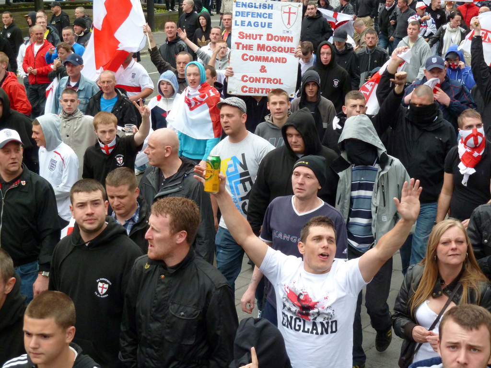
```
::: {.backgrnote}
Newcastle, May 2010

"Shut down the mosque" march.

*Photo:* [lionheartphotography](https://commons.wikimedia.org/wiki/File:English_Defence_League_protest_in_Newcastle.jpg).
:::
:::

:::

::: {.notes}
Most of them were born after 9/11 — ask who knows what happened, and why a whole generation of politics is said to have changed that day. The first two photos are the attack itself; the third is what is *claimed* to follow: far-right mobilisation against Muslims, here the English Defence League marching against a mosque. Today we test that claim causally, using a smaller attack one year later (Bali, 2002) as our natural experiment. Stress the phrase "average causal effect": we want a cause, not a correlation. Sensitive topic — keep it factual.
:::

## We would need an RCT

::: {.push-left}
```{r, echo = FALSE, out.width='70%', fig.align='center'}
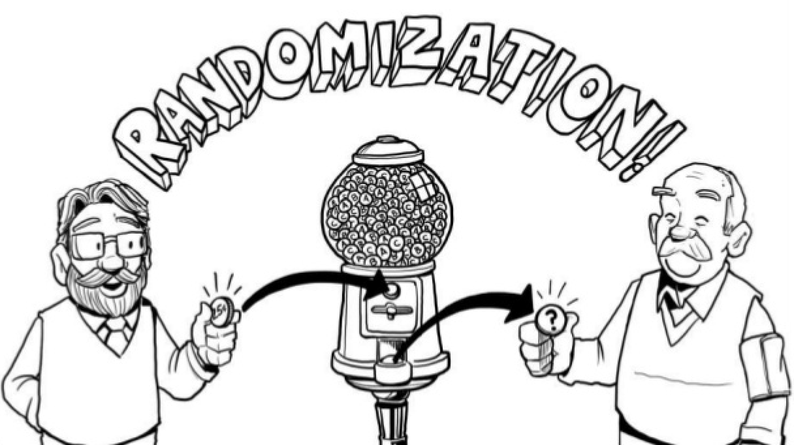
```

::: {.fragment fragment-index=1}
If we could **randomly** assign exposure to terrorism, treatment and control groups would come from the same population. They would be alike on **everything**, including their untreated potential outcome $Y_0$:

$$E[Y_{0i} \mid D = 1] = E[Y_{0i} \mid D = 0]$$

The selection-bias term would vanish and the raw difference would be the causal effect $\kappa$.
:::
:::

::: {.push-right .fragment fragment-index=2}
$$\begin{aligned}
& \underbrace{E[Y_{1i} \mid D=1] - E[Y_{0i} \mid D=0]}_{\text{Comparison between treatment and control group}} \\[1.2em]
&= E[Y_{0i} + \color{#901A1E}{\kappa} \mid D=1] - E[Y_{0i} \mid D=0], \\[1.2em]
&= \color{#901A1E}{\kappa} + \underbrace{E[Y_{0i} \mid D=1] - E[Y_{0i} \mid D=0]}_{\underbrace{0}_{\text{Selection bias (if randomization has worked)}}}, \\[1.2em]
&= \underbrace{\color{#901A1E}{\kappa}.}_{\text{The average causal effect}}
\end{aligned}$$
:::

::: {.notes}
Recall Lecture 6: randomising equalises the two groups' baseline $Y_0$, so selection bias is zero and the raw difference *is* the effect κ. Click to bring in the derivation on the right and walk through it line by line.
:::

## But that is unethical!

::: {.push-left}
```{r, echo = FALSE, out.width='100%'}
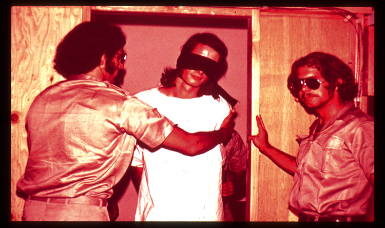
```

::: {.backgrnote}
Stanford Prison Experiment, 1971: "guards" with a blindfolded "prisoner". 

*Photo:* [Philip Zimbardo](https://commons.wikimedia.org/wiki/File:SPE1971-guards_with_blindfolded_prisoner.jpg).
:::

::: {.small}
Zimbardo randomly assigned student volunteers to be **guards** or **prisoners** in a mock prison. Guards humiliated and abused prisoners and the study was stopped after 6 of 14 planned days. Participants were traumatized and the researcher, acting as "superintendent", let it escalate.
:::
:::

::: {.push-right}
```{tikz rct-dag, echo = FALSE, out.width='80%', fig.align='center'}
\usetikzlibrary{shapes.geometric, arrows.meta, positioning}
\definecolor{kured}{HTML}{901A1E}
\begin{tikzpicture}[>=Latex, semithick]
\sffamily
\node[ellipse, draw=kured, thick] (I) at (0,0) {$I$};
\node[ellipse, draw] (D) at (2.6,0) {$D$};
\node[ellipse, draw] (C) at (2.6,1.8) {$C$};
\node[ellipse, draw] (Y) at (5.2,0) {$Y$};
\draw[->, kured] (I) -- (D);
\draw[->] (D) -- (Y);
\draw[->, dashed] (C) -- (D);
\draw[->, dashed] (C) -- (Y);
\end{tikzpicture}
```
:::

::: {.notes}
The Stanford Prison Experiment shows why ethics boards exist: randomly assigning people to harmful roles did real damage. Treating people with terrorism would be far worse, so an RCT is not an option here. This is a common and fundamental challenge in sociology. Many of the "treatments" we care about are things we can't, or shouldn't, manipulate. We need a different strategy: go hunting for randomisation the world already did for us.
:::

## But nature can randomise for us

::: {.push-left}
The first natural experiment: **John Snow** traced the 1854 London cholera outbreak to a water pump. Because rival companies' pipes were laid haphazardly, *which* water a household got was **as-if random**, that is, unrelated to their wealth or health.

::: {style="flex: 1; text-align: center;"}
::: {.push-right}
```{r, echo = FALSE, out.width='80%'}
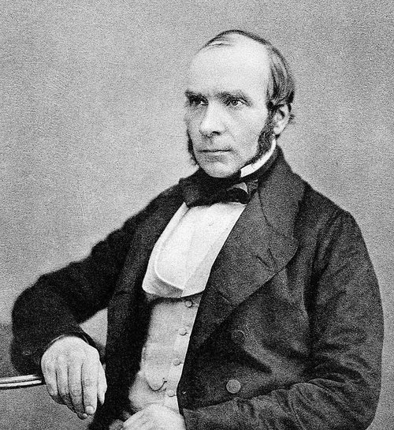
```
::: {.backgrnote}
**John Snow**, 1813–1858.
:::
:::
::: {.push-left}
```{r, echo = FALSE, out.width='100%'}

```
::: {.backgrnote}
Plaque honouring Snow. 

*Photo:* [Tony Hisgett](https://commons.wikimedia.org/wiki/File:Dr_John_Snow_(24023399742).jpg).
:::
:::
:::
:::

::: {.push-right}
::: {.r-stack}
::: {.fragment .fade-out fragment-index=1 style="text-align: center;"}
```{r, echo = FALSE, out.width='100%'}
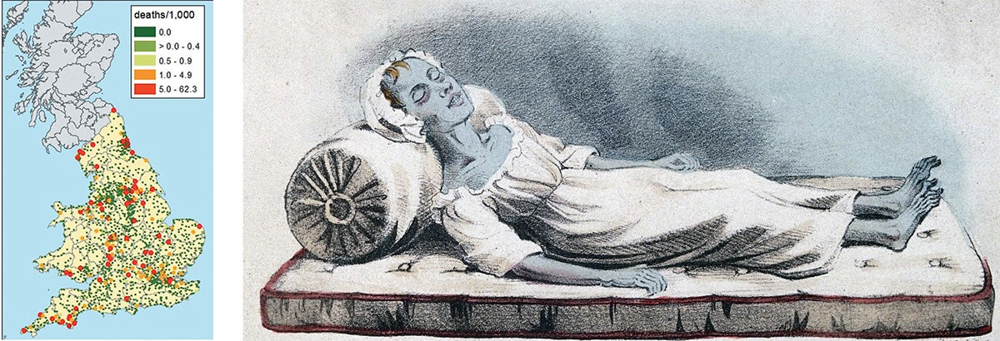
```
::: {.backgrnote}
Cholera killed fast and turned its victims blue: a victim in the "blue stage", and cholera deaths across England and Wales. *Image:* via [UCLA Dept. of Epidemiology](https://epi-snow.ph.ucla.edu/).
:::
:::

::: {.fragment .fade-in-then-out fragment-index=1 style="text-align: center;"}
```{r, echo = FALSE, out.width='72%'}
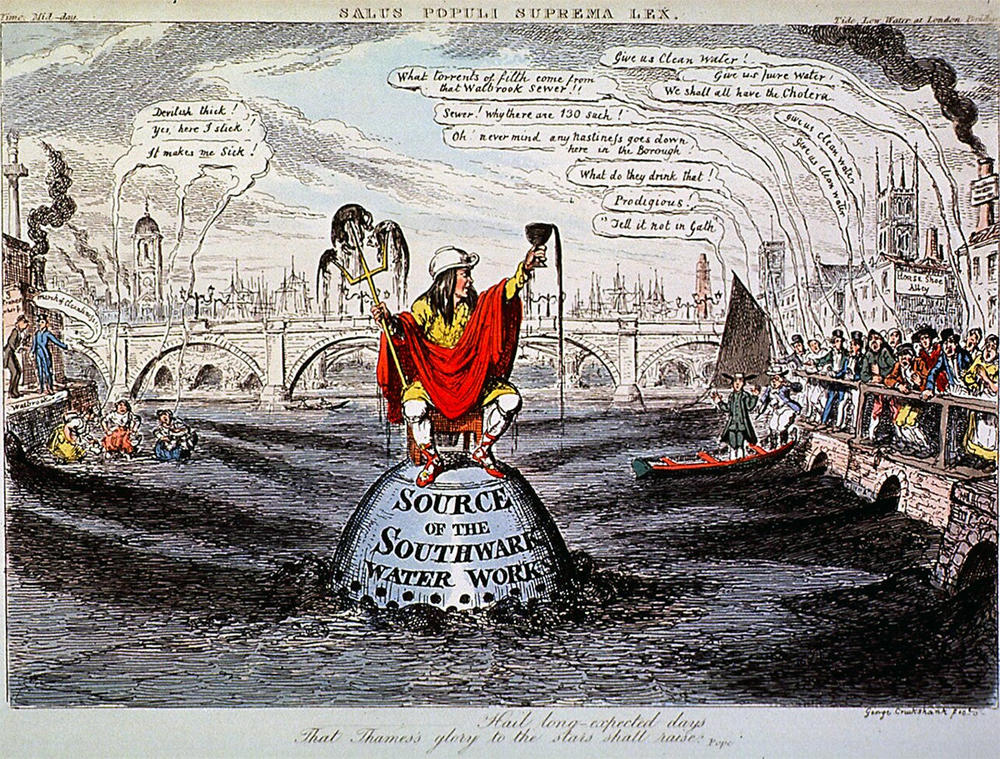
```
::: {.backgrnote}
"Salus Populi Suprema Lex": George Cruikshank mocks the Southwark Water Works for piping sewage-filled Thames water to London homes, 1832. *Image:* via [UCLA Dept. of Epidemiology](https://epi-snow.ph.ucla.edu/).
:::
:::

::: {.fragment .fade-in-then-out fragment-index=2 style="text-align: center;"}
```{r, echo = FALSE, out.width='100%'}
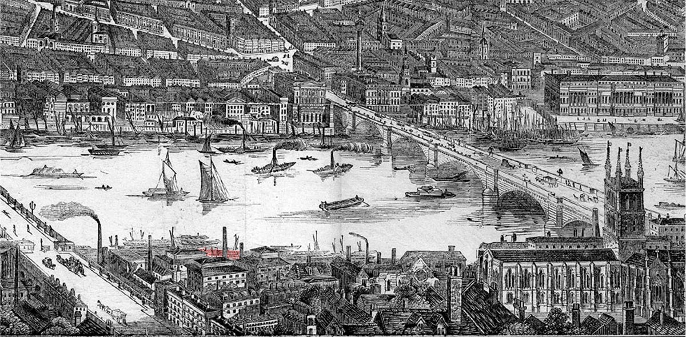
```
::: {.backgrnote}
The Southwark Water Company's works on the Thames, before 1845. *Image:* via [UCLA Dept. of Epidemiology](https://epi-snow.ph.ucla.edu/).
:::
:::

::: {.fragment .fade-in-then-out fragment-index=3 style="text-align: center;"}
```{r, echo = FALSE, out.width='75%'}
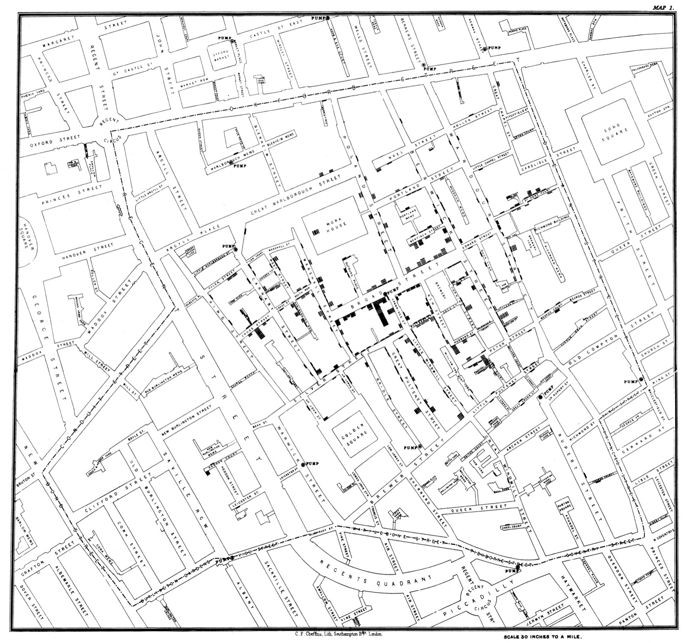
```
::: {.backgrnote}
`r Citet(myBib, "snow_mode_1856")` cholera map, 1854.
:::
:::

::: {.fragment fragment-index=4 style="text-align: center;"}
```{r, echo = FALSE, out.width='82%'}
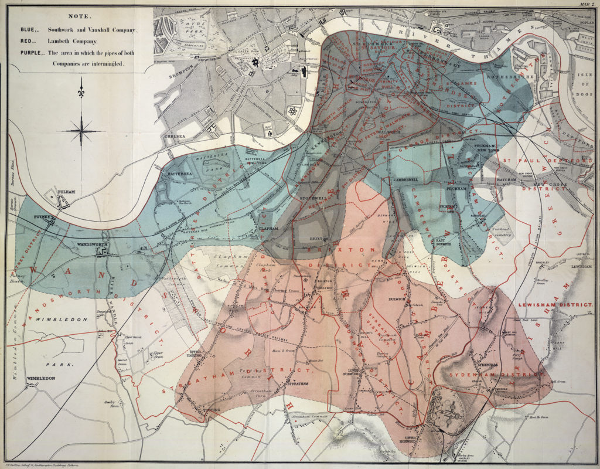
```
::: {.backgrnote}
Snow's 1855 map of the "grand experiment": districts supplied by the Southwark & Vauxhall (blue) vs. the Lambeth company (red), whose pipes were laid haphazardly side by side. *Image:* [Cooper Hewitt](https://www.cooperhewitt.org/), public domain.
:::
:::
:::
::: {.content-box-blue}
A **natural experiment**: exposure to treatment vs. control is [as-if random]{.alert}, decided *by nature* or by forces outside the researcher's control.
:::
:::

::: {.notes}
The core idea: sometimes exposure is "as-if random" by nature. Snow, 1854 — rival water firms had laid their pipes haphazardly, so *which* water a house drank was unrelated to wealth or health. That let him compare death rates by supplier and pin cholera on one pump. The first natural experiment in history.
:::

## Today's natural experiment: The Bali bombings, October 2002

::: {.push-left}
`r Citet(myBib, "legewie_terrorist_2013")` spotted a natural experiment: the 2002 **Bali attack** struck *during* the European Social Survey's fieldwork. Whether a respondent was interviewed **before** or **after** the attack was **as-if random**; so "after" is the treatment group, "before" the control.

```{r, echo = FALSE, out.width='48%'}

```

::: {.backgrnote .center}
Joscha Legewie, Harvard University
:::
:::

::: {.push-right}
::: {.r-stack}
::: {.fragment .fade-out fragment-index=1}
```{r, echo = FALSE, out.width='95%'}

```

<br>

<iframe src="https://en.wikipedia.org/wiki/2002_Bali_bombings" width="100%" height="330" style="border: 1px solid #ddd; margin-top: 0;"></iframe>
:::

::: {.fragment fragment-index=1}
```{r, echo = FALSE, out.width='100%'}
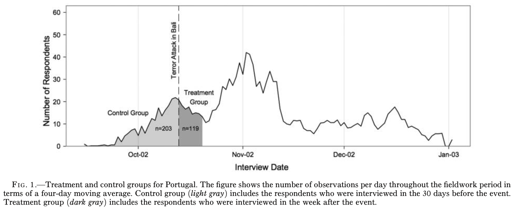
```

::: {.content-box-red .fragment fragment-index=2}
Under what conditions is this design valid?
:::

::: {.content-box-green .fragment fragment-index=3}
1. Interview *date* is as-if random. <br> $\rightarrow$ *Reachability bias*: easy-to-reach people are interviewed earlier.
2. No other event moved attitudes at the same time.
:::
:::
:::
:::

::: {.notes}
Start with the photo and the Wikipedia page: 202 dead, many of them European tourists, front-page news across Europe. Click: Legewie's move: the Bali attack landed *mid-fieldwork* in the ESS, so interview timing splits people into after (treated) and before (control). Point at the figure — control is the 30 days before, treatment the week after. Click: ask the class under what conditions this design is valid, and collect answers before revealing the two assumptions: interview date is as-if random (threat = *reachability bias*, easy-to-reach people are interviewed early), and no *other* big event hit at the same moment.
:::

## RCT vs. natural experiment


::: {.push-left}
::: {.content-box-red}


**_Internal_ validity**: The estimated parameter, $\beta_{I \rightarrow Y}$, really captures what the study claims it captures (e.g., a causal effect) in the study’s own sample and setting.
:::

```{tikz RCT-dag, echo = FALSE, out.width='90%', fig.align='center'}
\usetikzlibrary{shapes.geometric, arrows.meta, positioning, quotes}
\definecolor{kured}{HTML}{901A1E}
\begin{tikzpicture}[>=Latex, semithick]
\sffamily
\node[ellipse, draw=kured, thick] (E) at (0,0) {$I$};
\node[ellipse, draw] (D) at (2.6,0) {$D$};
\node[ellipse, draw, gray] (C) at (2.6,1.8) {$C$};
\node[ellipse, draw] (Y) at (5.2,0) {$Y$};
\draw[->, kured] (E) -- (D);
\draw[->] (D) -- (Y);
\draw[->, gray, dashed] (C) -- (D);
\draw[->, gray, dashed] (C) -- (Y);
\end{tikzpicture}
```

$\rightarrow$ the RCT wins over the natural experiment, because the researcher *controls* assignment. The intervention $I$ is therefore **known** to be random. We are sure no confounder $C$ sneaks in.
:::

::: {.push-right .fragment fragment-index=2}
::: {.content-box-blue}
**_External_ validity**: The estimated parameter, $\beta_{E \rightarrow Y}$, found in the study generalises to other people, places, times and real-world versions of the treatment.
:::

```{tikz natexp-dag, echo = FALSE, out.width='90%', fig.align='center'}
\usetikzlibrary{shapes.geometric, arrows.meta, positioning, quotes}
\definecolor{kured}{HTML}{901A1E}
\begin{tikzpicture}[>=Latex, semithick]
\sffamily
\node[ellipse, draw=kured, thick] (E) at (0,0) {$E$};
\node[ellipse, draw] (D) at (2.6,0) {$D$};
\node[ellipse, draw, gray] (C) at (2.6,1.8) {$C$};
\node[ellipse, draw] (Y) at (5.2,0) {$Y$};
\draw[->, kured] (E) -- (D);
\draw[<->, kured, dashed] (E) to["?"] (C);
\draw[->] (D) -- (Y);
\draw[->, gray, dashed] (C) -- (D);
\draw[->, gray, dashed] (C) -- (Y);
\end{tikzpicture}
```

$\rightarrow$ The natural experiment wins over the RCT. We study a **real event** $E$, not an artificial intervention; findings travel better. The price: we must *assume* $E$ is as-if random (the "?" arrow), not *know* it.
:::

::: {.notes}
Not a winner — a trade-off. RCT: we *control* assignment, so internal validity is high — we *know* it's random. Natural experiment: a *real* event, so external validity is better — but we must *assume* the as-if-random arrow (the "?"), we can't guarantee it. Both aim to shut the confounder $C$ — one by design, one by argument.
:::

## How to

::: {style="display: flex; gap: 1.2rem; align-items: center;"}
::: {style="flex: 0 0 34%;"}
```{r, echo = FALSE, out.width='100%'}
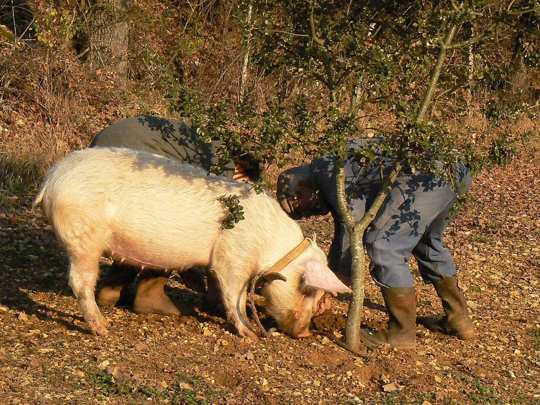
```
::: {.backgrnote}
*Photo:* [Robert Vayssié](https://commons.wikimedia.org/wiki/File:Cochon_truffier.JPG).
:::
:::

::: {style="flex: 1;"}
Finding a natural experiment, not the statistics, is the hard, creative part. They are rare as truffles. *Are you a lucky truffle pig?*
:::
:::

## Learning goal 1: terror can raise xenophobia

::: {.push-left}
Because the interview day is as-if random, Legewie estimates the **causal** effect of the Bali attack on anti-immigrant attitudes, country by country, with plain **OLS**.

::: {.content-box-red .fragment fragment-index=1}
**What does the figure show?** In which countries did the attack change anti-immigrant attitudes, and in which not?
:::

::: {.content-box-green .fragment fragment-index=2}
The attack **significantly raised xenophobia** in **Portugal, Poland & Finland** — but had **no** detectable effect in Great Britain, the Netherlands, or Norway. The same shock, different societies: *why* is the next research question. You can find the answer in `r Citet(myBib, "legewie_terrorist_2013")`.
:::

:::

::: {.push-right}
```{r, echo = FALSE, out.width='72%'}
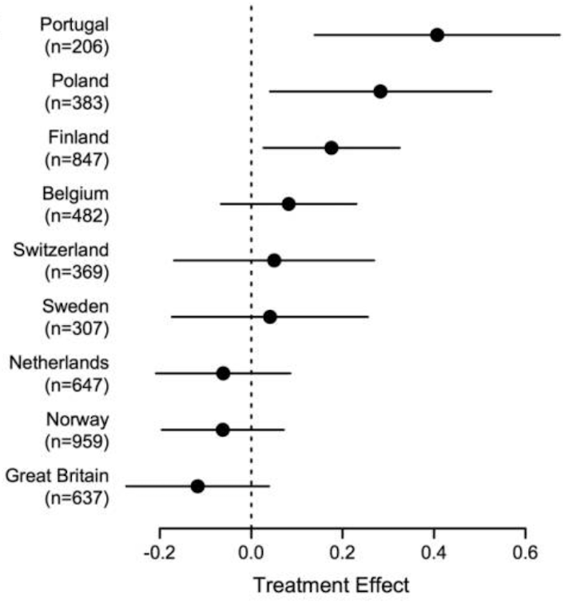
```

::: {.backgrnote .center}
*Source:* `r Citet(myBib, "legewie_terrorist_2013")`
:::
:::

::: {.notes}
The payoff. Point at the plot: significant rise in Portugal, Poland, Finland — nothing in the UK, Netherlands, Norway. Same shock, different societies — *why?* is the real sociological question (tell them to read the paper). And stress: the hard, creative part was *spotting* the natural experiment; the statistics are just weighted OLS.
:::

## Preparation: Legewie's data in R

::: {.panel-tabset}

### Packages
```{r libs-show, eval = FALSE}
pacman::p_load(
  tidyverse,       # Data manipulation and visualization
  haven,           # Read Stata (.dta) files
  estimatr,        # OLS with robust standard errors (and weights)
  modelsummary,    # Regression tables
  masteringmetrics # Data from Angrist & Pischke's book (exercise 2)
)
```

### The attack window
```{r window-show, eval = FALSE}
# Bali terror attack, and the ESS fieldwork window around it
event_date_begin <- as.Date("2002-09-14") # 30 days before
event_date       <- as.Date("2002-10-13") # The attack
event_date_end   <- as.Date("2002-10-20") # One week after
```

### Prepare the data
```{r legewie-show, eval = FALSE}
ESS <- read_dta("Legewie_ESS_02.dta") %>%
  mutate(
    int_date = sprintf("%s-%s-%s", inwyr, inwmm, inwdd) %>% as.Date(), # Interview day
    treat = case_when(                                         # Treatment indicator
      int_date > event_date & int_date <= event_date_end ~ "After the attack",
      int_date < event_date & int_date > event_date_begin ~ "Before the attack",
      TRUE ~ as.character(NA)) %>% fct_relevel("Before the attack", "After the attack"),
    anti_immi = rowMeans(select(., imtcjob, imbleco, imbgeco, imueclt, # Average of 7 items,
                                imwbcnt, imwbcrm, imbghct), na.rm = TRUE) %>%
      scale() %>% as.numeric(),                                # z-standardised,
    anti_immi = max(anti_immi, na.rm = TRUE) - anti_immi,      # high = xenophobic
    brncntr = as_factor(brncntr),                              # Born in the country?
    mocntr = as_factor(mocntr),                                # Mother born there?
    facntr = as_factor(facntr),                                # Father born there?
    pspwght = pweight * dweight) %>%                           # Weights
  filter(str_detect(cntry, "PT") &                             # Portugal, and only people
           brncntr == "yes" & mocntr == "yes" & facntr == "yes") %>% # without migration background
  select(treat, anti_immi, cntry, pspwght) %>%
  drop_na()
```

:::

::: {.notes}
Walk the pipeline once, top to bottom, in plain words: the interview date decides the group, seven attitude items are averaged into one xenophobia index, and the sample is restricted to Portuguese respondents without a migration background. They copy exactly this code in exercise 1, so the point here is recognition, not memorisation. Name the three new helpers as they pass: `read_dta()` reads a Stata file, `as.Date()` turns text into a date, `str_detect()` asks whether a text contains a pattern.
:::

## Break {.inverse background-color="#901A1E"}

<div class="ku-timer" data-min="15"></div>

## Your turn: exercise 1

::: {.left-column}
You replicate Legewie: estimate the Bali effect for **Portugal** and **Sweden**, and make a coefficient plot; a real AJS-style analysis.

[**Open exercise 1 in a new tab ↗**](7-exercise1.html){target="_blank"}

<div class="ku-timer" data-min="20"></div>
:::

::: {.right-column}
<iframe src='7-exercise1.html' width='100%' height='640' frameborder='0' scrolling='yes' style="border:1px solid #ddd; border-radius:6px;"></iframe>
:::

## Non-compliance & intention-to-treat (ITT) {.inverse background-color="#901A1E"}

[Part 2 of 3]{.part-pill}

::: {.lead}
Even RCTs can run into a problem: you can offer a treatment, but you cannot force people to take it.
:::

## Second research question of the day {.inverse background-color="#901A1E"}

::: {.lead}
Does the **neighbourhood** you grow up in shape your **future**?
:::

America's inner cities in the 1970s: arson, abandonment, and whole blocks left in rubble. 

What does growing up here do to a child?

::: {style="display: flex; gap: 1.2rem; align-items: flex-start; margin-top: 0.6em;"}

::: {style="flex: 1; text-align: center;"}
```{r, echo = FALSE, out.width='100%'}
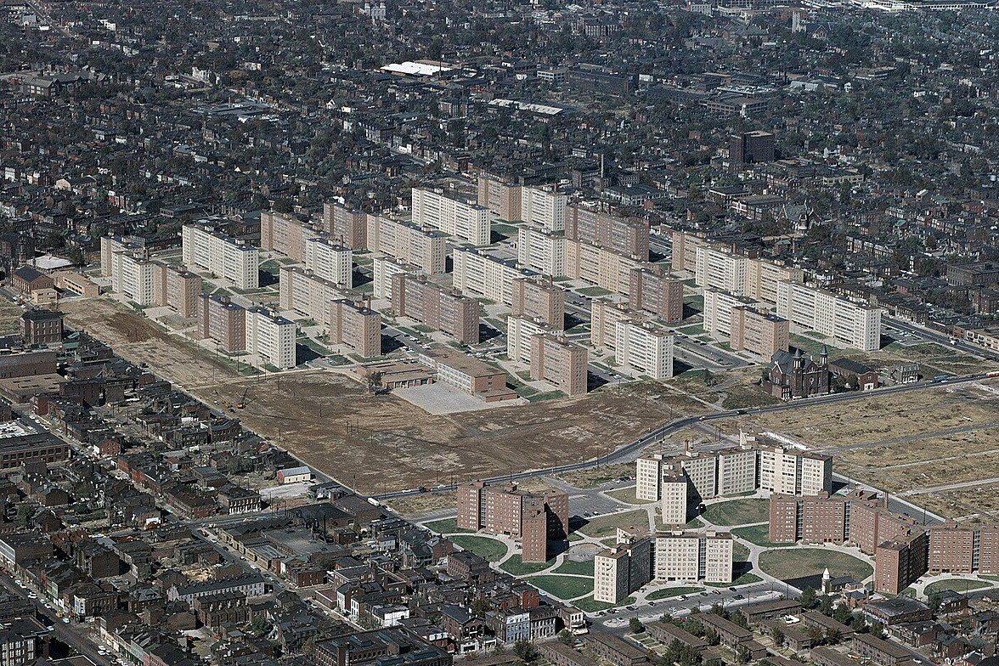
```
::: {.backgrnote}
Public housing, St. Louis, late 1960s.

*Photo:* [USGS](https://commons.wikimedia.org/wiki/File:Pruitt-igoeUSGS02.jpg).
:::
:::

::: {style="flex: 1; text-align: center;"}
```{r, echo = FALSE, out.width='100%'}
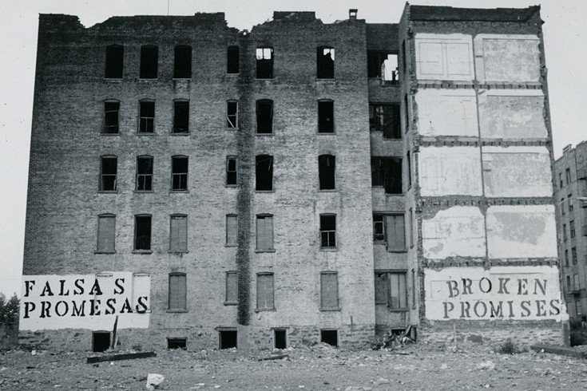
```
::: {.backgrnote}
A burned-out tenement, South Bronx, 1980.

*Photo:* [John Fekner](https://commons.wikimedia.org/wiki/File:BrokenPromises_JohnFekner.jpg).
:::
:::

::: {style="flex: 1; text-align: center;"}
```{r, echo = FALSE, out.width='100%'}
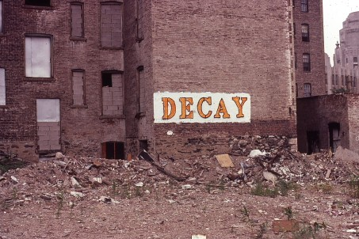
```
::: {.backgrnote}
A ruined building, South Bronx, 1980.

*Photo:* [John Fekner](https://commons.wikimedia.org/wiki/File:Decay,_John_Charlotte_Street,_New_York,_John_Fekner,_1980.jpg).
:::
:::

::: {style="flex: 1; text-align: center;"}
```{r, echo = FALSE, out.width='100%'}
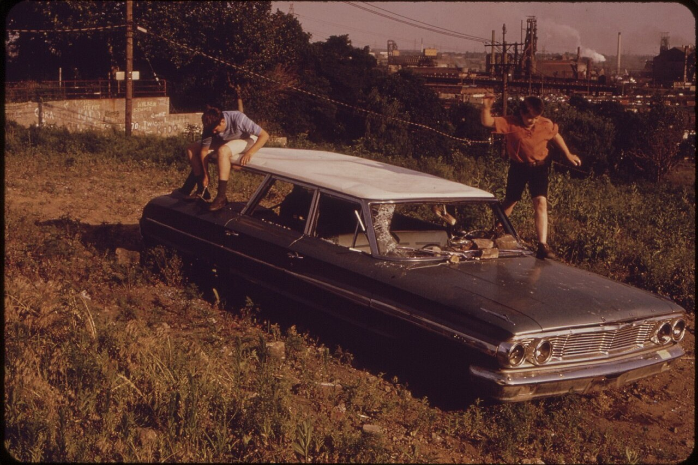
```
::: {.backgrnote}
Cleveland, 1973.

*Photo:* [Frank J. Aleksandrowicz](https://commons.wikimedia.org/wiki/File:VACANT_LOT_AND_ABANDONED_CAR_EQUAL_PLAY_AREA_AND_PLAYTHINGS_-_NARA_-_550283.jpg).
:::
:::

:::

::: {.notes}
Set the scene before the study. In the 1970s the South Bronx lost tens of thousands of homes to arson and abandonment; President Carter's 1977 visit to Charlotte Street made it a national symbol of urban decay. Pruitt-Igoe in St. Louis, the showcase public-housing project of the 1950s, was so run down by the 1970s that it was blown up (1972–76). Point at the Cleveland kids: this is the playground. Ask: what does growing up on a block like this do to a child's life chances — and how could we ever answer that causally, when families who live here differ from families who don't in countless ways?
:::

## Moving to Opportunity

::: {.push-left}
One of the largest social-science RCTs ever. ~4,600 low-income families in high-poverty housing were **randomly** offered a voucher to move to a low-poverty neighbourhood. The question: does growing up in a poor neighbourhood hold children back?

::: {style="display: flex; gap: 1.2rem; align-items: center;"}
::: {style="flex: 0 0 30%;"}
```{r, echo = FALSE, out.width='100%'}

```
:::
::: {style="flex: 1;"}
Raj Chetty and colleagues followed the MTO children into adulthood `r Citep(myBib, "chetty_effects_2016")`.
:::
:::
:::

::: {.push-right}
```{r, echo = FALSE, out.width='80%'}
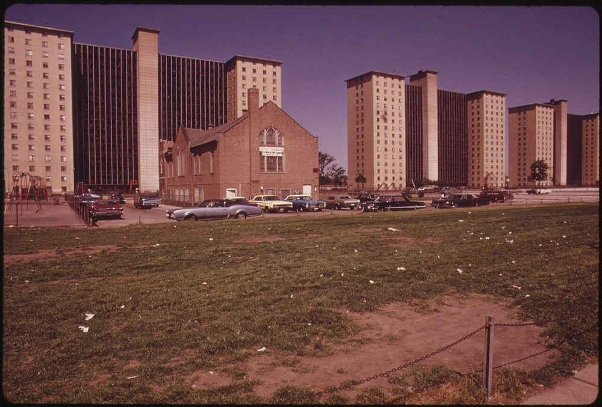
```

::: {.backgrnote .center}
Robert Taylor Homes, Chicago, 1973: the kind of high-poverty public housing MTO offered a way out of. *Photo:* [John H. White](https://commons.wikimedia.org/wiki/File:ROBERT_TAYLOR_HOMES,_A_LOW_INCOME_HIGHRISE_APARTMENT_COMPLEX_INHABITED_BY_BLACKS_ON_CHICAGO%27S_SOUTH_SIDE._THERE_ARE..._-_NARA_-_556179.jpg).
:::
:::

::: {.notes}
Gear change — this time a *real* RCT. The US government took ~4,600 poor families and randomly *offered* a voucher to move to a low-poverty area. The question: does your childhood neighbourhood set your destiny? Tease the catch coming next — they could offer the move, but not force it.
:::

## Voucher $\neq$ move

::: {.push-left}
::: {.content-box-red}
But the lottery only randomised the **offer**, not the **move**. Families could decline or move anyway. So the randomly assigned $Z$ (offer) is **not** the treatment $D$ (actually moving).
:::

:::

::: {.push-right}
```{r, echo = FALSE, out.width='85%'}
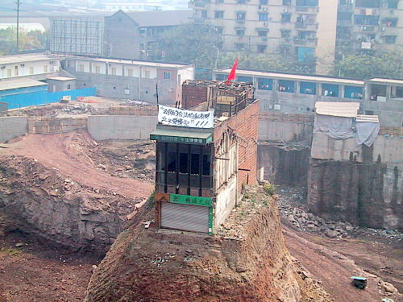
```

::: {.backgrnote .center}
You can offer the move; you cannot force it. A Chongqing "nail house" whose owners refused to leave, 2007. *Photo:* [Zhou Shuguang](https://commons.wikimedia.org/wiki/File:Chongqing_yangjiaping_2007.jpg).
:::
:::

::: {.notes}
The photo makes the point: a whole construction site dug away around one house, because its owners would not move. Ask why a family might turn down a voucher for a better neighbourhood: friends, family, school, a job nearby, fear of being the only poor family on the street. Every one of these reasons could also shape the children's future, so the families who used the voucher are a selected group.
:::

## Only compliers moved

::: {.push-left}
Among families with young children who were offered the experimental voucher, only about **48%** actually moved `r Citep(myBib, "chetty_effects_2016")`.

::: {.content-box-blue}
This is **(non-)compliance**: the random $Z$ (the offer) and the treatment $D$ (moving) are not the same, $|r_{Z,D}| < 1$; some move without a voucher, and some don't move despite having won a voucher.
:::
:::

::: {.push-right}
```{r, echo = FALSE, out.width='86%'}
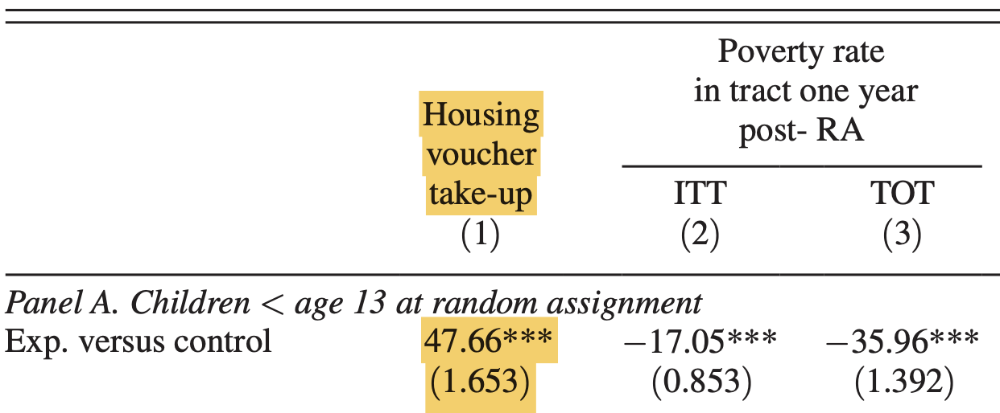
```

::: {.backgrnote .center}
Take-up ≈ 0.4766. *Source:* `r Citet(myBib, "chetty_effects_2016")`
:::

```{tikz compliance-dag, echo = FALSE, out.width='70%', fig.align='center'}
\usetikzlibrary{shapes.geometric, arrows.meta, positioning, quotes}
\definecolor{kured}{HTML}{901A1E}
\begin{tikzpicture}[>=Latex, semithick]
\sffamily
\node[ellipse, draw=kured, thick] (Z) at (0,0) {$Z$};
\node[ellipse, draw] (D) at (2.6,0) {$D$};
\node[ellipse, draw] (C) at (2.6,1.8) {$C$};
\node[ellipse, draw] (Y) at (5.2,0) {$Y$};
\draw[->, kured] (Z) to["$0.48$"] (D);
\draw[->] (D) -- (Y);
\draw[->, dashed] (C) -- (D);
\draw[->, dashed] (C) -- (Y);
\end{tikzpicture}
```
:::

::: {.notes}
The snag: only ~48% of offered families actually moved. So the randomly-assigned thing (Z = the offer) is *not* the treatment (D = moving). Give it its name — non-compliance — and note it breaks the clean RCT logic we just relied on.
:::

## The intention-to-treat effect (ITT)

::: {.push-left}
Compare everyone **offered** the voucher to everyone not offered, regardless of who moved. Because the *offer* was randomised, this **intention-to-treat (ITT)** difference is a clean causal effect: **+\$1,624** in adult earnings for kids whose parents were offered the move.

::: {.content-box-red}
Because it's randomised, it's a causal effect;<br> but of what?
:::

::: {.content-box-green .fragment}
It is the causal effect of **being offered** the move $Z$, **not** of actually **moving** $D$. Their kids earn **\$1,624** more on average. This ITT of $Z$ is a *diluted* effect of $D$: an effect for the ~48% who moved, mixed with zero for the ~52% who stayed.
:::
:::

::: {.push-right}
```{r, echo = FALSE, out.width='86%'}
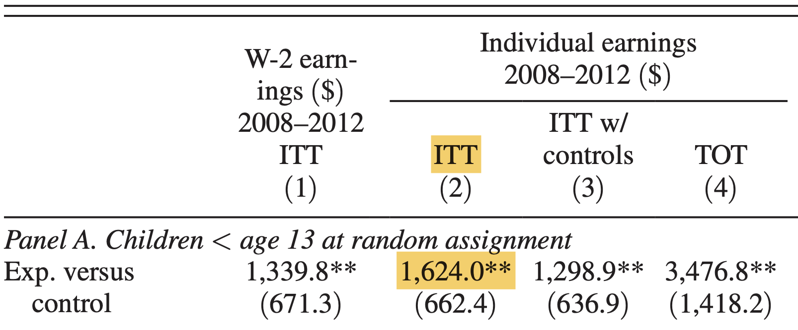
```

::: {.backgrnote .center}
ITT ≈ +\$1,624. *Source:* `r Citet(myBib, "chetty_effects_2016")`
:::
:::

::: {.notes}
The offer was random, so offered-vs-not is a clean causal effect: +\$1,624. But push them: the effect of *what*? Of being *offered*, not of *moving*. It's diluted — a big effect for the ~48% who moved, blended with zero for the ~52% who stayed.
:::

## RCT vs. intention-to-treat (ITT)

::: {.push-left}
::: {.content-box-red}
**Full-compliance RCT:** the intervention *is* the treatment.
$$|r_{I,D}| = 1 \;\Rightarrow\; I = D$$
The randomised difference is the treatment effect directly.

::: {.dag-blend}
```{tikz rct-full-dag, echo = FALSE, out.width='62%', fig.align='center'}
\usetikzlibrary{shapes.geometric, arrows.meta, positioning, quotes}
\definecolor{kured}{HTML}{901A1E}
\begin{tikzpicture}[>=Latex, semithick]
\sffamily
\node[ellipse, draw=kured, thick] (I) at (0,0) {$I$};
\node[ellipse, draw] (D) at (2.6,0) {$D$};
\node[ellipse, draw] (C) at (2.6,1.8) {$C$};
\node[ellipse, draw] (Y) at (5.2,0) {$Y$};
\draw[->, kured] (I) to["$|r_{I,D}|=1$"] (D);
\draw[->] (D) -- (Y);
\draw[->, dashed] (C) -- (D);
\draw[->, dashed] (C) -- (Y);
\end{tikzpicture}
```
:::
:::
:::

::: {.push-right}
::: {.content-box-blue}
**ITT / (non-)compliance:** the offer only *nudges* the treatment.
$$|r_{Z,D}| < 1 \;\Rightarrow\; Z \neq D$$
The randomised offer injects *some* random variation into $D$; enough to work with.

::: {.dag-blend}
```{tikz itt-dag, echo = FALSE, out.width='62%', fig.align='center'}
\usetikzlibrary{shapes.geometric, arrows.meta, positioning, quotes}
\definecolor{kured}{HTML}{901A1E}
\begin{tikzpicture}[>=Latex, semithick]
\sffamily
\node[ellipse, draw=kured, thick] (Z) at (0,0) {$Z$};
\node[ellipse, draw] (D) at (2.6,0) {$D$};
\node[ellipse, draw] (C) at (2.6,1.8) {$C$};
\node[ellipse, draw] (Y) at (5.2,0) {$Y$};
\draw[->, kured] (Z) to["$|r_{I,D}|<1$"] (D);
\draw[->] (D) -- (Y);
\draw[->, dashed] (C) -- (D);
\draw[->, dashed] (C) -- (Y);
\end{tikzpicture}
```
:::
:::
:::

::: {.content-box-green style="clear: both;"}
The injected random variation in $D$ is exactly what an **instrumental variable** exploits.
:::

::: {.notes}
Two correlations side by side: perfect RCT, intervention = treatment (|r| = 1); non-compliance, offer ≠ treatment (|r| < 1). The bridge line to Part 3: that *leftover* random wiggle the offer injects into $D$ is exactly what an instrumental variable exploits.
:::

## Instrumental variables (IV) {.inverse background-color="#901A1E"}

[Part 3 of 3]{.part-pill}

::: {.lead}
Use the randomly-assigned **offer** as an *instrument* to recover the effect of the **treatment itself**.
:::

## The cast of characters

Every IV argument juggles the same seven players.

::: {.small}
| Symbol | Role | In Moving to Opportunity |
|:--:|---|---|
| $Z$ | **Instrument** — randomly assigned | the **voucher offer** (the lottery) |
| $D$ | **Treatment** — what we care about | **actually moving** to a low-poverty area |
| $Y$ | **Outcome** | the child's **adult income** |
| $C$ | **Confounders** | why we can't just compare movers: ambition, family resources ... |
| $\phi$ | **First stage** $Z \rightarrow D$ | offer → move $= 0.48$ |
| $\rho$ | **Reduced form** $Z \rightarrow Y$ (the ITT) | offer → income $= \$1{,}624$ |
| $\lambda$ | **What we want** $D \rightarrow Y$ | move → income $= \rho/\phi \approx \$3{,}400$ |
:::

::: {.notes}
Slow down here — this is the anchor. Map every symbol to MTO out loud: Z = the offer, D = moved, Y = income, φ = 0.48, ρ = \$1,624, λ = what we want. Tell them to keep this table in their heads; everything that follows is just these seven letters.
:::

## An instrument, and its three demands

::: {.push-left}
**Goal:** the causal effect $\lambda$ of the treatment $D$ on outcome $Y$.

::: {.content-box-red}
**Three requirements for an instrument $Z$:**

1. **First stage:** $Z$ has a real effect $\phi$ on $D$ *(testable)*.
2. **As-if random:** $Z$ is unrelated to confounders $C$ *(in the MTO by design)*.
3. **Exclusion restriction:** $Z$ affects $Y$ **only** through $D$ *(not testable!)*.
:::
:::

::: {.push-right}
```{tikz iv-dag, echo = FALSE, out.width='90%'}
\usetikzlibrary{shapes.geometric, arrows.meta, positioning, quotes}
\definecolor{kured}{HTML}{901A1E}
\begin{tikzpicture}[>=Latex, semithick]
\sffamily
\node[ellipse, draw=kured, thick] (Z) at (0,0) {$Z$};
\node[ellipse, draw] (D) at (2.6,0) {$D$};
\node[ellipse, draw, gray] (C) at (2.6,1.8) {$C$};
\node[ellipse, draw] (Y) at (5.2,0) {$Y$};
\draw[->, kured] (Z) to["$\phi$"] (D);
\draw[->] (D) to["$\lambda$"] (Y);
\draw[->, gray, dashed] (C) -- (D);
\draw[->, gray, dashed] (C) -- (Y);
\end{tikzpicture}
```
:::

::: {.notes}
Three tests for a good instrument. (1) First stage — does Z actually move D? This one is *testable* (the offer did cause moves). (2) As-if random — true here by the lottery. (3) Exclusion restriction — Z reaches Y *only* through D. Flag #3 now as the hard, untestable one; we unpack it next.
:::

## The exclusion restriction is fragile

::: {.push-left}
Winning the lottery clearly makes families:
1. **move** (first stage ✓) 
2. it was **random** (✓) 
$\rightarrow$ two boxes ticked.

::: {.content-box-red}
**Discuss:** could the random offer still reach a child's income through some *other* path than moving — and so ruin the instrument?
:::

::: {.content-box-green .fragment}
Yes — for example if winning also sparked **optimism** that lifts earnings, whether or not the family moved. Then $Z$ reaches $Y$ through a **second path**: the exclusion restriction breaks. It is the **one requirement you cannot test** — you must *argue* it is implausible.
:::
:::

::: {.push-right}
::: {.small .center}
**A violated exclusion restriction**
:::
```{tikz excl-dag, echo = FALSE, out.width='88%'}
\usetikzlibrary{shapes.geometric, arrows.meta, positioning, quotes}
\definecolor{kured}{HTML}{901A1E}
\begin{tikzpicture}[>=Latex, semithick]
\sffamily
\node[ellipse, draw, align=center] (Z) at (0,0) {Win\\lottery};
\node[ellipse, draw, align=center] (D) at (3,0) {Moving out\\of poverty};
\node[ellipse, draw=kured, align=center] (C) at (3,2.1) {Optimistic\\personality};
\node[ellipse, draw, align=center] (Y) at (6.2,0) {Income\\as adult};
\draw[->] (Z) -- (D);
\draw[->, kured] (Z) to["?"] (C);
\draw[->] (D) -- (Y);
\draw[->, kured] (C) -- (Y);
\end{tikzpicture}
```
:::

::: {.notes}
The crux — and the assumption students confuse with "as-if random". Ask the blue question first, give them a moment, *then* reveal: winning → optimism → income *directly*, bypassing the move. Hammer the point — you can never *test* this, you can only *argue* it's implausible. This is where IV papers live or die.
:::

## Why divide? The dilution intuition

::: {.push-left}
The offer only moved **48%** of families. So the offer's effect on income, the **\$1,624** ITT, is a **diluted** effect of *moving*: a gain for the ~48% who moved, blended with **zero** for the ~52% who did not.

To undo the dilution, **scale it back up** by the share who actually moved:
$$\lambda = \frac{\$1{,}624}{0.48} \approx \$3{,}400$$

::: {.backgrnote}
If everyone had complied ($\phi = 1$), the ITT *would* be the treatment effect — no scaling needed. Non-compliance is exactly why we divide.
:::
:::

::: {.push-right}
```{r waffle, echo = FALSE, out.width = '100%', fig.width = 8, fig.height = 2.6}
tibble(family = 1:100,
       x = (family - 1) %% 20,
       y = (family - 1) %/% 20,
       moved = case_when(family <= 48 ~ "moved", TRUE ~ "stayed")) %>%
  ggplot(aes(x = x, y = -y, fill = moved)) +
  geom_tile(colour = "white", linewidth = 1.5) +
  scale_fill_manual(values = c("moved" = "#901A1E", "stayed" = "grey80")) +
  coord_equal() +
  labs(title = "100 families offered a voucher: 48 moved, 52 stayed") +
  theme_void(base_size = 15) +
  theme(legend.position = "none", plot.title = element_text(hjust = 0.5))
```

::: {.content-box-blue .fragment fragment-index=1}
**Check:** $48 \times \$3{,}400 = \$163{,}200$. Shared by **all 100** offered families: about **\$1,630** each. That *is* the ITT.
:::

::: {.content-box-green .fragment fragment-index=2}
**In one line:** a *weak* nudge that *still* shifted incomes means each real **mover** gained a **lot**.
:::
:::

::: {.notes}
Build the intuition *before* the algebra. Point at the picture: of 100 families who won a voucher, 48 moved. Only the red squares can gain anything from moving. Click: run the arithmetic forwards. If every mover gains \$3,400, the total gain spread over all 100 offered families is about \$1,630 each, which is the ITT. So the ITT is the move effect, thinned out by the grey squares. Click: run it backwards. Divide by 0.48 to undo the thinning and get ~\$3,400. One line to say aloud: a weak nudge that *still* shifted incomes means each actual mover must have gained a lot.
:::

## The Wald IV estimator: a ratio

Two effects we *can* estimate cleanly, because $Z$ is random:

::: {.push-left}
**First stage** — $Z$'s effect on the treatment $D$:
$$\phi = E[D \mid Z{=}1] - E[D \mid Z{=}0]$$

**Reduced form** — $Z$'s effect on the outcome (the ITT):
$$\rho = E[Y \mid Z{=}1] - E[Y \mid Z{=}0]$$
:::

::: {.push-right}
::: {.r-stack}
::: {.fragment .fade-out fragment-index=1}
```{tikz iv-dag-wald, echo = FALSE, out.width='90%', fig.align='center'}
\usetikzlibrary{shapes.geometric, arrows.meta, positioning, quotes}
\definecolor{kured}{HTML}{901A1E}
\begin{tikzpicture}[>=Latex, semithick]
\sffamily
\node[ellipse, draw=kured, thick] (Z) at (0,0) {$Z$};
\node[ellipse, draw] (D) at (2.6,0) {$D$};
\node[ellipse, draw, gray] (C) at (2.6,1.8) {$C$};
\node[ellipse, draw] (Y) at (5.2,0) {$Y$};
\draw[->, kured] (Z) to["$\phi$"] (D);
\draw[->] (D) to["$\lambda$"] (Y);
\draw[->, gray, dashed] (C) -- (D);
\draw[->, gray, dashed] (C) -- (Y);
\end{tikzpicture}
```
:::

::: {.fragment fragment-index=1}
If $Z$ works only through $D$, then $\phi \times \lambda = \rho$, so:
$$\lambda = \frac{\rho}{\phi} = \frac{\text{reduced form}}{\text{first stage}}$$

::: {.content-box-green}
For MTO: $\lambda = \dfrac{\$1{,}624}{0.4766} \approx \mathbf{\$3{,}400}$ — the effect of *moving* for those who move because of the offer.
:::
:::
:::
:::

::: {.notes}
Now formalise: first stage φ, reduced form ρ, and λ = ρ/φ. Same \$3,400 as the last slide — this is just that intuition written as algebra. If it helps, read it as "the outcome effect of the offer, undone by how much the offer actually shifted the treatment."
:::

## Why a broken exclusion restriction is dangerous

::: {.push-left}
Suppose the offer to move also affects income by some path $\delta$ that bypasses moving out of the high-poverty neighborhood (e.g. optimism). Then the reduced form mixes two things:
$$\rho = \underbrace{\phi \times \lambda}_{\text{through } D} + \underbrace{\color{#901A1E}{\delta}}_{\text{the leak}}$$

::: {.fragment fragment-index=1}
The Wald estimator divides **all** of $\rho$ by $\phi$:
$$\frac{\rho}{\phi} = \lambda + \color{#901A1E}{\frac{\delta}{\phi}}$$
:::

::: {.content-box-red .fragment fragment-index=2}
**Intuition:** dividing by $\phi$ scales the ITT up to "what if *everyone* had complied". But $\delta$ works for **everyone offered**, complying mover or not, so scaling it up by $\frac{1}{\phi}$ blows it up too. We additionally **weigh up every other effect** of $Z$ by $\frac{1}{\phi}$.
:::
:::

::: {.push-right}
```{tikz excl-bias-dag, echo = FALSE, out.width='80%', fig.align='center'}
\usetikzlibrary{shapes.geometric, arrows.meta, positioning, quotes}
\definecolor{kured}{HTML}{901A1E}
\begin{tikzpicture}[>=Latex, semithick]
\sffamily
\node[ellipse, draw] (Z) at (0,0) {$Z$};
\node[ellipse, draw] (D) at (2.6,0) {$D$};
\node[ellipse, draw] (Y) at (5.2,0) {$Y$};
\draw[->] (Z) to["$\phi$"] (D);
\draw[->] (D) to["$\lambda$"] (Y);
\draw[->, kured, dashed] (Z) to[bend left=55, "$\delta$"] (Y);
\end{tikzpicture}
```

::: {.content-box-blue .fragment fragment-index=3}
**MTO in numbers:** say winning the lottery adds just **\$200** to income directly. IV then reports
$$\lambda + \frac{\$200}{0.48} \approx \lambda + \mathbf{\$420}$$
The leak, $\delta$, is **more than doubled**. With a weak first stage, say $\phi = 0.1$, the same \$200 becomes **\$2,000** of fake effect.
:::
:::

::: {.notes}
This makes the last slide's warning concrete. Write ρ = φλ + δ on the board: the reduced form is the effect through moving plus any leak. Click: the Wald estimator divides the whole thing by φ, so we get λ + δ/φ. Click: the intuition — dividing by φ is how we scale a diluted ITT up to the compliers, but the leak was never diluted, it hit everyone who won the lottery; scaling it up inflates it. Click: the numbers. A small \$200 leak becomes \$420 with MTO's φ = 0.48, and \$2,000 with a weak instrument. Punchline: the weaker the first stage, the more a tiny exclusion violation contaminates the IV estimate — another reason to argue the exclusion restriction carefully and to want a strong first stage.
:::

## IV is LATE: only valid for compliers

::: {.push-left}
The instrument only moves the **compliers**, people who take the treatment *because* they were assigned it. So IV recovers a **Local Average Treatment Effect**:
$$\lambda = E[Y_{1i} - Y_{0i} \mid \text{complier}]$$

- **Why only compliers?** Never- and always-takers do the *same* thing whether offered or not; the offer shifts neither their $D$ nor their $Y$, so they add **nothing** to $\rho$ or $\phi$ and cancel out of the ratio. Only compliers are left.
- **Monotonicity:** assume **no defiers** (people who do the *opposite* of their assignment). Almost always reasonable.

::: {.backgrnote}
**Why a new letter?** In Lecture 6 an RCT gave us $\kappa$ — the effect for *everyone*. An instrument is weaker: $\lambda$ is the same kind of causal effect, but only for the **compliers**. Same idea, narrower population — hence $\lambda$, not $\kappa$.
:::
:::

::: {.push-right}
```{tikz complier-tree, echo = FALSE, out.width='96%'}
\usetikzlibrary{trees}
\definecolor{kured}{HTML}{901A1E}
\begin{tikzpicture}[semithick,
  level 1/.style={sibling distance=5cm},
  level 2/.style={sibling distance=2.4cm},
  every node/.style={align=center, font=\sffamily\small}]
\node {Sample}
  child {node {Offered\\$Z=1$}
    child {node[kured] {moved\\= complier}}
    child {node {stayed\\= never-taker}}
  }
  child {node {Not offered\\$Z=0$}
    child {node {moved\\= always-taker}}
    child {node[kured] {stayed\\= complier}}
  };
\end{tikzpicture}
```
:::

::: {.notes}
The twist nobody expects: IV speaks *only* about compliers. Walk the tree. Why? Never- and always-takers do the same thing regardless of the offer, so the instrument shifts neither their D nor their Y — they cancel out of both ρ and φ. Monotonicity = assume no "defiers" who do the opposite; almost always reasonable.
:::

## Learning goal 2: neighbourhoods matter

::: {.push-left}
Instrumenting the move with the random voucher offer, `r Citet(myBib, "chetty_effects_2016")` recover the effect of **actually moving** as a young child: about **+\$3,477** in annual adult earnings.

::: {.content-box-green}
Growing up in a low-poverty neighbourhood **causally** raises children's later earnings $\rightarrow$ place shapes destiny, for the compliers whose move the lottery caused.
:::
:::

::: {.push-right}
```{r, echo = FALSE, out.width='86%'}
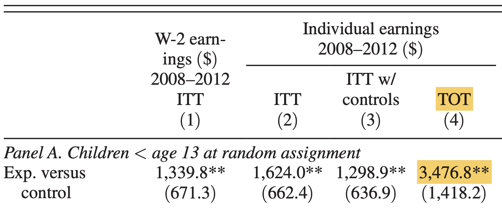
```

::: {.backgrnote .center}
IV / treatment-on-treated ≈ +\$3,477. *Source:* `r Citet(myBib, "chetty_effects_2016")`
:::
:::

::: {.notes}
Payoff number two: instrument the move with the random offer, and moving out as a young child raises adult earnings by ~\$3,477 (the treatment-on-treated column). Strong causal evidence that place shapes destiny — but keep them honest: this is the effect for the *compliers*, the families whose move the lottery actually caused.
:::

## Third research question of the day {.inverse background-color="#901A1E"}

::: {.push-left}
Minneapolis, early 1980s. The police are called to a domestic assault. Should they **arrest** the suspect, or calm things down and leave?

Two theories predict **opposite** effects:

- **Deterrence:** punishment that is certain, swift and severe stops people from doing it again.
- **Labelling:** punishment makes repeat offending *more* likely. It changes relationships, closes legal options, and pushes people into a deviant role.

::: {.content-box-blue}
**Research question:** does **arrest** reduce **repeat** domestic violence?
:::
:::

::: {.push-right}
::: {.r-stack}
::: {.fragment .fade-out fragment-index=1 style="width: 100%;"}
::: {style="display: flex; gap: 1rem; align-items: flex-start;"}
::: {style="flex: 1; text-align: center;"}
```{r, echo = FALSE, out.width='100%'}
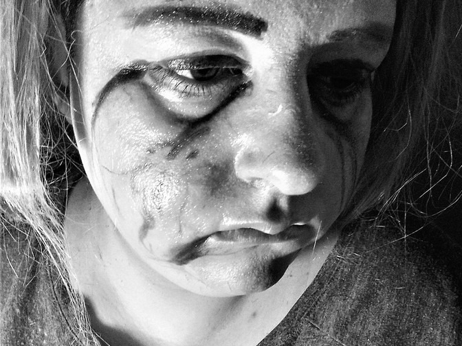
```
::: {.backgrnote}
Domestic violence (staged, make-up). *Photo:* [Commonpersoon](https://commons.wikimedia.org/wiki/File:Free_image_to_use_for_domestic_abuse_victims_f9ree_picture_public_domain_domesti_woman_human_rights_(24)_03.jpg), CC0.
:::
:::
::: {style="flex: 1; text-align: center;"}
```{r, echo = FALSE, out.width='100%'}
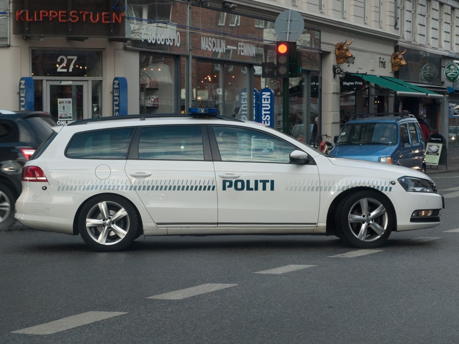
```
::: {.backgrnote}
A Copenhagen Police patrol car. *Photo:* [Dk-2100](https://commons.wikimedia.org/wiki/File:Dansk_Volkswagen_politibil.jpg), CC BY-SA 3.0.
:::
:::
:::

::: {.content-box-blue}
**Discuss:** which theory do you find more plausible? And how would you test it?
:::
:::

::: {.fragment fragment-index=1 style="width: 100%;"}
```{r, echo = FALSE, out.width='92%'}

```

::: {.backgrnote .center}
*Source:* `r Citet(myBib, "sherman_specific_1984")`
:::
:::
:::
:::

::: {.notes}
A third question, and a hard one. Sensitive topic, so keep it factual. Read the two theories as a real debate in criminology: deterrence says arrest teaches a lesson, labelling says arrest makes things worse. Let them vote, then ask how they would test it. Someone will say: randomly decide whether the police arrest. Click: that is exactly what Sherman and Berk did, together with 42 Minneapolis patrol officers. And as with MTO, the lottery decided what officers were *told* to do, not what they *did*.
:::

## Preparation: the Minneapolis data

::: {.push-left}
The **Minneapolis Domestic Violence Experiment**. `r Citet(myBib, "sherman_specific_1984")` randomly told officers how to respond when called to intervene in a domestic violence case — but officers did not always comply.

```{r mdve-prep}
# The data ship with the masteringmetrics package
data("mdve", package = "masteringmetrics")
mdve <- mdve %>%
  mutate( 
    T_RANDOM = case_when( # What officers were TOLD to do
      T_RANDOM == 2 | T_RANDOM == 3 ~ "Coddle!",
      T_RANDOM == 1 ~ "Arrest!",
      TRUE ~ as.character(NA)),
    T_FINAL = case_when( # What officers actually DID
      T_FINAL == 2 | T_FINAL == 3 ~ "Coddled",
      T_FINAL == 1 ~ "Arrested",
      TRUE ~ as.character(NA)))
```

```{r mdve-table}
mdve %>%
  select(T_RANDOM, T_FINAL) %>%
  table() # Cross-tabulate: who complied?
```
:::

::: {.push-right}
::: {.content-box-blue}
**Discuss:** which cells are the **compliers**? And who are the others?
:::

::: {.content-box-green .fragment}
On the **diagonal**, officers did what the lottery said: told to arrest and arrested, told to coddle and coddled. **Off** the diagonal, they did something else: **non-compliance**, as in MTO.
:::
:::

::: {.notes}
Read the cross-table with them: the diagonal cells, told to arrest and arrested, told to coddle and coddled, are the compliers. The off-diagonal cells are officers who did something else than the lottery said. This is the same non-compliance as in MTO, now as a table they can compute themselves — `table()` is the one new function, and it simply counts every combination.
:::

## Your turn: exercise 2

::: {.left-column}
Does **arresting** domestic-violence suspects deter repeat offences? The Minneapolis experiment had non-compliance too. You compute the **IV** estimate yourself.

[**Open exercise 2 in a new tab ↗**](7-exercise2.html){target="_blank"}

<div class="ku-timer" data-min="20"></div>
:::

::: {.right-column}
<iframe src='7-exercise2.html' width='100%' height='640' frameborder='0' scrolling='yes' style="border:1px solid #ddd; border-radius:6px;"></iframe>
:::

## Today's general lessons {.inverse background-color="#901A1E"}

1. A **natural experiment** exploits *as-if random* exposure created by nature; less control than an RCT, but real events and better external validity.

2. With **non-compliance**, the randomised $Z$ is not the treatment $D$. The **intention-to-treat** effect is the clean causal effect of $Z$, diluted by everyone who didn't comply.

3. An **instrumental variable** uses the random $Z$ to recover the treatment effect $\lambda = \rho/\phi$, *if* the first stage is real, $Z$ is as-if random, and the **exclusion restriction** holds.

4. IV estimates a **LATE**: the effect only for **compliers**, assuming **no defiers** (monotonicity). It is silent about never- and always-takers.

::: {.notes}
Recap the four ideas: natural experiment (nature randomises), ITT (the effect of the offer), IV (recovers the treatment effect as ρ/φ), LATE (compliers only). Tie it together: the whole day was about finding — or engineering — random variation to shut the confounder C.
:::

## Check yourself: today's goals

::: {.checklist}
- Explain why an interview date, or a lottery, can serve as "as-if random" assignment, and what could break that.
- Say why the ITT effect of *being offered* a move is not the effect of *moving*, and what non-compliance does to $r_{Z,D}$.
- Compute an IV estimate as reduced form ÷ first stage, and state whose effect (which group) it is.
:::

::: {.content-box-green}
Shaky on any of these? That is what this week's **Absalon quiz** and the **Friday exercise class** are for.
:::

## Today's important functions

::: {.small}
- `estimatr::lm_robust(y ~ z, weights = ...)`: the **reduced form** ($\rho$, effect of the offer) and — with the treatment as the outcome — the **first stage** ($\phi$).
- The **Wald estimator** is then just arithmetic: `lambda <- rho / phi`. No special function needed.
- `haven::read_dta()`: read a Stata (`.dta`) file, such as Legewie's ESS data.
- `as.Date()`: turn text like `"2002-10-13"` into a date you can compare with `<` and `>`.
- `str_detect(x, "PT")`: does a text contain a pattern? Handy in `filter()`.
- `table()`: cross-tabulate two variables, e.g. assigned vs. actual treatment.
- `masteringmetrics::mdve`: the Minneapolis domestic-violence experiment (exercise 2).
- *(Soon)* `ivreg::ivreg(y ~ d | z)` runs the first stage, reduced form and division in **one step** — 2SLS.
:::

## References

::: {.small}
```{r ref, results = 'asis', echo = FALSE}
PrintBibliography(myBib)
```
:::

```{=html}
<script>
(function () {
  function fmt(s) { var m = Math.floor(s / 60), ss = s % 60; return m + ":" + (ss < 10 ? "0" : "") + ss; }
  function build(el) {
    var total = (parseInt(el.getAttribute("data-min"), 10) || 5) * 60, rem = total, id = null;
    el.innerHTML =
      '<div class="kt-display">' + fmt(rem) + '</div>' +
      '<div class="kt-btns">' +
        '<button class="kt-start" type="button">Start</button>' +
        '<button class="kt-pause" type="button">Pause</button>' +
        '<button class="kt-reset" type="button">Reset</button>' +
      '</div>';
    var disp = el.querySelector(".kt-display");
    function render() { disp.textContent = fmt(rem); el.classList.toggle("kt-done", rem <= 0); }
    function start() { if (id) return; id = setInterval(function () { if (rem > 0) { rem--; render(); } else { stop(); } }, 1000); }
    function stop() { clearInterval(id); id = null; }
    function reset() { stop(); rem = total; render(); }
    el.querySelector(".kt-start").onclick = start;
    el.querySelector(".kt-pause").onclick = stop;
    el.querySelector(".kt-reset").onclick = reset;
    el._start = start; el._reset = reset; render();
  }
  function init() {
    document.querySelectorAll(".ku-timer").forEach(build);
    if (window.Reveal && Reveal.on) {
      Reveal.on("slidechanged", function (e) {
        document.querySelectorAll(".ku-timer").forEach(function (t) { if (t._reset) t._reset(); });
        var here = e.currentSlide ? e.currentSlide.querySelectorAll(".ku-timer") : [];
        here.forEach(function (t) { if (t._start) setTimeout(t._start, 250); });
      });
    }
  }
  if (document.readyState !== "loading") init();
  else document.addEventListener("DOMContentLoaded", init);
})();
</script>
```
