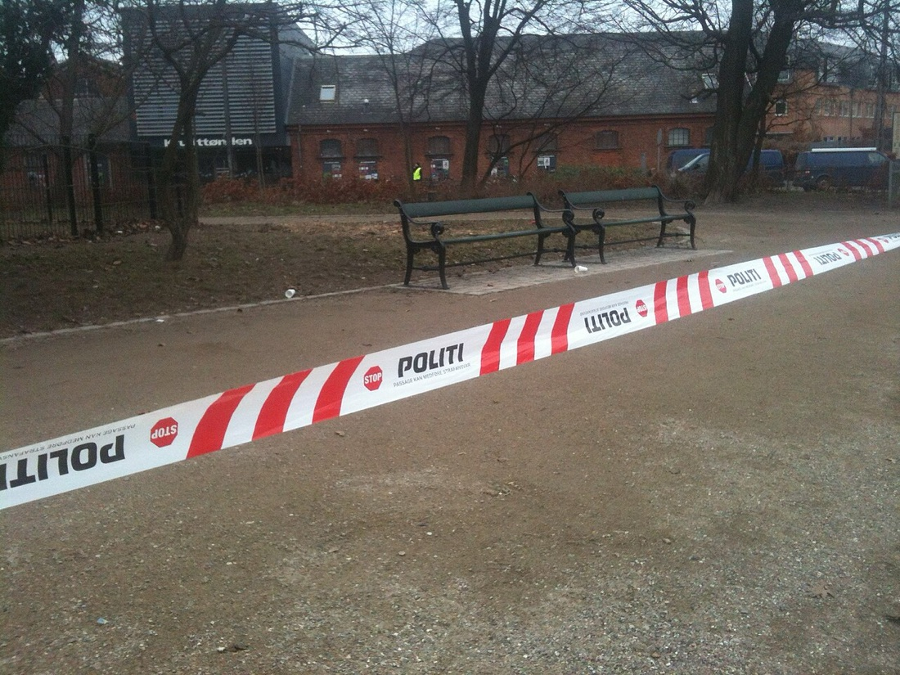
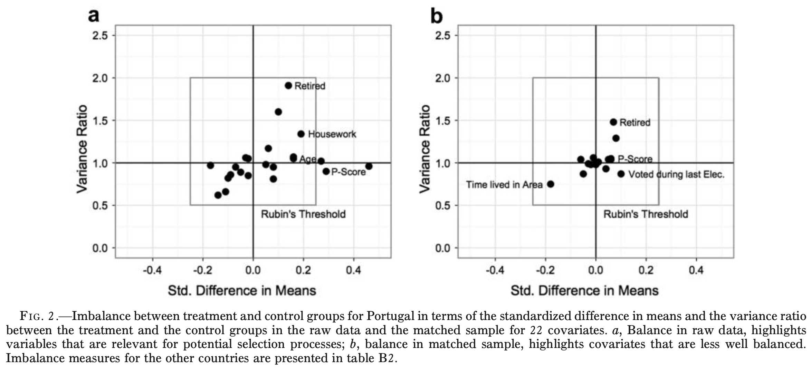
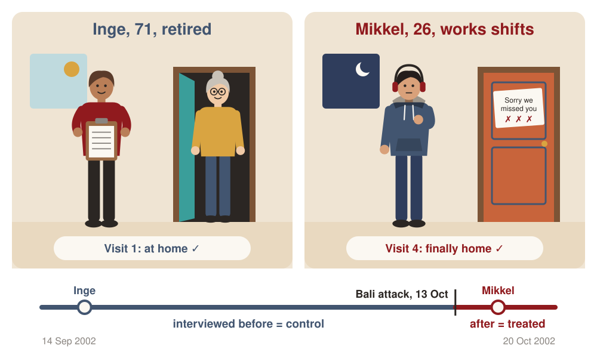
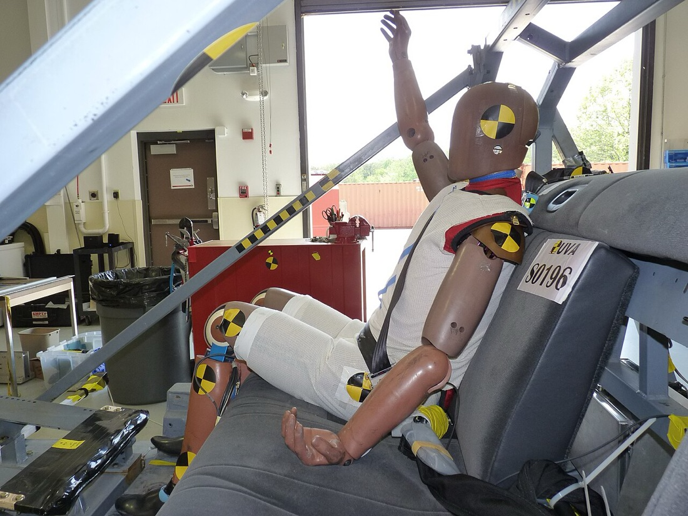
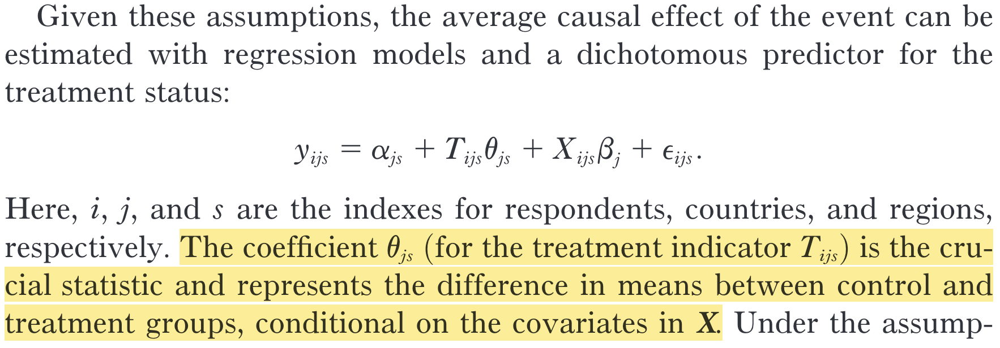

```{r setup, include = FALSE}
library(RefManageR)
library(knitr)

options(htmltools.preserve.raw = FALSE,
        htmltools.dir.version = FALSE, servr.interval = 0.5, width = 115, digits = 3)
knitr::opts_chunk$set(
  collapse = TRUE, message = FALSE, fig.retina = 3, error = TRUE,
  warning = FALSE, cache = FALSE, fig.align = 'center',
  comment = "#", strip.white = TRUE, tidy = FALSE)

BibOptions(check.entries = FALSE,
           bib.style = "authoryear",
           style = "markdown",
           hyperlink = FALSE,
           no.print.fields = c("doi", "url", "ISSN", "urldate", "language", "note", "isbn", "volume"))
myBib <- ReadBib("../Stats_II.bib", check = FALSE)
```

## By the end of today you can … {.inverse background-color="#901A1E"}

1. explain **omitted variable bias**: why leaving a confounder out of a regression shifts a coefficient, and **in which direction**;

2. read a multiple OLS coefficient as *"holding the other variables constant"*, and show what that means with the **Frisch–Waugh** three-step;

3. estimate an **adjusted** effect in R, and say honestly what multiple OLS does **not** fix.

::: {.notes}
Set the stakes: they can already run `lm()` with two predictors — nobody needs a lecture to add a `+`. What they cannot yet do is say *why* the number moved, by how much, and in which direction. That is today. Flag goal 3 as the honest one: today's tool is weaker than a coin flip, and we will say exactly how.
:::

## Closer to home: Copenhagen, February 2015 {.inverse background-color="#901A1E"}

::: {.push-left}
A gunman attacked a debate on free speech at **Krudttønden**, then the **Great Synagogue** in Krystalgade. Two people were killed.

::: {.content-box-blue}
**Discuss:** did the attacks make people in Denmark more hostile towards immigrants? How could you find out?
:::
:::

::: {.push-right}
::: {style="display: flex; gap: 1.2rem; align-items: flex-start;"}
::: {style="flex: 1;"}
```{r, echo = FALSE, out.width='100%'}

```
::: {.backgrnote}
Krudttønden, 15 February 2015.<br> *Photo:* [Kim Bach](https://commons.wikimedia.org/wiki/File:Police_line_near_Krudtt%C3%B8nden,_Copenhagen,_Denmark.JPG).
:::
:::

::: {style="flex: 1;"}
```{r, echo = FALSE, out.width='100%'}

```
::: {.backgrnote}
Great Synagogue, 22 February 2015.<br> *Photo:* [Kim Bach](https://commons.wikimedia.org/wiki/File:Flowers_in_front_Copenhagen_Great_Synagogue_in_Krystalgade_after_shootings.JPG).
:::
:::
:::

::: {.fragment fragment-index=2}
**Why not for Denmark?** Of everyone the ESS interviewed in the five weeks around the Bali attack, only **2** were living in Denmark; interviewing only got going at the very end of October, after the window had closed. Natural experiments need *lucky timing*.
:::
:::

::: {.notes}
Open close to home. Many of them will remember February 2015: the attack on the free-speech debate at Krudttønden in Østerbro, then the shooting at the synagogue in Krystalgade; Finn Nørgaard and Dan Uzan were killed. Sensitive topic, so keep it factual. Ask the question and collect a few designs before you click. Click: last week's answer, the natural experiment. Click: the Danish twist, which is a real number from Legewie's data. Denmark simply was not in the field when Bali happened, so the design cannot say anything about Danes. That is the point: you cannot plan a natural experiment, you can only be lucky. And today we will see that even a lucky one can have a crack.
:::

## Where we are

::: {.lead}
Three lectures, three ways to estimate causal effects:
:::

```{tikz design-map, echo = FALSE, out.width='70%', fig.align='center'}
\usetikzlibrary{arrows.meta}
\definecolor{kured}{HTML}{901A1E}
\begin{tikzpicture}[
  box/.style = {draw, rounded corners = 3pt, align = center, inner sep = 4pt,
                font = \sffamily\small, minimum height = 0.9cm},
  today/.style = {box, draw = kured, very thick, text = kured},
  level distance = 1.6cm,
  level 1/.style = {sibling distance = 5.6cm},
  level 2/.style = {sibling distance = 3.0cm},
  edge from parent/.style = {draw, -{Latex}, semithick}]
\node[box, font = \sffamily\bfseries] {Who decided who got treated?}
  child {node[box] {A researcher\\randomised (L6)}
    child {node[box] {RCT:\\bivariate OLS}
      child {node[box] {$\kappa$: the average\\causal effect}}}}
  child {node[box] {Nature randomised,\\as if (L7)}
    child {node[box] {ITT: bivariate\\OLS on $Z$}
      child {node[box] {$\rho$: effect of\\the assignment}}}
    child {node[box] {IV: $\lambda = \rho / \phi$}
      child {node[box] {$\lambda$: LATE for\\the compliers}}}}
  child {node[today] {Nobody randomised\\(today)}
    child {node[today] {measure $C$:\\multiple OLS}
      child {node[today] {$\kappa$, \emph{if} every\\confounder is measured}
        edge from parent [draw = kured, very thick]}
      edge from parent [draw = kured, very thick]}
    edge from parent [draw = kured, very thick]};
\end{tikzpicture}
```

::: {.content-box-red}
**Beware:** read from left to right in descending order of credibility. Today's tool is the weakest of the three, and the one you will use most often.
:::

::: {.notes}
The map of the causal half of the course, rebuilt from the old deck's design tree. Walk it top-down: the only question that matters is who decided who got treated. A researcher's coin (L6): an RCT, plain bivariate OLS, the average causal effect κ. Nature's coin (L7): the intention-to-treat comparison ρ, and when compliance is broken the instrument, λ = ρ/φ, the LATE for compliers. Today's branch, in red: nobody flipped a coin at all, so we measure the confounders and adjust for them. Be blunt about the ranking and stress the "if" in the last red box; it is today's whole honesty problem in one word.
:::

## The crack in last week's natural experiment {.inverse .photo-bg background-color="#901A1E" background-image="img/L7/bali_memorial.jpg" background-opacity="0.28" background-size="cover" background-position="center"}

[Part 1 of 3]{.part-pill}

::: {.lead}
Legewie's Bali design assumed interview date was as-if random. The balance table says: **almost, but not quite.**
:::

::: {.photo-credit}
The Bali bombing memorial, Kuta. *Photo:* Jorge Láscar, [CC BY 2.0](https://commons.wikimedia.org/wiki/File:The_Bali_bombing_memorial_(16702974500).jpg).
:::

## Almost random is not random

::: {.left-column}
Last week we treated the day of a respondent's ESS interview as **as-if random**: the people interviewed after the Bali attack should look like those interviewed before.

**Legewie** did not just assume it. The paper *checks* it, and honestly reports that they do not quite:

> "The treatment group is on average slightly younger, and the proportion of people who are retired and who work from home is lower" `r Citet(myBib, "legewie_terrorist_2013", after = ", p. 1211")`.
:::

::: {.right-column}
```{r, echo = FALSE, out.width='88%'}

```

::: {.content-box-blue}
**Discuss:** why would people interviewed *early* in a survey period differ systematically from those interviewed late?
:::
:::

::: {.notes}
Do not re-explain the Bali design: one sentence of reminder, then straight to the crack. Make it personal: Joscha is a friend, and the paper is a model of good conduct, because it runs the balance check on its own design and prints the uncomfortable answer instead of hiding it. That is what we want from them in their own papers. The mechanism behind the imbalance is *reachability bias*. Let them work it out from the blue box before you move on; the next slide shows the answer as a story.
:::

## Who opens the door first?

::: {.left-column}
An ESS interviewer rings at two doors on the first day of fieldwork.

::: {.content-box-red}
**Reachability bias:** the easy to reach (retired, at home, *older*) are interviewed early, **before** the attack. The hard to reach (working, out, *younger*) only after several visits, often **after** it.
:::

So the interview day is not quite a coin flip: it **depends on age**.
:::

::: {.right-column}
```{r, echo = FALSE, out.width='100%'}

```
:::

::: {.notes}
The answer to the last slide's question, as a story. Inge is retired and at home, so the interviewer gets her on the very first visit, mid-September: she lands in the control group. Mikkel works shifts and is out three times; the interviewer leaves a card each time and only catches him on the fourth visit, after the attack: he lands in the treatment group. Nobody did anything wrong, and still the two groups now differ in age. Inge and Mikkel are invented, but the pattern is exactly what Legewie's balance table shows.
:::

## Age, the confounder

::: {.push-left}
1. Xenophobia tends to increase with age.

2. The younger a respondent, the more likely they were still to be interviewed after the attack.

$$\Rightarrow \text{Avg}_n[Y_{0i} \mid D_i = 0] \;\color{#901A1E}{>}\; \text{Avg}_n[Y_{0i} \mid D_i = 1]$$

::: {.backgrnote}
In **Portugal** the imbalance runs the other way. Older respondents were more likely to land in the treatment group. Same logic, opposite sign.
:::

::: {.content-box-blue}
**Discuss:** does this imbalance make our estimate of the Bali effect **too large** or **too small**?
:::
:::

::: {.push-right}
```{tikz dag-age, echo = FALSE, out.width='92%'}
\usetikzlibrary{shapes.geometric, arrows.meta, positioning}
\definecolor{kured}{HTML}{901A1E}
\begin{tikzpicture}[>=Latex, semithick]
\sffamily
\node[ellipse, draw, align=center] (D) at (0,0) {Interviewed\\after Bali};
\node[ellipse, draw=kured, thick, dashed] (C) at (3.2,2.4) {Age};
\node[ellipse, draw, align=center] (Y) at (6.4,0) {Xenophobia};
\draw[->] (D) -- (Y);
\draw[->, kured, dashed] (C) -- (D);
\draw[->, kured, dashed] (C) -- (Y);
\end{tikzpicture}
```

::: {.content-box-green .fragment}
The treatment group had a *lower* baseline xenophobia to begin with $\rightarrow$ the raw comparison **understates** the attack's effect.
:::
:::

::: {.notes}
The two bullets are the two arrows — walk them one at a time, then trace the backdoor path. Getting the *direction* right is the hardest exam skill in this block, so make them commit out loud before you move on. Do not resolve it yet; the toy simulation is where they will see it happen. And flag the Portugal footnote, because their exercise uses Portugal and the sign is reversed there.
:::

## The hidden term, selection bias, is back

Lecture 5 split group comparisons into two parts:

::: {.r-stack}
::: {.fragment .fade-out fragment-index=1 style="width: 100%;"}
$$\underbrace{\text{Avg}_n[Y_{1i} \mid D_i = 1] - \text{Avg}_n[Y_{0i} \mid D_i = 0]}_{\text{what we compare}} = \text{ATT} \; + \; \underbrace{\text{Avg}_n[Y_{0i} \mid D_i = 1] - \text{Avg}_n[Y_{0i} \mid D_i = 0]}_{\text{Selection Bias } = \; 0 \text{ if exposure is as-if random (L6, L7)}}$$
:::

::: {.fragment fragment-index=1 style="width: 100%;"}
$$\underbrace{\text{Avg}_n[Y_{1i} \mid D_i = 1] - \text{Avg}_n[Y_{0i} \mid D_i = 0]}_{\text{what we compare}} = \text{ATT} \; + \; \color{#901A1E}{\underbrace{\text{Avg}_n[Y_{0i} \mid D_i = 1] - \text{Avg}_n[Y_{0i} \mid D_i = 0]}_{< \; 0 \text{: the treated are younger}}}$$
:::
:::

::: {.push-left}
::: {.content-box-blue}
**Last week:** we assumed the interview day was as-if random, and that both groups shared the same baseline $Y_0$. We thought the selection-bias term was **zero** and the raw difference was the effect.
:::
:::

::: {.push-right}
::: {.content-box-red .fragment fragment-index=1}
**Beware:** in Legewie's data the term is **not quite zero**. The treated are younger, so their baseline $Y_0$ is *lower*, and the raw comparison **understates** the effect.
:::

::: {.content-box-green .fragment fragment-index=2}
**Today:** for a confounder we *measured*, we can put a **number** on this hidden term (Part 2) and remove it (Part 3).
:::
:::

::: {.notes}
The bridge to Lecture 5. Put the decomposition back on the screen: what we compare equals the effect on the treated plus the hidden selection-bias term. Remind them that randomisation, by a researcher or by nature, is what set that term to zero. Click: in Legewie's data it is not zero any more; the treated are younger, so their baseline is lower and the term is negative. Click: today's promise. For a confounder that happens to be in the data set, the hidden term stops being hidden: we can compute it, and we can take it out.
:::

## A laboratory where we know the truth

Like engineers who crash a car with a dummy before they trust it with people, we **simulate** data where we *set* the true effect, then check how OLS works.

::: {.panel-tabset}

### Packages
::: {.push-left}
```{r libs}
pacman::p_load(
  tidyverse,    # Data manipulation and visualization
  estimatr,     # OLS with robust standard errors
  modelr,       # Residuals and predictions from a model
  modelsummary  # Nicely formatted regression tables
)
```
:::

::: {.push-right}
```{r, echo = FALSE, out.width='72%'}

```
:::

### Step 1: age
::: {.push-left}
```{r sim-age}
set.seed(831983) # So everyone gets the SAME "random" numbers

toydat <- tibble(
  age = rnorm( # Random age
    n = 500,   # for 500 fictitious people
    mean = 40, # Average age 40
    sd = 5     # Standard deviation 5 years
  )
)
```
:::

::: {.push-right}
```{r sim-age-plot, echo = FALSE, out.width='80%', fig.height = 3.6, fig.width = 5.6}
ggplot(data = toydat, aes(x = age)) +
  geom_histogram(binwidth = 1, fill = "#425570", color = "white") +
  labs(x = "Age", y = "Number of people") +
  theme_minimal(base_size = 14)
```
:::

### Step 2: who gets treated
::: {.push-left}
```{r sim-treat}
# Older people are interviewed EARLIER, so they less often
# end up in the post-attack (treatment) group.
toydat <- toydat %>%
  mutate(
    int_day = (-0.1 * age) + rnorm(n = 500, mean = 0, sd = 1),
    bali    = case_when(
      int_day < mean(int_day) ~ 0,   # before the attack
      int_day >= mean(int_day) ~ 1)  # after the attack
  )
```
:::

::: {.push-right}
```{r sim-treat-plot, echo = FALSE, out.width='80%', fig.height = 3.6, fig.width = 5.6}
ggplot(data = toydat, aes(x = age, y = bali)) +
  geom_point(position = position_jitter(height = 0.05, width = 0, seed = 1), # own seed: leaves the
             alpha = 0.4) +                                                  # simulation's numbers alone
  geom_smooth(method = "lm", se = FALSE, color = "#901A1E") +
  scale_y_continuous(breaks = c(0, 1), labels = c("0: before", "1: after")) +
  labs(x = "Age", y = "Interviewed") +
  theme_minimal(base_size = 14)
```
::: {.backgrnote .center}
The older someone is, the less likely they land in the post-attack group.
:::
:::

### Step 3: the outcome
::: {.push-left}
```{r sim-outcome}
# In this simulation, 
# WE decide the truth: the Bali effect is exactly 1,
# and each year of age adds 0.3 to xenophobia.
toydat <- toydat %>%
  mutate(
    xeno = (1 * bali) + (0.3 * age) +
      rnorm(n = 500, mean = 0, sd = 1)
  )
```
:::

::: {.push-right}
```{r sim-outcome-plot, echo = FALSE, out.width='80%', fig.height = 3.6, fig.width = 5.6}
ggplot(data = toydat, aes(x = age, y = xeno, color = factor(bali))) +
  geom_point(alpha = 0.5) +
  scale_color_manual(values = c("0" = "#425570", "1" = "#901A1E"),
                     labels = c("Before the attack", "After the attack"), name = NULL) +
  labs(x = "Age", y = "Xenophobia") +
  theme_minimal(base_size = 14) +
  theme(legend.position = "top")
```
::: {.backgrnote .center}
Two overlapping clouds. The red ones sit a little further *left*: they are younger.
:::
:::

:::

::: {.notes}
Sell the trick before the code, with the crash-test dummy: engineers do not test a new car on real people, they crash it with a dummy whose injuries they can measure exactly. A simulation is our crash test. In real research we never know the right answer, so we cannot tell a good method from a bad one; here we *write down* the truth and check whether our method recovers it. Walk the three steps as a story, and use the plots: people have ages (step 1), age pushes them into one group, older people less often after the attack (step 2), and then we build xenophobia by hand out of the treatment plus age plus noise (step 3). Point hard at the highlighted line: the truth is 1. They must carry that number into the next slide.
:::

## Which model is right?

::: {.push-left}
```{r toy-ols, results = 'hide'}
# Bivariate: the treatment only
ols_bi <- lm_robust(xeno ~ bali, data = toydat)

# Multiple: add the confounder
ols_mult <- lm_robust(xeno ~ bali + age, data = toydat)

modelsummary(
  list("Bivariate" = ols_bi, "Multiple" = ols_mult),
  coef_rename = c("bali" = "Exposed to Bali", "age" = "Age"),
  stars = TRUE, gof_map = c("nobs", "r.squared"),
  output = "kableExtra"
)
```
:::

::: {.push-right}
::: {.small}
```{r toy-tab, ref.label = "toy-ols", echo = FALSE, results = 'asis'}
```
:::

::: {.content-box-red .fragment}
The **bivariate** model is badly wrong. It misses the truth by a wide margin. Adding one variable, `age`, recovers ≈ 1.
:::
:::

::: {.notes}
This is the money slide of Part 1. Show only the first column, ask them to compare it to 1, and let the size of the miss land. Then reveal the second column. The lesson to state explicitly: nothing about the data changed and nothing about the outcome changed — the only difference is which variables we let the model see. Do not explain *why* yet; that is Part 2, and the suspense is useful.
:::

## Omitted variable bias {.inverse background-color="#901A1E"}

[Part 2 of 3]{.part-pill}

::: {.lead}
The gap between those two numbers has a **formula**.
:::

## Where the gap comes from

```{r ovb-nums, include = FALSE}
b_bi   <- coef(lm_robust(xeno ~ bali, data = toydat))["bali"]
b_mult <- coef(lm_robust(xeno ~ bali + age, data = toydat))["bali"]
b_cy   <- coef(lm_robust(xeno ~ bali + age, data = toydat))["age"]
b_dc   <- coef(lm_robust(age ~ bali, data = toydat))["bali"]
```

::: {.push-left}
The exposed and the unexposed differ in **two** ways:

1. In **exposure**: the causal effect. We *know* it is 1; the multiple model's `r sprintf("%.3f", b_mult)` is 1 plus a little **sampling error** (Lecture 3).

::: {.fragment fragment-index=1}
2. In **age**: the exposed are on average **`r sprintf("%.2f", abs(b_dc))` years younger** (the table).
:::

::: {.content-box-blue .fragment fragment-index=2}
**Discuss:** each year of age adds ≈ `r sprintf("%.3f", b_cy)` xenophobia. How much xenophobia does that age gap alone account for?
:::

::: {.content-box-green .fragment fragment-index=4}
**Take 1 and 2 together:** `r sprintf("%.3f", b_mult)` + (`r sprintf("%.3f", b_cy * b_dc)`) = **`r sprintf("%.3f", b_bi)`**, exactly the bivariate estimate.
:::
:::

::: {.push-right}
::: {.fragment fragment-index=1}
```{r toy-cd, results = 'hide'}
# How much do the two groups differ in AGE?
ols_age <- lm_robust(age ~ bali, data = toydat)

modelsummary(
  list("Age" = ols_age),
  coef_rename = c("bali" = "Exposed to Bali"),
  coef_omit = "(Intercept)",
  stars = TRUE, gof_map = c("nobs"),
  output = "kableExtra"
)
```

::: {.small}
```{r toy-cd-tab, ref.label = "toy-cd", echo = FALSE, results = 'asis'}
```
:::
:::

::: {.content-box-red .fragment fragment-index=3}
The age gap alone: $`r sprintf("%.2f", b_dc)` \times `r sprintf("%.3f", b_cy)` = `r sprintf("%.3f", b_cy * b_dc)`$ xenophobia.
:::
:::

::: {.notes}
Build the arithmetic with them rather than showing it, one click at a time, as in the old deck. Two groups, two differences: the one we want and the one that is contaminating it. Start with the first: we know the truth is 1, and the multiple model's 1.135 is 1 plus sampling error, a callback to Lecture 3. Click: the age gap, from the regression of the confounder on the treatment. Click: ask them to multiply the gap by the age effect. Click: the product. Click: add the two pieces and they get the bivariate estimate from the previous slide, to the third decimal. That recognition is the point.
:::

## Seeing the gap

```{r gap-plot-fun, include = FALSE}
# Group means and the two parallel lines of the multiple model
gm <- toydat %>%
  group_by(bali) %>%
  summarise(age = mean(age), xeno = mean(xeno))
a0 <- gm$age[gm$bali == 0]; y0 <- gm$xeno[gm$bali == 0]
a1 <- gm$age[gm$bali == 1]; y1 <- gm$xeno[gm$bali == 1]
cf <- coef(lm(xeno ~ bali + age, data = toydat))
line1_at_a0 <- cf[1] + cf[2] + cf[3] * a0  # the exposed line, at the unexposed group's mean age

gap_plot <- function(step) {
  p <- ggplot(toydat, aes(x = age, y = xeno, color = factor(bali))) +
    geom_point(alpha = 0.25) +
    scale_color_manual(values = c("0" = "#425570", "1" = "#901A1E"),
                       labels = c("Before the attack", "After the attack"), name = NULL) +
    coord_cartesian(xlim = c(33, 48), ylim = c(10.6, 15.2)) +
    labs(x = "Age", y = "Xenophobia") +
    theme_minimal(base_size = 16) +
    theme(legend.position = "top")
  if (step == 1) {  # group averages only
    p <- p +
      geom_hline(data = gm, aes(yintercept = xeno, color = factor(bali)),
                 linetype = "dashed", linewidth = 0.9) +
      annotate("segment", x = 47.2, xend = 47.2, y = y0, yend = y1,
               linewidth = 1.2, arrow = arrow(ends = "both", length = unit(0.12, "cm"))) +
      annotate("label", x = 46.1, y = (y0 + y1) / 2 + 0.35, size = 5.5,
               label = sprintf("%.3f", y1 - y0))
  }
  if (step >= 2) {  # where the two groups sit
    p <- p +
      geom_vline(data = gm, aes(xintercept = age, color = factor(bali)),
                 linetype = "dotted", linewidth = 0.8) +
      geom_point(data = gm, aes(x = age, y = xeno, fill = factor(bali)),
                 size = 5, shape = 21, color = "white", stroke = 1.5) +
      scale_fill_manual(values = c("0" = "#425570", "1" = "#901A1E"), guide = "none") +
      annotate("segment", x = a1, xend = a0, y = 10.8, yend = 10.8,
               linewidth = 1.2, arrow = arrow(ends = "both", length = unit(0.12, "cm"))) +
      annotate("label", x = (a0 + a1) / 2, y = 11.15, size = 5.5,
               label = sprintf("%.2f years", a0 - a1))
  }
  if (step >= 3) {  # the multiple OLS lines: same slope, shifted
    p <- p +
      geom_abline(intercept = cf[1], slope = cf[3], color = "#425570", linewidth = 1.2) +
      geom_abline(intercept = cf[1] + cf[2], slope = cf[3], color = "#901A1E", linewidth = 1.2) +
      annotate("segment", x = a0, xend = a0, y = y0, yend = line1_at_a0,
               linewidth = 1.4, arrow = arrow(ends = "both", length = unit(0.14, "cm"))) +
      annotate("label", x = a0 + 1.6, y = (y0 + line1_at_a0) / 2, size = 5.5,
               label = sprintf("%.3f\nsame age", cf[2]))
  }
  if (step >= 4) {  # the climb along the red line = the omitted variable bias
    p <- p +
      annotate("segment", x = a1, xend = a0, y = y1, yend = line1_at_a0,
               color = "#901A1E", linewidth = 3, alpha = 0.6) +
      annotate("segment", x = a1, xend = a0, y = y1, yend = y1,
               color = "#901A1E", linetype = "dashed", linewidth = 1) +
      annotate("segment", x = a0, xend = a0, y = y1, yend = line1_at_a0,
               color = "#901A1E", linewidth = 2.4) +
      annotate("label", x = a1 - 0.2, y = line1_at_a0 + 0.55, size = 5, hjust = 1,
               color = "#901A1E",
               label = sprintf("climb: %.3f × %.2f\n= %.3f", cf[3], a0 - a1, cf[3] * (a0 - a1)))
  }
  p
}
```

::: {style="display: flex; gap: 1.6rem; align-items: flex-start;"}
::: {style="flex: 0 0 38%;"}
::: {.small}
1. Compare the two **group averages**: they are only **`r sprintf("%.3f", b_bi)`** apart. That is the bivariate estimate.

::: {.fragment fragment-index=1}
2. But the groups are not similarly old: the exposed are **`r sprintf("%.2f", abs(b_dc))` years younger** on average.
:::

::: {.fragment fragment-index=2}
3. Now compare people of the **same age**. Multiple OLS fits two *parallel* lines; at any age they are **`r sprintf("%.3f", b_mult)`** apart. That is the multiple OLS estimate, *holding age constant*.
:::

::: {.fragment fragment-index=3}
4. Walk along the red line from the exposed group's average age to the other group's: it climbs **`r sprintf("%.3f", b_cy)` × `r sprintf("%.2f", abs(b_dc))` = `r sprintf("%.3f", abs(b_cy * b_dc))`**. That is **omitted variable bias**: `r sprintf("%.3f", b_mult)` − `r sprintf("%.3f", abs(b_cy * b_dc))` = `r sprintf("%.3f", b_bi)`.
:::
:::
:::

::: {style="flex: 1;"}
::: {.r-stack}
::: {.fragment .fade-out fragment-index=1 style="width: 100%;"}
```{r gap1, echo = FALSE, out.width='100%', fig.height = 5.4, fig.width = 8}
gap_plot(1)
```
:::

::: {.fragment .fade-in-then-out fragment-index=1 style="width: 100%;"}
```{r gap2, echo = FALSE, out.width='100%', fig.height = 5.4, fig.width = 8}
gap_plot(2)
```
:::

::: {.fragment .fade-in-then-out fragment-index=2 style="width: 100%;"}
```{r gap3, echo = FALSE, out.width='100%', fig.height = 5.4, fig.width = 8}
gap_plot(3)
```
:::

::: {.fragment fragment-index=3 style="width: 100%;"}
```{r gap4, echo = FALSE, out.width='100%', fig.height = 5.4, fig.width = 8}
gap_plot(4)
```
:::
:::

::: {.backgrnote .center}
Zoomed in on the middle of the toy data.
:::
:::
:::

::: {.notes}
The same numbers as the last slide, as a picture; this is the slide that makes "holding constant" visible. Step 1: the two group averages, the dashed lines, are only 0.17 apart, the bivariate estimate. Click: but the big dots show the groups sit at different ages, the exposed about three years further left. Click: multiple OLS fits one line per group with the *same* slope; at any given age the lines are 1.14 apart, and that vertical gap between people of the same age is what "holding age constant" means. Click: the triangle. Walking along the red line from the exposed group's average age to the unexposed group's, the line climbs slope times age gap, 0.96. That climb is the omitted variable bias, and the bivariate gap is just the same-age gap minus the climb. This identity is exact, not an approximation.
:::

## The formula

::: {.push-left}
```{tikz dag-ovb, echo = FALSE, out.width='62%'}
\usetikzlibrary{shapes.geometric, arrows.meta, positioning}
\definecolor{kured}{HTML}{901A1E}
\begin{tikzpicture}[>=Latex, semithick]
\sffamily
\node[ellipse, draw] (D) at (0,0) {$D$};
\node[ellipse, draw=kured, thick, dashed] (C) at (2,2.2) {$C$};
\node[ellipse, draw] (Y) at (4,0) {$Y$};
\draw[->] (D) -- node[below]{$\beta_{D \rightarrow Y}$} (Y);
\draw[->, kured, dashed] (C) -- node[above left]{$\beta_{D \rightarrow C}$} (D);
\draw[->, kured, dashed] (C) -- node[above right]{$\beta_{C \rightarrow Y}$} (Y);
\end{tikzpicture}
```

::: {.content-box-red}
$$\underbrace{\tilde\beta_{D \rightarrow Y}}_{\text{what the biased model gives}} = \underbrace{\beta_{D \rightarrow Y}}_{\text{the truth}} + \underbrace{(\beta_{C \rightarrow Y} \times \beta_{D \rightarrow C})}_{\textbf{omitted variable bias}}$$
:::
:::

::: {.push-right}
Put our simulated numbers in: **the two paths, multiplied**:

$$\underbrace{`r sprintf("%.3f", b_bi)`}_{\text{bivariate}} \;=\; \underbrace{`r sprintf("%.3f", b_mult)`}_{\text{multiple}} \;+\; (\underbrace{`r sprintf("%.3f", b_cy)`}_{C \rightarrow Y} \times \underbrace{`r sprintf("%.2f", b_dc)`}_{D \rightarrow C})$$

::: {.content-box-green}
It **adds up**, exactly. The bias is the confounder's effect on the outcome, times the imbalance in the confounder between the groups. It is the size of Lecture 5's **hidden term**, for one confounder.
:::
:::

::: {.notes}
Generalise what they just computed and saw. Two things make this slide work: the bias is the *product of the two dashed arrows*, and it is a product, so if **either** arrow is zero there is no bias at all. Ask what that means practically: a variable is only a confounder if it affects the outcome *and* is imbalanced across the groups. That is the test they should apply for the rest of the course. Close the loop to Lecture 5: this product is the hidden selection-bias term, now with a name and a size.
:::

## Which way does the bias run?

The formula also tells you the **sign**:

| $\beta_{C \rightarrow Y}$ | $\beta_{D \rightarrow C}$ | Bias |
|:--|:--|:--|
| $+$ | $+$ | **too large** |
| $+$ | $-$ | **too small** |
| $-$ | $+$ | **too small** |
| $-$ | $-$ | **too large** |

::: {.notes}
The most exam-relevant slide in the deck. Make them do the sign reasoning out loud before revealing — and note it is just multiplying two signs, nothing more. The payoff is that they can predict the *direction* of a bias without any data, which is what a good discussant does in a seminar. Tell them explicitly that "controlling for it will lower the estimate" is a claim they can now check rather than guess.
:::

## Naming things

::: {.push-left}
These terms name the same problem, but from different angles:

- **Selection bias** (L5): the general problem, groups differ at baseline.
- **Confounder bias**: named after the *variable* that causes it.
- **Omitted variable bias**: named after the *fact that it is missing from your model*.
:::

::: {.push-right}
::: {.content-box-green}
"Omitted variable bias" is the useful name today, because it points at the fix: the variable is **omitted**, so put it in.
:::

::: {.content-box-red}
**Beware:** that only works for variables you actually **measured**. There is no formula for the confounders you never recorded.
:::
:::

::: {.notes}
Students get genuinely confused by the three names, so spend thirty seconds tidying the vocabulary. The distinction worth making: selection bias is the general condition, omitted variable bias names one specific culprit that you could have included. Then plant the red box — it is the seed of the honesty slide later in Part 3.
:::

## Break {.inverse background-color="#901A1E"}

<div class="ku-timer" data-min="15"></div>

## Your turn: exercise 1

::: {.left-column}
You estimate the **adjusted** Bali effect for Portugal, controlling for age, gender and employment status. And compare it to the unadjusted one.

[**Open exercise 1 in a new tab ↗**](8-exercise1.html){target="_blank"}

<div class="ku-timer" data-min="20"></div>
:::

::: {.right-column}
<iframe src='8-exercise1.html' width='100%' height='620' frameborder='0' scrolling='yes' style="border:1px solid #ddd; border-radius:6px;"></iframe>
:::

## How multiple OLS solves omitted variable bias — and what it can't do {.inverse background-color="#901A1E"}

[Part 3 of 3]{.part-pill}

::: {.lead}
"Holding age constant": `r Citet(myBib, "frisch_partial_1933")` showed it is an **arithmetic procedure**.
:::

::: {style="display: flex; gap: 1.6rem; align-items: center; margin-top: 1em;"}
::: {style="flex: 0 0 15%;"}
```{r, echo = FALSE, out.width='100%'}

```
:::

::: {style="flex: 1;"}
**Ragnar Frisch** (1895–1973), a Norwegian, coined the word *econometrics*, was the first editor of the journal *Econometrica*, where this theorem appeared in volume 1, and shared the very first Nobel prize in economics, 1969. His co-author **Frederick Waugh** was an agricultural economist in the US.

::: {.backgrnote}
*Photo:* [Borgens Atelier](https://commons.wikimedia.org/wiki/File:Uio_frisch_2006_0025.jpg).
:::
:::
:::

::: {.notes}
Give the theorem a face, and a Scandinavian one. Frisch invented the word econometrics, edited Econometrica from its first issue, and won the first ever Nobel prize in economics. The theorem they are about to learn was published in the journal's very first volume, in 1933. Then the promise of Part 3: "holding constant" is not a metaphor, it is three regressions they can run themselves.
:::

## "Holding age constant"

::: {.push-left}
```{r gap-words, echo = FALSE, out.width='86%', fig.height = 4.8, fig.width = 7.6}
gap_plot(3)
```

::: {.content-box-green .fragment fragment-index=2}
"comparing people with the same values on the other variables, …". That is what *holding constant*, *controlling for* and *adjusted for* mean.
:::
:::

::: {.push-right}
The multiple model gave **`r sprintf("%.3f", b_mult)`** for *Exposed to Bali*. And **`r sprintf("%.3f", b_cy)`** for *Age*: the slope of both lines.

::: {.content-box-blue}
**Discuss:** say in one sentence what each of the two coefficients means.
:::

::: {.content-box-red .fragment fragment-index=1}
"Comparing people of the same age, the ones interviewed after the attack score `r sprintf("%.2f", b_mult)` points higher on xenophobia."

"Among people interviewed before/after the attack, each extra year of age goes with `r sprintf("%.2f", b_cy)` points more."*
:::
:::

::: {.notes}
The reading skill from learning goal 2, practised before the machinery. Point at the picture: the vertical gap between the two parallel lines is the treatment coefficient, and the common slope of both lines is the age coefficient. Make two or three students say the sentence out loud before you click, and insist on the opening words "comparing two people of the same age". Then the template. Every multiple OLS coefficient they ever read, in any paper, gets this sentence.
:::

## Frisch–Waugh, step 1

```{r fw-print, include = FALSE}
options(tibble.print_min = 4, tibble.print_max = 4) # Print only 4 rows below
```

::: {.push-left}
Frisch and Waugh (1933) demonstrated that "controlling" for a confounder is mathematically equivalent to a three-step procedure.


**Regress the outcome on the confounder, keep the residuals:** the part of xenophobia that age does *not* explain.

```{r fw1}
(toydat <- toydat %>%
   add_residuals(
     model = lm(xeno ~ age, data = .),
     var   = "e_xeno" # A new column
   ))
```

::: {.backgrnote}
Each red line is one person's residual: how far they sit from what their age alone predicted.
:::
:::

::: {.push-right}
```{tikz dag-fw, echo = FALSE, out.width='46%'}
\usetikzlibrary{shapes.geometric, arrows.meta, positioning}
\begin{tikzpicture}[>=Latex, semithick]
\sffamily
\node[ellipse, draw] (D) at (0,0) {\texttt{bali}};
\node[ellipse, draw=gray, double, thick] (C) at (1.8,1.5) {\texttt{age}};
\node[ellipse, draw] (Y) at (3.6,0) {\texttt{xeno}};
\draw[->] (D) -- (Y);
\draw[->, gray, dashed] (C) -- (D);
\draw[->, gray, dashed] (C) -- (Y);
\end{tikzpicture}
```

::: {.backgrnote .center}
The **double circle**: we control for age, which closes the backdoor path.
:::

```{r fw1-plot, echo = FALSE, out.width='72%', fig.height = 4.2, fig.width = 6}
toydat %>%
  mutate(pred = xeno - e_xeno) %>%
  ggplot(aes(x = age, y = xeno)) +
  geom_linerange(aes(ymin = pred, ymax = xeno),
                 color = "#901A1E", alpha = 0.45) +
  geom_smooth(method = "lm", se = FALSE, color = "#425570") +
  geom_point(alpha = 0.45) +
  labs(x = "Age", y = "Xenophobia") +
  theme_minimal(base_size = 14)
```
:::

::: {.notes}
Announce the three steps before starting, so they know where this is going, and introduce the double circle: from now on it means "we controlled for this variable", which closes the backdoor path through it. Step 1 strips age out of the outcome. Point at the printout: the data set has a new column, `e_xeno`. Ask what the leftovers mean: `e_xeno` is xenophobia *for someone of that age*, above or below what age alone would predict. That phrasing is what "holding age constant" actually means, and it is worth saying in those words.
:::

## Frisch–Waugh, step 2

::: {.push-left}
**Regress the treatment on the confounder, keep the residuals**: the part of Bali exposure that age does *not* explain.

```{r fw2}
(toydat <- toydat %>%
   add_residuals(
     model = lm(bali ~ age, data = .),
     var   = "e_bali" # Another new column
   ))
```

::: {.content-box-blue}
**Discuss:** what kind of person has a large *positive* `e_bali`?
:::
:::

::: {.push-right}
```{tikz dag-fw2, ref.label = "dag-fw", echo = FALSE, out.width='46%'}
```

```{r fw2-plot, echo = FALSE, out.width='72%', fig.height = 4.2, fig.width = 6}
toydat %>%
  mutate(pred = bali - e_bali) %>%
  ggplot(aes(x = age, y = bali)) +
  geom_linerange(aes(ymin = pred, ymax = bali),
                 color = "#901A1E", alpha = 0.45) +
  geom_smooth(method = "lm", se = FALSE, color = "#425570") +
  geom_point(alpha = 0.35) +
  scale_y_continuous(breaks = c(0, 1)) +
  labs(x = "Age", y = "Exposed to Bali (0/1)") +
  theme_minimal(base_size = 14)
```
:::

::: {.notes}
Exactly the same operation, now on the treatment — the symmetry is the point, both variables cleaned with the same rag. The blue box has a nice concrete answer: someone *older* than you would expect given that they were exposed, i.e. a surprising case. Those surprising people are precisely the ones carrying the information, which sets up the "why it works" slide.
:::

## Frisch–Waugh, step 3

::: {.push-left}
**Regress the two sets of residuals on each other.** Its slope is *identical* to the multiple OLS coefficient.

```{r fw3, results = 'hide'}
ols_resid <- lm_robust(e_xeno ~ e_bali, data = toydat)

modelsummary(
  list("Multiple OLS" = ols_mult, "Residualised" = ols_resid),
  coef_rename = c("bali" = "Exposed to Bali", "age" = "Age",
                  "e_bali" = "Exposed to Bali (resid.)"),
  coef_omit = "(Intercept)",
  stars = TRUE, gof_map = c("nobs"),
  output = "kableExtra"
)
```

```{tikz dag-fw3, ref.label = "dag-fw", echo = FALSE, out.width='46%'}
```
:::

::: {.push-right}
::: {.small}
```{r fw3-tab, ref.label = "fw3", echo = FALSE, results = 'asis'}
```
:::

::: {.content-box-green}
Same number, two routes. **That is what "controlling for age" does:** it removes age from both variables and fits a line to what is left.
:::
:::

::: {.notes}
Let them see the two coefficients match before you say anything. The demystification is the whole point: multiple regression is not a black box that "adjusts" in some vague way, it subtracts the confounder out of both variables and runs the same bivariate OLS they already know. Flag the forward-reference — they will do this again in Lecture 9 on real data, so a flicker of recognition then is intended.
:::

## Why it works

Look at step 2 again: after removing age, who still has a lot of *unexplained* exposure? The **untypical** cases: the older people who were still interviewed after the attack, and the younger ones interviewed before it.

::: {.push-left}
```{r fw-why-step2, echo = FALSE, out.width='72%', fig.height = 3.7, fig.width = 6}
why_dat <- toydat %>%  # the quarter with the largest step-2 residuals = untypical
  mutate(pred = bali - e_bali,
         untypical = case_when(abs(e_bali) >= quantile(abs(e_bali), 0.75) ~ "untypical",
                               TRUE ~ "typical"))

ggplot(why_dat, aes(x = age, y = bali, color = untypical)) +
  geom_linerange(data = why_dat %>% filter(untypical == "untypical"),
                 aes(ymin = pred, ymax = bali), alpha = 0.35) +
  geom_point(alpha = 0.6) +
  geom_smooth(aes(group = 1), method = "lm", se = FALSE, color = "#425570") +
  annotate("text", x = 48, y = 1.14, label = "older, yet after", color = "#901A1E", size = 5) +
  annotate("text", x = 31, y = -0.14, label = "younger, yet before", color = "#901A1E", size = 5) +
  scale_color_manual(values = c("typical" = "grey65", "untypical" = "#901A1E"), guide = "none") +
  scale_y_continuous(breaks = c(0, 1)) +
  labs(title = "Step 2: exposure, with age removed", x = "Age", y = "Exposed to Bali (0/1)") +
  theme_minimal(base_size = 14)
```

::: {.content-box-green}
Multiple OLS quietly **down-weights typical cases and up-weights untypical ones**. The comparison is carried by people who broke the pattern.
:::
:::

::: {.push-right}
```{r fw3-plot, echo = FALSE, out.width='72%', fig.height = 3.7, fig.width = 6}
ggplot(why_dat, aes(x = e_bali, y = e_xeno)) +
  geom_point(aes(color = untypical), alpha = 0.6) +
  geom_smooth(method = "lm", color = "#425570") +
  scale_color_manual(values = c("typical" = "grey65", "untypical" = "#901A1E"), guide = "none") +
  labs(title = "Step 3: the same people, far out on the x-axis",
       x = "Exposure to Bali, with age removed",
       y = "Xenophobia, with age removed") +
  theme_minimal(base_size = 14)
```

::: {.content-box-red}
**Beware:** if *nobody* breaks the pattern (if age predicted exposure perfectly) there would be no residual variation left, and nothing to estimate from.
:::
:::

::: {.notes}
A genuinely useful intuition that most textbooks skip, now with both pictures side by side as in the old deck. Left: step 2 again, with the untypical people in red, the quarter with the largest residuals. Older people who were still interviewed after the attack, younger people interviewed before it: in the story, a retiree who happened to be away, a student who opened the door on day one. Right: the same red people in step 3. They are exactly the points far out on the x-axis, so they pull hardest on the slope. Then the warning, which matters practically: the more strongly a control predicts the treatment, the less variation survives and the noisier the estimate gets. That is the honest reason you cannot just throw in every control you can think of.
:::

## Still just OLS

::: {.push-left}
Nothing new is being minimised. The best-fitting *plane* still minimises the sum of squared residuals:

$$\min \sum_{i=1}^{n} \left(y_i - (\alpha + \beta_1 x_{1i} + \dots + \beta_k x_{ki})\right)^2$$

$$y_{i} = \alpha + \beta_{1}x_{1} + \beta_{2}x_{2} + \ldots + \beta_{k}x_{k} + \epsilon_{i}$$

::: {.backgrnote}
With a 0/1 treatment and one control, the "plane" is simply the **two parallel lines** from *Seeing the gap*.
:::
:::

::: {.push-right}
::: {.content-box-red}
**Beware — two things that follow:**

1. Multiple OLS assumes a **linear** relation for *every* continuous predictor, not just the one you care about.

2. Every coefficient is adjusted for **all** the others. There is no such thing as adding a control "just for one variable".
:::
:::

::: {.notes}
Keep this brief — it is reassurance, not new machinery. Same loss function they met in Lecture 2, just more slopes. The two warnings are what actually matters: the linearity assumption now applies to every continuous control, and adjustment is mutual, so a badly chosen control can distort the coefficient they care about. Point three arrives on the next slide.
:::

## What multiple OLS cannot fix

::: {.push-left}
::: {.content-box-green}
**It can** close a backdoor path through a confounder you **measured**.
:::

::: {.content-box-red}
**It cannot** do anything about a confounder you never measured. And no test will tell you one is there.
:::

::: {style="display: flex; gap: 1.2rem; align-items: flex-start;"}
::: {style="flex: 0 0 42%;"}
```{r, echo = FALSE, out.width='100%'}

```
:::

::: {.small style="flex: 1;"}
**The streetlight effect.** A man searches for his lost keys under a street lamp. Did he lose them here? *"No, but this is where the light is."* We control for what we happened to **measure**, not necessarily for what **matters**.
:::
:::
:::

::: {.push-right}
```{tikz dag-unobs, echo = FALSE, out.width='72%'}
\usetikzlibrary{shapes.geometric, arrows.meta, positioning}
\definecolor{kured}{HTML}{901A1E}
\begin{tikzpicture}[>=Latex, semithick]
\sffamily
\node[ellipse, draw] (D) at (0,0) {$D$};
\node[ellipse, draw=gray, double, align=center] (C1) at (0,2.4) {$C_1$\\{\footnotesize observed}};
\node[ellipse, draw] (Y) at (4.4,0) {$Y$};
\node[ellipse, draw=kured, thick, dashed, align=center] (C2) at (4.4,2.4) {$C_2$\\{\footnotesize unobserved}};
\draw[->] (D) -- (Y);
\draw[->, gray, dashed] (C1) -- (D);
\draw[->, gray, dashed] (C1) -- (Y);
\draw[->, kured, dashed] (C2) -- (D);
\draw[->, kured, dashed] (C2) -- (Y);
\end{tikzpicture}
```

::: {.backgrnote}
The double circle is a **closed** backdoor path: we controlled for it. The red dashed one stays wide open.
:::

::: {.content-box-blue}
**Discuss:** if the confounders you *can* see turned out to be imbalanced, is it likely that the ones you *cannot* see are perfectly balanced?
:::
:::

::: {.notes}
The honesty slide, and the one to slow down for. Tell the streetlight joke first: the man searches under the lamp not because he lost his keys there, but because that is where he can see. Regression adjustment is searching under the lamp: we adjust for the confounders our survey happened to measure. The double circle means closed; the red path is still open and no diagnostic will ever flag it. Then put the question to them properly, because it is the strongest argument in the lecture: if the confounders you could see were imbalanced, what are the odds the invisible ones happen to be perfectly balanced? This is precisely why L7's natural experiment and L6's coin outrank today's tool.
:::

## Back to Bali: the Portuguese sample

```{r bali-data, include = FALSE}
pacman::p_load(haven)

# Bali terror attack, and the ESS 2002 fieldwork window around it
event_date_begin <- as.Date("2002-09-14")
event_date       <- as.Date("2002-10-13")
event_date_end   <- as.Date("2002-10-20")

ESS <- read_dta("../assets/Legewie_ESS_02.dta") %>%
  mutate(
    int_date = sprintf("%s-%s-%s", inwyr, inwmm, inwdd) %>% as.Date(),
    treat = case_when(
      int_date > event_date & int_date <= event_date_end   ~ "After the attack",
      int_date < event_date & int_date > event_date_begin  ~ "Before the attack",
      TRUE ~ as.character(NA)
    ) %>% fct_relevel("Before the attack", "After the attack"),
    anti_immi = rowMeans(select(., imtcjob, imbleco, imbgeco, imueclt,
                                imwbcnt, imwbcrm, imbghct), na.rm = TRUE) %>%
      scale() %>% as.numeric(),
    anti_immi = max(anti_immi, na.rm = TRUE) - anti_immi,
    brncntr = as_factor(brncntr),
    mocntr = as_factor(mocntr),
    facntr = as_factor(facntr),
    age     = inwyr - yrbrn,
    pspwght = pweight * dweight
  ) %>%
  filter(cntry == "PT",
         brncntr == "yes", mocntr == "yes", facntr == "yes") %>%
  select(treat, age, anti_immi, cntry, int_date, pspwght) %>%
  drop_na()
```

::: {.push-left}
The same wrangling as last week. Now keeping **age** as well, and restricting to **Portugal**.

::: {.panel-tabset}

### Balance
::: {.small}
```{r bali-balance, echo = FALSE, results = 'asis'}
ESS %>%
  select(treat, age, anti_immi, pspwght) %>%
  rename(weights = pspwght) %>%
  datasummary_balance(~ treat, data = .,
                      output = "kableExtra")
```
:::

### R code
```{r bali-balance-code, eval = FALSE}
ESS %>%
  select(treat, age, anti_immi, pspwght) %>%
  rename(weights = pspwght) %>% # Used as survey weights
  datasummary_balance(~ treat, data = .,
                      output = "kableExtra")
```

:::
:::

::: {.push-right}
::: {.content-box-blue}
**Discuss:** in Portugal, is the raw estimate too large or too small?
:::

::: {.backgrnote}
Careful: the direction is the **opposite** of the all-country pattern Legewie reports. Portugal is its own case.
:::
:::

::: {.notes}
Now the real data, where nobody knows the truth. Point out that the balance table is the empirical counterpart of $\beta_{D \rightarrow C}$ from the formula — the imbalance term, measured. In Portugal the treatment group is *older*, which is the reverse of the pooled pattern, so the sign rule now predicts the adjustment will push the estimate **down**. Make them commit to a direction before the next slide.
:::

## The adjusted effect

```{r bali-mods, include = FALSE}
ols_pt_bi   <- lm_robust(anti_immi ~ treat, weights = pspwght, data = ESS)
ols_pt_mult <- lm_robust(anti_immi ~ treat + age, weights = pspwght, data = ESS)
ols_pt_dc   <- lm_robust(age ~ treat, weights = pspwght, data = ESS)

b_pt_bi   <- coef(ols_pt_bi)["treatAfter the attack"]
b_pt_mult <- coef(ols_pt_mult)["treatAfter the attack"]
b_pt_cy   <- coef(ols_pt_mult)["age"]
b_pt_dc   <- coef(ols_pt_dc)["treatAfter the attack"]
```

::: {.push-left}
```{r bali-tab-code, eval = FALSE}
ols_pt_bi   <- lm_robust(anti_immi ~ treat,
                         weights = pspwght, data = ESS)
ols_pt_mult <- lm_robust(anti_immi ~ treat + age,
                         weights = pspwght, data = ESS)

modelsummary(
  list("Bivariate" = ols_pt_bi, "Adjusted" = ols_pt_mult),
  coef_rename = c(
    "treatAfter the attack" = "After the attack",
    "age" = "Age"),
  stars = TRUE, gof_map = c("nobs", "r.squared"),
  output = "kableExtra"
)
```

$$\underbrace{`r sprintf("%.3f", b_pt_bi)`}_{\text{bivariate}} \;\approx\; \underbrace{`r sprintf("%.3f", b_pt_mult)`}_{\text{adjusted}} \;+\; (\underbrace{`r sprintf("%.4f", b_pt_cy)`}_{C \rightarrow Y} \times \underbrace{`r sprintf("%.2f", b_pt_dc)`}_{D \rightarrow C})$$
:::

::: {.push-right}
::: {.small}
```{r bali-tab, echo = FALSE, results = 'asis'}
modelsummary(
  list("Bivariate" = ols_pt_bi, "Adjusted" = ols_pt_mult),
  coef_rename = c("treatAfter the attack" = "After the attack", "age" = "Age"),
  stars = TRUE, gof_map = c("nobs", "r.squared"),
  output = "kableExtra"
)
```
:::

::: {.content-box-green}
Adjusting for age moves the estimate by only **`r sprintf("%+.3f", b_pt_mult - b_pt_bi)`** SD. **Why so little?** The bias is a *product*, and in Portugal age barely predicts xenophobia (`r sprintf("%.4f", b_pt_cy)` per year).
:::
:::

::: {.notes}
The payoff, and the honest one: the formula they verified in a toy simulation also works on real survey data — walk the arithmetic once more. But do **not** oversell the shift, because it is small, and that is the lesson. Ask them why before you reveal: the imbalance is real, 2.6 years, yet age turns out to barely move xenophobia in Portugal. A product with one near-zero factor is near zero. This is exactly the point from the formula slide, now confirmed on real data — and a useful corrective to the instinct that every control must be added.
:::

## The adjusted effect, drawn

::: {.panel-tabset}

### The plot
```{r ref.label = "bali-coefplot", out.width='72%', fig.height = 3.6, fig.width = 8, echo = FALSE}
```

### … its R code
```{r bali-coefplot, fig.show = 'hide'}
plotdata <- bind_rows( # Stack the two tidy tables on top of each other
  tidy(ols_pt_bi),     # Model 1: bivariate
  tidy(ols_pt_mult),   # Model 2: adjusted for age
  .id = "model") %>%   # ... and remember which row came from which model
  filter(term != "(Intercept)") %>%
  mutate(model = case_when(model == "1" ~ "Bivariate",
                           model == "2" ~ "Adjusted for age"),
         term = case_when(term == "treatAfter the attack" ~ "After the attack",
                          term == "age" ~ "Age"))

ggplot(data = plotdata, aes(y = estimate, x = term, color = model)) +
  geom_hline(yintercept = 0, color = "#901A1E", lty = "dashed") +
  geom_pointrange(aes(ymin = conf.low, ymax = conf.high),
                  position = position_dodge(width = 0.5)) + # Side by side
  coord_flip() +
  labs(x = "", y = "Difference in xenophobia (SD)", color = "") +
  theme_minimal(base_size = 15)
```

:::

::: {.notes}
The table from the previous slide as a picture, which is how papers show it. Two new tools, both in the code tab: `bind_rows()` stacks the two tidy tables, and `.id` remembers which model each row came from; `position_dodge()` puts the two estimates side by side instead of on top of each other. They need both in exercise 1.
:::

## It's real research

::: {.push-left}
```{r, echo = FALSE, out.width='94%'}

```

::: {.backgrnote .center}
*Source:* `r Citet(myBib, "legewie_terrorist_2013", after = ", p. 1210")`
:::
:::

::: {.push-right}
Legewie's published models adjust for a whole battery of observed confounders: age, gender, education, employment, and more.

::: {.content-box-green}
Alternative names for the same thing, all of which you will meet in papers:
**controlling for** $X$ · **partialling out** $X$ · **adjusted for** $X$ · **conditional on** $X$.
:::
:::

::: {.notes}
Show them the published table so today's move looks like normal scholarly practice rather than a classroom exercise. The vocabulary box is genuinely useful — all four phrases mean the identical operation, and papers switch between them without warning. Mention that they will produce a version of this table themselves in exercise 1.
:::

## Your turn: exercise 2

::: {.left-column}
You become the simulator: **set** the confounder's strength and sign yourself, predict the bias from the formula, then check whether OLS agrees.

[**Open exercise 2 in a new tab ↗**](8-exercise2.html){target="_blank"}

<div class="ku-timer" data-min="20"></div>
:::

::: {.right-column}
<iframe src='8-exercise2.html' width='100%' height='620' frameborder='0' scrolling='yes' style="border:1px solid #ddd; border-radius:6px;"></iframe>
:::

## Today's general lessons {.inverse background-color="#901A1E"}

1. A confounder you leave out of your model creates **omitted variable bias**: $\tilde\beta = \beta + (\beta_{C \rightarrow Y} \times \beta_{D \rightarrow C})$. It is the same problem as selection bias, named after the missing variable.

2. Because the bias is a **product of two effects**, you can predict its **sign** before running anything. And it is zero if *either* effect is zero.

3. **Holding $C$ constant** means comparing people with the same $C$: the gap between two parallel lines. **Frisch–Waugh** shows how OLS does it: residualise $Y$ on $C$, residualise $D$ on $C$, and regress the leftovers.

4. Multiple OLS is **still OLS**: minimising squared residuals, with every coefficient adjusted for all the others.

5. It can repair imbalance in **observed** confounders. It can do **nothing** about unobserved ones, which is why a good design still beats a good regression.

## Check yourself: today's goals

::: {.checklist}
- Write down the omitted variable bias formula, and say what makes the bias zero.
- Given a DAG and the signs of two arrows, say whether an unadjusted estimate is too large or too small.
- Say in one sentence what a multiple OLS coefficient means: *"comparing people with the same …"*.
- Explain in the three Frisch–Waugh steps what "controlling for age" does, and name one thing multiple OLS cannot fix.
:::

::: {.content-box-green}
Shaky on any of these? That is what this week's **Absalon quiz** and the **Friday exercise class** are for.
:::

## Today's important functions

::: {.small}
- `lm_robust(y ~ d + c, ...)`: multiple OLS — the coefficient on `d` holds `c` constant.
- `modelr::add_residuals(model = ..., var = ...)`: keep a model's residuals (the Frisch–Waugh workflow).
- `modelsummary::datasummary_balance(~ group, data = ...)`: the balance table — your empirical read on $\beta_{D \rightarrow C}$.
- `modelsummary(list("Bivariate" = ..., "Adjusted" = ...))`: put the unadjusted and adjusted models side by side.
- `set.seed()` + `rnorm()`: simulate data where *you* know the true effect.
- `bind_rows(tidy(m1), tidy(m2), .id = "model")` + `position_dodge()`: two models in one coefficient plot.
:::

## References

::: {.small}
```{r ref, results = 'asis', echo = FALSE}
PrintBibliography(myBib)
```
:::

```{=html}
<script>
(function () {
  function fmt(s) { var m = Math.floor(s / 60), ss = s % 60; return m + ":" + (ss < 10 ? "0" : "") + ss; }
  function build(el) {
    var total = (parseInt(el.getAttribute("data-min"), 10) || 5) * 60, rem = total, id = null;
    el.innerHTML =
      '<div class="kt-display">' + fmt(rem) + '</div>' +
      '<div class="kt-btns">' +
        '<button class="kt-start" type="button">Start</button>' +
        '<button class="kt-pause" type="button">Pause</button>' +
        '<button class="kt-reset" type="button">Reset</button>' +
      '</div>';
    var disp = el.querySelector(".kt-display");
    function render() { disp.textContent = fmt(rem); el.classList.toggle("kt-done", rem <= 0); }
    function start() { if (id) return; id = setInterval(function () { if (rem > 0) { rem--; render(); } else { stop(); } }, 1000); }
    function stop() { clearInterval(id); id = null; }
    function reset() { stop(); rem = total; render(); }
    el.querySelector(".kt-start").onclick = start;
    el.querySelector(".kt-pause").onclick = stop;
    el.querySelector(".kt-reset").onclick = reset;
    el._start = start; el._reset = reset; render();
  }
  function init() {
    document.querySelectorAll(".ku-timer").forEach(build);
    if (window.Reveal && Reveal.on) {
      Reveal.on("slidechanged", function (e) {
        document.querySelectorAll(".ku-timer").forEach(function (t) { if (t._reset) t._reset(); });
        var here = e.currentSlide ? e.currentSlide.querySelectorAll(".ku-timer") : [];
        here.forEach(function (t) { if (t._start) setTimeout(t._start, 250); });
      });
    }
  }
  if (document.readyState !== "loading") init();
  else document.addEventListener("DOMContentLoaded", init);
})();
</script>
```
