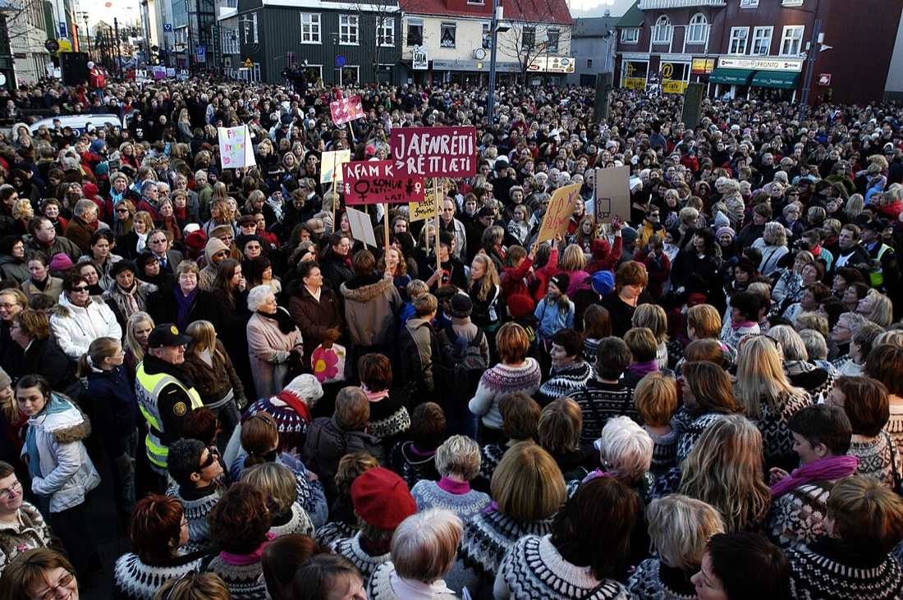
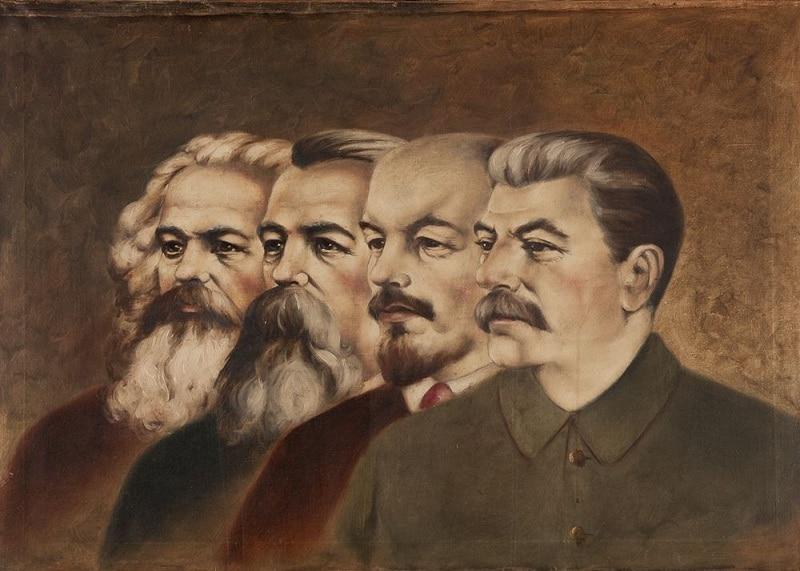
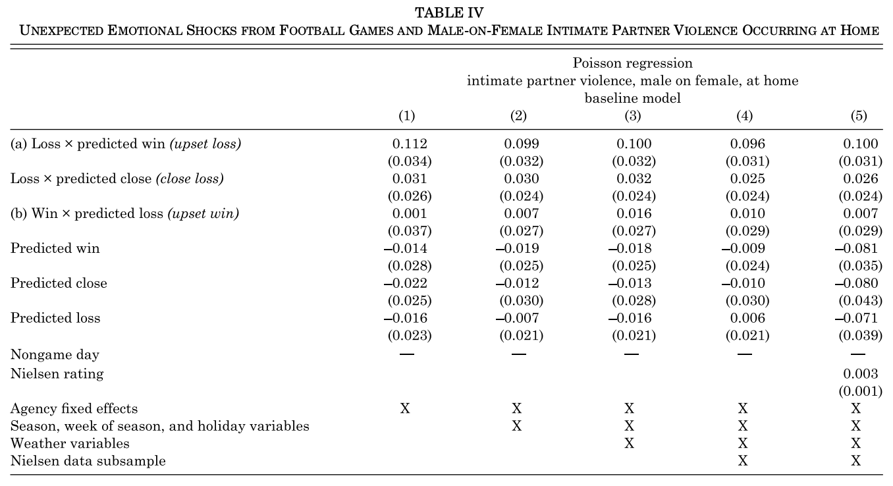
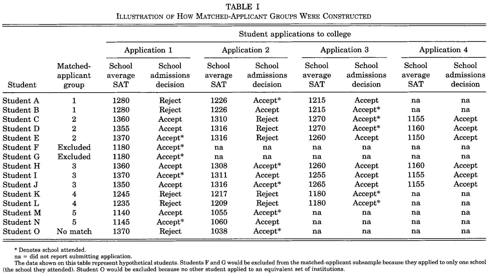
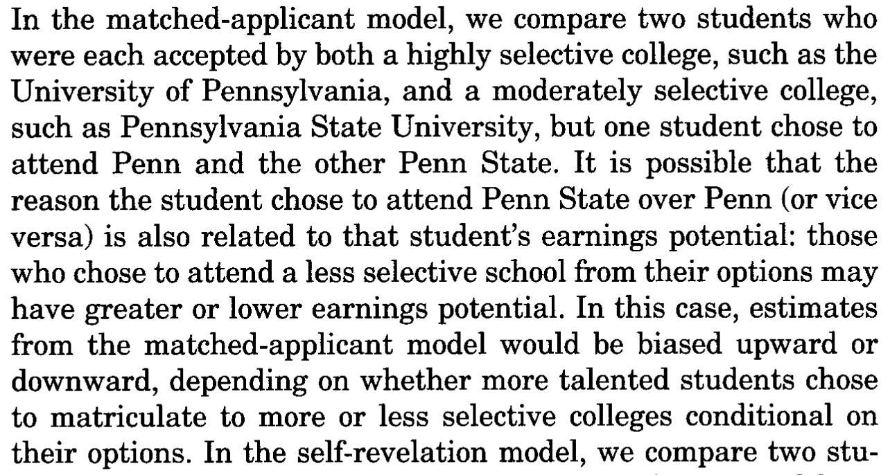
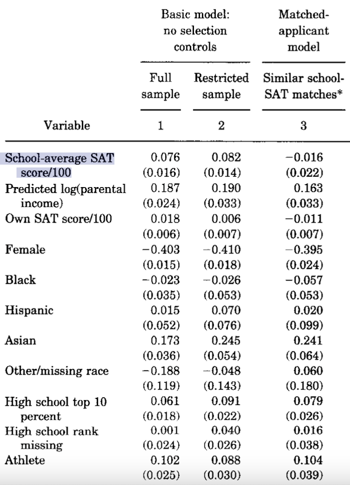

```{r setup, include = FALSE}
library(RefManageR)
library(knitr)
library(ggrepel) # Nicely placed labels in figures
library(modelr)  # add_residuals(): the Frisch-Waugh workflow

options(htmltools.preserve.raw = FALSE,
        htmltools.dir.version = FALSE, servr.interval = 0.5, width = 115, digits = 3)
knitr::opts_chunk$set(
  collapse = TRUE, message = FALSE, fig.retina = 3, error = TRUE,
  warning = FALSE, cache = FALSE, fig.align = 'center',
  comment = "#", strip.white = TRUE, tidy = FALSE)

BibOptions(check.entries = FALSE,
           bib.style = "authoryear",
           style = "markdown",
           hyperlink = FALSE,
           no.print.fields = c("doi", "url", "ISSN", "urldate", "language", "note", "isbn", "volume"))
myBib <- ReadBib("../Stats_II.bib", check = FALSE)
```

## By the end of today you can … {.inverse background-color="#901A1E"}

1. tell a **confounder** from a **mediator** on a causal diagram, and understand why you *control* the first but usually *not* the second;

2. use last week's tools on real data: predict the **direction** of a bias with the sign rule, and show what "holding constant" does with **Frisch–Waugh**;

3. use a **smart summary control** to stand in for confounders you cannot measure.

::: {.notes}
By now they can *run* a multiple regression; today is about deciding what belongs in it. Set the stakes early: adding a variable is not a neutral act. The same command can repair a comparison or quietly destroy it. Two running examples today, and one of them picks Lecture 2 back up.
:::

## What multiple OLS is good for

```{tikz uses-map, echo = FALSE, out.width='66%', fig.align='center'}
\usetikzlibrary{arrows.meta}
\definecolor{kured}{HTML}{901A1E}
\begin{tikzpicture}[
  box/.style = {draw, rounded corners = 3pt, align = center, inner sep = 4pt,
                font = \sffamily\small, minimum height = 0.9cm},
  today/.style = {box, draw = kured, very thick, text = kured},
  past/.style = {box, draw = gray, text = gray},
  level distance = 1.7cm,
  level 1/.style = {sibling distance = 7cm},
  level 2/.style = {sibling distance = 3.5cm},
  edge from parent/.style = {draw, -{Latex}, semithick}]
\node[box, font = \sffamily\bfseries] {Uses of multiple OLS}
  child {node[box] {Improve\\comparisons}
    child {node[today] {control\\confounders (Part 1)}}
    child {node[today] {separate out\\mediators (Part 1)}}}
  child {node[box] {Get closer to\\causal effects}
    child {node[past] {repair a cracked\\natural experiment (L8)}}
    child {node[today] {smart summary\\controls (Part 2)}}};
\end{tikzpicture}
```

::: {.content-box-red}
**Beware:** only the last turns multiple OLS into a natural experiment. The others make a comparison *fairer*, not *fair*.
:::

::: {.notes}
The road map for today, rebuilt from the old deck's schedule tree. Grey is last week: repairing Legewie's natural experiment by adjusting for age. Red is today. Part 1 is about which variables belong in the model at all, confounders yes, mediators usually not. Part 2 is about the confounders nobody can measure, and how one clever variable can stand in for them.
:::

## Confounders vs. mediators {.inverse background-color="#901A1E"}

[Part 1 of 2]{.part-pill}

::: {.lead}
Adding a variable to a regression can *sharpen* a comparison — or quietly *ruin* it. The difference is the arrow's direction.
:::

## Two jobs for a control variable

```{tikz confmed-dag, echo = FALSE, out.width='25%', fig.align='center'}
\usetikzlibrary{shapes.geometric, arrows.meta, positioning}
\definecolor{kured}{HTML}{901A1E}
\definecolor{kublue}{HTML}{425570}
\begin{tikzpicture}[>=Latex, semithick]
\sffamily
\node[ellipse, draw, minimum width=1cm] (D) at (0,0) {$D$};
\node[ellipse, draw, minimum width=1cm] (Y) at (4,0) {$Y$};
\node[ellipse, draw=kured, double, thick] (C) at (2,1.7) {$C$};
\node[ellipse, draw=kublue, thick] (M) at (2,-1.7) {$M$};
\draw[->] (D) -- (Y);
\draw[->, kured] (C) -- (D);
\draw[->, kured] (C) -- (Y);
\draw[->, kublue] (D) -- (M);
\draw[->, kublue] (M) -- (Y);
\end{tikzpicture}
```

::: {.push-left}
::: {.content-box-red}
**Confounder** $C$ opens a **backdoor path**: an arrow runs *into* the treatment $D$ *and* into the outcome $Y$.

$\rightarrow$ **Control it!** Multiple OLS blocks the backdoor and makes the comparison fairer.
:::
:::

::: {.push-right .fragment}
::: {.content-box-blue}
**Mediator** $M$ is (part of) the **causal path** $D \rightarrow M \rightarrow Y$: an arrow runs *out of* $D$.

$\rightarrow$ **Usually don't control it.** Controlling a mediator *removes (part of) the causal effect*.
:::
:::

::: {.notes}
This one DAG is the whole first half. Make them read the arrowheads, not the positions: the confounder has an arrow running *into* the treatment, the mediator has one running *out of* it. Same shape on the page, opposite advice. If they can tell these apart on an exam DAG, today has worked.
:::

## Why the direction matters

::: {.content-box-red}
To get closer to the total causal effect $D \rightarrow Y$, **control observed confounders**, but **never a mediator**: you would throw away the part of the effect that runs *through* it.
:::

::: {.content-box-blue}
Sometimes we want the **partial effect** of $D$ that does **not** run through $M$. Then controlling $M$ is exactly the point.
:::

::: {.notes}
Resist giving them a rule to memorise. "Never control a mediator" is the default, but the blue box is the honest version: sometimes the partial effect *is* the question. The discipline is not knowing the rule, it is knowing which question you asked before you typed the formula.
:::

## Confounder or mediator?

::: {.content-box-green}
Does a degree from KU pay off?

**Discuss:** where does each variable sit on the DAG? Should you control for it?
:::

| Variable | |
|:--|:--|
| Your parents' income | [**confounder**: it shapes both whether you go to KU and what you earn. Control it.]{.fragment} |
| Your high-school grade average | [**confounder**: it decides admission and predicts earnings. Control it.]{.fragment} |
| The first job you get after graduating | [**mediator**: part of how the degree pays off. Leave it out.]{.fragment} |
| The friends you make during your studies | [**mediator**: another channel of the degree's effect. Leave it out.]{.fragment} |

::: {.notes}
A quick round of practice before the real examples, on a question they care about personally. Take each row in turn and let them shout an answer before you click. The test is always the same: does the arrow run into the treatment (confounder) or out of it (mediator)? If someone argues that grades are partly caused by the kind of school you went to, that is fine: it is still before the treatment, so it is still a confounder. We come back to this exact question in Part 2 with Dale and Krueger.
:::

## A clear case of mediation

::: {.panel-tabset}

### The question
::: {.push-left}
Women in Denmark earn less per month than men. How much of that gap is because women more often work *fewer contracted hours*?

```{r, echo = FALSE, out.width='72%'}

```
::: {.backgrnote}
Reykjavík, 24 October 2005: women walked off work at 14:08, the minute after which, given the pay gap, they worked for free.<br> *Photo:* [Johannes Jansson](https://commons.wikimedia.org/wiki/File:Kvinnostrejk_i_Reykjavik_(5).jpg).
:::
:::

::: {.push-right}
Work hours is a **mediator**: gender shapes hours, and hours shape pay. But controlling for this path, we can see how much of the gender wage gap is caused by other factors than contracted work hours.

```{tikz gender-dag, echo = FALSE, out.width='90%'}
\usetikzlibrary{shapes.geometric, arrows.meta, positioning}
\definecolor{kured}{HTML}{901A1E}
\begin{tikzpicture}[>=Latex, semithick]
\sffamily
\node[ellipse, draw] (G) at (0,0) {Gender};
\node[ellipse, draw=gray, double, thick] (H) at (3,-1.6) {Work hours};
\node[ellipse, draw] (W) at (6,0) {Gross wage};
\draw[->, kured, very thick] (G) -- node[above]{direct} (W);
\draw[->, gray] (G) -- (H);
\draw[->, gray] (H) -- (W);
\end{tikzpicture}
```
:::

### The data
```{r ess-data}
pacman::p_load(tidyverse, haven, estimatr, modelsummary)

# ESS round 9, Denmark. Monthly gross wage, gender, contracted work hours.
ESS <- read_spss("../assets/ESS9e03_1.sav") %>%
  filter(cntry == "DK") %>%
  select(pspwght, gndr, wkhct, grspnum, infqbst) %>%
  mutate(
    pspwght = zap_labels(pspwght), # Make numeric
    wkhct   = zap_labels(wkhct),   # Make numeric
    grspnum = zap_labels(grspnum), # Make numeric
    gndr    = as_factor(gndr),
    grwage = case_when(          # Put everyone on a monthly basis
      infqbst == 1 ~ 4 * grspnum,   # weekly  -> monthly
      infqbst == 3 ~ grspnum / 12,  # yearly  -> monthly
      TRUE         ~ grspnum        # already monthly
    )
  ) %>%
  filter(wkhct > 0) %>%
  drop_na()
```

### The models
```{r ess-mods, results = 'hide'}
mod1 <- lm_robust(grwage ~ gndr,         data = ESS, weights = pspwght)
mod2 <- lm_robust(grwage ~ gndr + wkhct, data = ESS, weights = pspwght)

modelsummary(
  list("Gross wage" = mod1, "Gross wage" = mod2),
  coef_rename = c("gndrFemale" = "Female", "wkhct" = "Weekly hours"),
  stars = TRUE, gof_map = c("nobs", "r.squared"),
  output = "kableExtra"
)
```

### The result
::: {.push-left}
::: {.small}
```{r ess-tab, ref.label = "ess-mods", echo = FALSE, results = 'asis'}
```
:::
:::

```{r ess-share, echo = FALSE}
share <- round((1 - coef(mod2)["gndrFemale"] / coef(mod1)["gndrFemale"]) * 100)
```

::: {.push-right}
How much of the gap runs through hours? Compare the gap *before* and *after* holding hours constant:

$$\Big(1 - \frac{`r round(coef(mod2)["gndrFemale"])`}{`r round(coef(mod1)["gndrFemale"])`}\Big) \times 100 = `r share`\%$$

:::

:::

::: {.notes}
Open with the photo. In 2005, women in Iceland left work at 14:08: given the gap in earnings, everything after that minute was unpaid work compared with men. Then the question: how much of such a gap is about hours? The Bristol photo shows an early version of the arrangement: in wartime Britain, part-time shifts were created so that mothers could work around school hours. The arrangement stayed, and it stayed mostly female. An unambiguous mediator, so use it to build confidence: gender cannot be caused by working hours, the arrow only runs one way. Ask them to predict what happens to the gap before you show the second column. In the verdict tab, walk the share formula once: one minus the gap after, divided by the gap before. The shrinkage is not a nuisance, it is the finding: that share of the gap *is* the hours. And note what the remaining gap means: equal contracted hours, still unequal pay.
:::

## An *unclear* case: back to Lecture 2

::: {.left-column}
In Lecture 2 we asked: do state-owned (socialist) economies reduce poverty? Descriptively — no. But they also offer fewer civil liberties, and civil liberties themselves predict *less* poverty.

::: {.content-box-blue}
**Discuss:** are **civil liberties** a **confounder** or a **mediator** of the state ownership → poverty relationship? Should we control for them?
:::
:::

::: {.right-column}
::: {style="display: flex; gap: 1.2rem; align-items: flex-start;"}
::: {style="flex: 1; text-align: center;"}
```{r, echo = FALSE, out.width='78%'}

```
::: {.backgrnote}
New York Stock Exchange. *Photo:* [O'Halloran](https://commons.wikimedia.org/wiki/File:NY_stock_exchange_traders_floor_LC-U9-10548-6.jpg).
:::
:::
::: {style="flex: 1; text-align: center;"}
```{r, echo = FALSE, out.width='72%'}

```
::: {.backgrnote}
Marx, Engels, Lenin & Stalin. *Image:* [Kriyosxd](https://commons.wikimedia.org/wiki/File:Marx,_Engels,_Lenin,_Stalin..jpg).
:::
:::
:::

```{tikz triangle-dag, echo = FALSE, out.width='62%'}
\usetikzlibrary{shapes.geometric, arrows.meta, positioning}
\definecolor{kured}{HTML}{901A1E}
\begin{tikzpicture}[>=Latex, semithick]
\sffamily
\node[ellipse, draw, align=center] (S) at (0,0) {State\\ownership};
\node[ellipse, draw, gray, align=center] (F) at (3,2.4) {Civil\\liberties};
\node[ellipse, draw, align=center] (P) at (6,0) {Poverty};
\draw[->, kured, very thick] (S) -- (P);
\draw[<->, gray, dashed] (S) -- (F);
\draw[->, gray, dashed] (F) -- (P);
\end{tikzpicture}
```
:::

::: {.notes}
Use the two pictures to bring back the Cold War contrast from Lecture 2: the economy owned and run by the state, against the economy run by markets. Then the hard case, and there is no clean answer — say that up front. Let them argue both readings: civil liberties as a confounder (regimes that restrict liberties also nationalise) or as a mediator (state ownership erodes liberties). Point at the double-headed arrow: with cross-country data we genuinely cannot settle the direction. The honest move is to change the question, which is the next slide.
:::

## Revised research question {.inverse background-color="#901A1E"}

::: {.lead}
Would state-owned economies reduce poverty *more*, if they did not also curb their citizens' civil liberties?
:::

::: {.notes}
This is the move worth teaching: when you cannot resolve the DAG, sharpen the question until your model answers something you can actually defend. We are no longer claiming the total effect — we are asking about the part that does not run through civil liberties. Say the revised question slowly; they will need it to read the next table honestly.
:::

## Preparation

::: {.panel-tabset}

### Packages
```{r libs}
pacman::p_load(
  tidyverse,    # Data manipulation and visualization
  wbstats,      # World Bank data via API
  vdemdata,     # Varieties of Democracy (V-Dem) data
  estimatr,     # OLS with robust standard errors
  modelsummary  # Regression tables
)
```

### V-Dem data
```{r tri-data-vdem}
# V-Dem: civil liberties (equality before the law and
# individual liberty) and state ownership
Dat_vdem <- vdem %>%
  as_tibble() %>%
  select(country_text_id, year,
         civ_liberties = v2xcl_rol,
         state_own_raw   = v2clstown) %>%
  mutate(state_ownership = -state_own_raw) # Reverse: higher = MORE state ownership
```

### World Bank data & join
```{r tri-data}
# World Bank: extreme poverty (< $3.00 a day). Naming the indicator
# (poverty = ...) makes wbstats name the column for us.
Dat_poverty <- wb_data(c(poverty = "SI.POV.DDAY"),
                       start_date = 1972, end_date = 2025) %>%
  rename(year = date, country_text_id = iso3c) %>%
  select(country_text_id, year, country, poverty) %>%
  drop_na(poverty) %>%
  group_by(country) %>% filter(year == max(year)) %>% ungroup()

Dat <- inner_join(Dat_poverty, Dat_vdem,
                  by = c("country_text_id", "year")) %>%
  drop_na(poverty, state_ownership, civ_liberties)
```

### The joined data
```{r tri-data-show}
Dat
```

:::

## Multiple OLS

::: {.push-left}
```{r tri-mods, results = 'hide'}
# Bivariate: state ownership only
ols <- lm_robust(poverty ~ state_ownership, data = Dat)

# Multiple: add civil liberties
ols_mult <- lm_robust(
  poverty ~ state_ownership + civ_liberties,
  data = Dat
)

modelsummary(
  list("Poverty" = ols, "Poverty" = ols_mult),
  coef_rename = c("state_ownership" = "State ownership",
                  "civ_liberties" = "Civil liberties"),
  stars = TRUE, gof_map = c("nobs", "r.squared"),
  output = "kableExtra"
)
```
:::

::: {.push-right}
::: {.small}
```{r ref.label = "tri-mods", echo = FALSE, results = 'asis'}
```
:::
:::

::: {.notes}
Cover column two with your hand if you can, and ask them to predict it with last week's sign rule: civil liberties lower poverty, minus; state ownership comes with fewer liberties, minus; minus times minus is plus, so the bivariate estimate is pushed up. Then reveal. A sign flip is dramatic and they will remember it, but immediately supply the careful reading: not "state ownership reduces poverty", but "among countries with **the same** civil liberties, more state ownership goes with less poverty". Same data, one extra column, opposite story. Nothing here is causal, and the comparison is only fairer, not fair.
:::

## Last week's formula

```{r tri-ovb, include = FALSE}
b_t_bi   <- coef(ols)["state_ownership"]
b_t_mult <- coef(ols_mult)["state_ownership"]
b_t_cy   <- coef(ols_mult)["civ_liberties"]
b_t_dc   <- coef(lm_robust(civ_liberties ~ state_ownership, data = Dat))["state_ownership"]
```

::: {.push-left}
```{tikz tri-ovb-dag, echo = FALSE, out.width='80%'}
\usetikzlibrary{shapes.geometric, arrows.meta, positioning}
\definecolor{kured}{HTML}{901A1E}
\begin{tikzpicture}[>=Latex, semithick]
\sffamily
\node[ellipse, draw, align=center] (D) at (0,0) {State\\ownership};
\node[ellipse, draw=kured, thick, dashed, align=center] (C) at (3,2.4) {Civil\\liberties};
\node[ellipse, draw] (Y) at (6,0) {Poverty};
\draw[->] (D) -- (Y);
\draw[->, kured, dashed] (D) -- node[above left, font=\Huge]{$-$} (C);
\draw[->, kured, dashed] (C) -- node[above right, font=\Huge]{$-$} (Y);
\end{tikzpicture}
```
:::

::: {.push-right}
$$\underbrace{`r sprintf("%.3f", b_t_bi)`}_{\text{bivariate}} = \underbrace{`r sprintf("%.3f", b_t_mult)`}_{\text{multiple}} + (\underbrace{`r sprintf("%.3f", b_t_cy)`}_{C \rightarrow Y} \times \underbrace{`r sprintf("%.4f", b_t_dc)`}_{D \rightarrow C})$$

::: {.content-box-green}
We cannot be sure about the direction of the $D$–$C$ arrow. It could be a mediation or a confounding. But last week's formula works anyway; it holds for any control variable.
:::
:::

::: {.notes}
Spaced repetition of last week's centrepiece, now on 161 real countries instead of toy data. Walk the arithmetic: civil liberties on poverty, holding state ownership constant, is strongly negative; civil liberties on state ownership is negative too. Their product is the bias, and adding it to the multiple estimate gives back the bivariate one exactly. The backgrnote matters for the honest students: the formula is an identity about regression coefficients, so it holds whether civil liberties are a confounder or a mediator. What the arrow means is a question for the DAG, not for the arithmetic.
:::

## Frisch–Waugh, step 1

::: {.push-left}
Regress the outcome on the control, keep the residuals (the part of poverty that civil liberties do *not* explain).

```{r fw1}
Dat <- Dat %>%
  add_residuals(
    model = lm(poverty ~ civ_liberties, data = .),
    var   = "e_poverty"
  )
```
:::

::: {.push-right}
```{r fw1-plot, echo = FALSE, out.width='88%', fig.height = 4.2, fig.width = 6}
Dat %>%
  mutate(pred = poverty - e_poverty) %>%
  ggplot(aes(x = civ_liberties, y = poverty)) +
  geom_linerange(aes(ymin = pred, ymax = poverty),
                 color = "#901A1E", alpha = 0.5) +
  geom_smooth(method = "lm", se = FALSE, color = "#425570") +
  geom_text(aes(label = country), size = 3, alpha = 0.6) + # Every country by name
  geom_label_repel(data = . %>% filter(country == "Denmark"), aes(label = country),
                   color = "#901A1E", size = 5, box.padding = 1, min.segment.length = 0) +
  scale_x_continuous(expand = expansion(mult = 0.1)) + # Room for names at the edges
  labs(x = "Civil liberties",
       y = "% below $3.00 a day") +
  theme_minimal(base_size = 14)
```
:::

::: {.notes}
Frame the three steps before starting step 1: we are going to *earn* the phrase "holding constant" instead of just saying it. Step 1 strips civil liberties out of poverty — the red lines are what is left over, the part civil liberties cannot explain. Keep the pace brisk; the payoff is step 3.
:::

## Frisch–Waugh, step 2

::: {.push-left}
Regress the treatment on the control, keep the residuals (the part of state ownership that civil liberties do *not* explain).

```{r fw2}
Dat <- Dat %>%
  add_residuals(
    model = lm(state_ownership ~ civ_liberties, data = .),
    var   = "e_stateown"
  )
```
:::

::: {.push-right}
```{r fw2-plot, echo = FALSE, out.width='88%', fig.height = 4.2, fig.width = 6}
Dat %>%
  mutate(pred = state_ownership - e_stateown) %>%
  ggplot(aes(x = civ_liberties, y = state_ownership)) +
  geom_linerange(aes(ymin = pred, ymax = state_ownership),
                 color = "#901A1E", alpha = 0.5) +
  geom_smooth(method = "lm", se = FALSE, color = "#425570") +
  geom_text(aes(label = country), size = 3, alpha = 0.6) + # Every country by name
  geom_label_repel(data = . %>% filter(country == "Denmark"), aes(label = country),
                   color = "#901A1E", size = 5, box.padding = 1, min.segment.length = 0) +
  scale_x_continuous(expand = expansion(mult = 0.1)) + # Room for names at the edges
  labs(x = "Civil liberties",
       y = "State ownership of the economy") +
  theme_minimal(base_size = 14)
```
:::

::: {.notes}
Exactly the same operation, now on the treatment: strip civil liberties out of state ownership. What remains is variation in state ownership that has nothing to do with civil liberties. Point out that both variables have now been cleaned with the *same* rag — that symmetry is why the next step works.
:::

## Frisch–Waugh, step 3

::: {.push-left}
Regress the two sets of residuals on each other. Its slope is *identical* to the multiple-regression coefficient.

```{r fw3, results = 'hide'}
ols_resid <- lm_robust(e_poverty ~ e_stateown, data = Dat)

modelsummary(
  list("Multiple OLS" = ols_mult,
       "Residualised" = ols_resid),
  coef_rename = c("state_ownership" = "State ownership",
                  "civ_liberties" = "Civil liberties",
                  "e_stateown" = "State ownership (resid.)"),
  coef_omit = "(Intercept)",
  stars = TRUE, gof_map = c("nobs"),
  output = "kableExtra"
)
```
:::

::: {.push-right}
::: {.small}
```{r ref.label = "fw3", echo = FALSE, results = 'asis'}
```
:::
:::

::: {.notes}
The payoff: let them see the two coefficients match to the decimal before you say anything. Then the point: multiple regression is not doing anything mysterious, it is subtracting away the control from both variables and fitting a simple line to what is left. "Holding constant" now has a mechanism, not just a phrase.
:::

## The flip in signs

::: {.push-left}
```{r flip-raw, echo = FALSE, out.width='86%', fig.height = 4.4, fig.width = 6}
ggplot(Dat, aes(x = state_ownership, y = poverty)) +
  geom_text(aes(label = country), size = 3, alpha = 0.6) + # Every country by name
  geom_smooth(method = "lm", color = "#425570") +
  geom_label_repel(data = Dat %>% filter(country == "Denmark"), aes(label = country),
                   color = "#901A1E", size = 5, box.padding = 1, min.segment.length = 0) +
  scale_x_continuous(expand = expansion(mult = 0.1)) + # Room for names at the edges
  labs(title = "Raw: every country as it is",
       x = "State ownership of the economy", y = "% below $3.00 a day") +
  theme_minimal(base_size = 14)
```
:::

::: {.push-right}
```{r flip-resid, echo = FALSE, out.width='86%', fig.height = 4.4, fig.width = 6}
ggplot(Dat, aes(x = e_stateown, y = e_poverty)) +
  geom_text(aes(label = country), size = 3, alpha = 0.6) + # Every country by name
  geom_smooth(method = "lm", color = "#901A1E") +
  geom_label_repel(data = Dat %>% filter(country == "Denmark"), aes(label = country),
                   color = "#901A1E", size = 5, box.padding = 1, min.segment.length = 0) +
  scale_x_continuous(expand = expansion(mult = 0.1)) + # Room for names at the edges
  labs(title = "Residualised: civil liberties removed from both",
       x = "State ownership, civil liberties removed",
       y = "Poverty, civil liberties removed") +
  theme_minimal(base_size = 14)
```
:::

::: {.notes}
The picture behind the sign flip, recovered from the old deck, which showed both plots side by side. Left: the raw scatter, slightly rising. Right: the same countries after step 1 and step 2, falling. Nothing about the countries changed; only the comparison did. Denmark is in red in both, so they can see where their own country ends up once civil liberties are taken out.
:::

## Show the result: a coefficient plot

::: {.panel-tabset}

### The plot
```{r ref.label = "coefplot", echo = FALSE, out.width='62%', fig.height = 4, fig.width = 8}
```

### … its R code
```{r coefplot, fig.show = 'hide'}
ols_mult %>%
  tidy() %>%                      # Results as a tibble
  filter(term != "(Intercept)") %>%
  mutate(term = case_when(
    term == "state_ownership" ~ "State ownership",
    term == "civ_liberties" ~ "Civil liberties")) %>%
  ggplot(aes(x = reorder(term, estimate), y = estimate)) +
  geom_hline(yintercept = 0, color = "#901A1E", lty = "dashed") +
  geom_pointrange(aes(ymin = conf.low, ymax = conf.high)) +
  coord_flip() +
  labs(x = "", y = "Estimated coefficient (percentage points of poverty)") +
  theme_minimal(base_size = 15)
```

:::

::: {.notes}
The coefficient plot is last week's tool, so keep it short. It answers "how big, and how sure?" for each variable, but it does not show what the model predicts for a country. That is the next slide.
:::

## Show the result: predictions, step by step

::: {.panel-tabset}

### Step 1: fictional data
```{r pred-print, include = FALSE}
options(tibble.print_min = 4, tibble.print_max = 4) # Print only 4 rows below
```

::: {.push-left}
Make up the countries you want predictions for. **Vary the treatment**, and **pin the control** to an informative value: here, average civil liberties.

We let state ownership run from the most market-based economy in the data (Japan, `r sprintf("%.1f", min(Dat$state_ownership))`) to beyond the most state-owned one (Turkmenistan, `r sprintf("%.1f", max(Dat$state_ownership))`).
:::

::: {.push-right}
```{r pred1}
(fict_dat <- tibble(
  # The treatment: from -3 to 5 in steps of 0.1.
  # Our data stop at 2.0, so 2.1 to 5 go BEYOND them.
  state_ownership = seq(-3, 5, by = 0.1),
  # The control: every fictional country gets the
  # same, average civil liberties.
  civ_liberties = mean(Dat$civ_liberties)
))
```
:::

### Step 2: predict
::: {.push-left}
Apply the estimated model to the fictional data: for each made-up country, what poverty rate does the model predict, and how sure is it?

`predict()` returns three columns: the prediction `fit`, and the lower (`lwr`) and upper (`upr`) end of its 95% confidence interval.
:::

::: {.push-right}
```{r pred2}
(fict_dat <- predict(
  ols_mult,              # Our multiple OLS model,
  newdata = fict_dat,    # applied to the fictional data,
  interval = "confidence", # with a 95% confidence
  level = 0.95)$fit %>%    # interval; keep the $fit table
  as_tibble() %>%        # Turn it into a tibble,
  bind_cols(fict_dat, .)) # put it next to fict_dat
```
:::

### Step 3: plot
::: {.push-left}
```{r pred3, fig.show = 'hide'}
ggplot(data = fict_dat,
       aes(x = state_ownership, y = fit)) +
  # The 95% confidence interval as a grey band
  geom_ribbon(aes(ymin = lwr, ymax = upr), alpha = 0.3) +
  # The predictions as a line
  geom_line(linewidth = 1) +
  # Dashed line: where our data end (Turkmenistan)
  geom_vline(xintercept = max(Dat$state_ownership),
             color = "#901A1E", lty = "dashed") +
  # Dashed line: poverty cannot fall below 0%
  geom_hline(yintercept = 0,
             color = "orange", lty = "dashed") +
  labs(x = "State ownership\n(at average civil liberties)",
       y = "Predicted % below $3.00 a day") +
  theme_minimal(base_size = 14)
```
:::

::: {.push-right}
```{r ref.label = "pred3", echo = FALSE, out.width='92%', fig.height = 4, fig.width = 6}
```
:::

### Beyond the data
::: {.push-left}
```{r ref.label = "pred3", echo = FALSE, out.width='100%', fig.height = 4.4, fig.width = 6}
```
:::

::: {.push-right}
Left of the red dashed line, the model has real countries to learn from. Right of it, there are none: no economy in our data is more state-owned than Turkmenistan (value  of 2).

::: {.content-box-blue}
**Discuss:** what does the model predict to the right of the red line? Would you trust it?
:::

::: {.content-box-red .fragment}
**Negative poverty**: impossible. Beyond our data, the straight line is a prediction, not evidence.
:::
:::

:::

::: {.notes}
Recovered from the old deck, where the prediction was built in visible steps; they need exactly this code in exercise 2. Step 1: invent the data you want predictions for, and stress the choice hiding in it: you must *pin the control somewhere*, and we pinned civil liberties at their average. Different choice, different line, so always say where you pinned it. We also let state ownership run past the last real country on purpose. Step 2: `predict()` with `interval = "confidence"` returns the fit and its lower and upper bound; `bind_cols()` puts them next to the fictional data. Step 3 is a plain ggplot of that tibble, plus two dashed reference lines, as in the old deck. Ask the Discuss question before you click: to the right of the red line, the model happily predicts less than zero percent poor people. OLS draws a straight line forever; the data do not. The band also gets wider out there, which is the model's own way of saying it knows less.
:::

## Break {.inverse background-color="#901A1E"}

<div class="ku-timer" data-min="15"></div>

## Your turn: exercise 1

::: {.left-column}
You practice multiple OLS on the **carbon divide** from Lecture 4: do regions differ in emissions *beyond* their wealth?

[**Open exercise 1 in a new tab ↗**](9-exercise1.html){target="_blank"}

<div class="ku-timer" data-min="20"></div>
:::

::: {.right-column}
<iframe src='9-exercise1.html' width='100%' height='620' frameborder='0' scrolling='yes' style="border:1px solid #ddd; border-radius:6px;"></iframe>
:::

## Smart summary controls {.inverse background-color="#901A1E"}

[Part 2 of 2]{.part-pill}

::: {.lead}
"To control for a wide range of factors seems daunting: the possibilities are virtually infinite, and many characteristics are hard to quantify."
:::

::: {.backgrnote}
— `r Citet(myBib, "angrist_mastering_2014", after = ", p. 51")`
:::

::: {.notes}
Read the Angrist quote out loud — it names the anxiety they should be feeling by now. If good inference means controlling for everything, and the list is infinite and half of it unmeasurable, the project looks hopeless. Part 2 is the escape: sometimes *one* cleverly chosen variable stands in for the whole list.
:::

## American Football and domestic violence

::: {.left-column}
```{r, echo = FALSE, out.width='96%'}

```

::: {.content-box-blue}
**Discuss:** what confounds the effect of a team *losing* on domestic violence? How could a single variable, betting markets' point spread, stand in for all of them?
:::
:::

::: {.right-column}
```{tikz card-dag, echo = FALSE, out.width='82%'}
\usetikzlibrary{shapes.geometric, arrows.meta, positioning}
\definecolor{kured}{HTML}{901A1E}
\begin{tikzpicture}[>=Latex, semithick]
\sffamily
\node[ellipse, draw, gray, dashed, align=center] (C) at (0,2.2) {Team quality,\\fans, city … ($C$)};
\node[ellipse, draw=gray, double, thick, align=center] (S) at (0,0) {Point spread\\(betting market)};
\node[ellipse, draw, align=center] (L) at (3,-2) {Upset\\loss};
\node[ellipse, draw, align=center] (V) at (6,0) {Domestic\\violence};
\draw[->, gray, dashed] (C) -- (S);
\draw[->, gray, dashed] (C) to[bend left=20] (V);
\draw[->] (S) -- (L);
\draw[->, kured, very thick] (L) -- (V);
\end{tikzpicture}
```
:::

::: {.notes}
Let them brainstorm confounders first — they will produce team quality, kind of fan, kind of city, and quickly run out of measurable ones. Then the trick: a betting market has already done that work, because thousands of people with money at stake priced every one of those factors into a single number. One column standing in for a list nobody could finish.
:::

## Football and domestic violence

::: {.left-column}
By comparing games with the *same* pre-game point spread, `r Citet(myBib, "card_family_2011")` isolate the emotional shock of an *upset loss* (a loss when your team was predicted to win).

::: {.content-box-green}
What does the OLS regression tell us about the effect of an upset loss?
:::
:::

::: {.notes}
Define "upset loss" carefully: not just losing, but losing when the market expected you to win — the emotional shock is the *surprise*. Then read the table across, left to right: the estimate barely budges as controls pile up. That stability is the evidence the summary control already absorbed the confounding. A number that refuses to move is a number you can start to trust.
:::

::: {.right-column}
```{r, echo = FALSE, out.width='100%'}

```

::: {.backgrnote .center}
*Source:* `r Citet(myBib, "card_family_2011")`
:::
:::

## Do selective universities pay off?

::: {.left-column}
Graduates of selective universities earn more. But the ambitious, well-connected, rich, and able both select into selective universities and earn more; a swarm of confounders ($C$).

::: {.content-box-blue}
**Discuss:** what could summarise a student's ambition and ability *as university admissions system see it*?
:::
:::

::: {.right-column}
```{r, echo = FALSE, out.width='36%'}

```

::: {.backgrnote .center}
Johnston Gate, Harvard. *Photo:* [John Phelan](https://commons.wikimedia.org/wiki/File:Johnston_Gate,_Harvard,_Cambridge_MA.jpg).
:::

```{tikz dk-dag, echo = FALSE, out.width='62%'}
\usetikzlibrary{shapes.geometric, arrows.meta, positioning, bbox}
\definecolor{kured}{HTML}{901A1E}
\begin{tikzpicture}[>=Latex, semithick, bezier bounding box]
\sffamily
\node[ellipse, draw, align=center] (U) at (0,0) {Selective\\university};
\node[ellipse, draw, gray, dashed] (P) at (0,2.2) {Parental \$};
\node[ellipse, draw, gray, dashed] (I) at (2.8,2.2) {IQ};
\node[ellipse, draw=kured, dashed, text=kured] (C) at (-2.8,2.2) {\dots\ $C$?};
\node[ellipse, draw] (Y) at (6,0) {Earnings};
\draw[->, kured, very thick] (U) -- node[above]{?} (Y);
\draw[->, gray, dashed] (P) -- (U);
\draw[->, gray, dashed] (I) -- (U);
\draw[->, kured, dashed] (C) -- (U);
\draw[->, gray, dashed] (P) -- (Y);
\draw[->, gray, dashed] (I) -- (Y);
\draw[->, kured, dashed] (C) to[out=40, in=125, looseness=0.9] (Y);
\end{tikzpicture}
```
:::

::: {.notes}
This one lands personally — they are all sitting in a selective university right now. Set up the problem honestly: graduates of selective schools *do* earn more, but the ambitious and able both choose those schools and would have earned more anyway. Let them chew on the blue box before the next slide; the answer is genuinely clever.
:::

## The smart summary control: where you applied and were admitted to

::: {.push-left}
```{tikz dk-match, echo = FALSE, out.width='100%'}
\usetikzlibrary{shapes.geometric, arrows.meta, positioning, bbox}
\definecolor{kured}{HTML}{901A1E}
\begin{tikzpicture}[>=Latex, semithick, bezier bounding box]
\sffamily
\node[ellipse, draw, align=center] (U) at (0,0) {Selective\\university};
\node[ellipse, draw=gray, double, thick, align=center] (M) at (0,1.5) {Matched\\students};
\node[ellipse, draw, gray, align=center] (Ad) at (-2.2,3.0) {Unis\\admitted to};
\node[ellipse, draw, gray, align=center] (A) at (2.2,3.0) {Unis\\applied to};
\node[ellipse, draw, gray, dashed] (P) at (0,4.5) {Parental \$};
\node[ellipse, draw, gray, dashed] (I) at (2.9,4.5) {IQ};
\node[ellipse, draw=kured, dashed, text=kured] (C) at (-2.9,4.5) {\dots\ $C$?};
\node[ellipse, draw] (Y) at (6.4,0) {Earnings};
\draw[->, kured, very thick] (U) -- node[above]{?} (Y);
\draw[->, gray, dashed] (M) -- (U);
\draw[->, gray, dashed] (Ad) -- (M);
\draw[->, gray, dashed] (A) -- (M);
\draw[->, gray, dashed] (A) -- (Ad);
\draw[->, gray, dashed] (P) -- (Ad);
\draw[->, gray, dashed] (P) -- (A);
\draw[->, gray, dashed] (I) -- (A);
\draw[->, gray, dashed] (I) -- (Ad);
\draw[->, gray, dashed] (C) -- (Ad);
\draw[->, gray, dashed] (C) -- (A);
\draw[->, gray, dashed] (P) to[out=55, in=115, looseness=1.4] (Y);
\draw[->, gray, dashed] (I) -- (Y);
\draw[->, gray, dashed] (C) to[out=50, in=90, looseness=1.3] (Y);
\end{tikzpicture}
```
:::

::: {.push-right}
`r Citet(myBib, "dale_estimating_2002")` compare students who applied to, and were admitted by, the same universities. Where you *applied* shows how you see yourself. Where you were *admitted* shows how the universities see you.
:::

::: {.notes}
Recovered from the old deck: the DAG with where you applied and where you were admitted. Walk it from the top: parental money, IQ and whatever else ($C$) shape where you apply and where you get in. You can only be admitted where you applied, hence the small arrow between the two. Together they define your matched group, the double ring, and the matched group decides which selective university you can choose. Let them trace the paths before you click. The answer: as drawn, every backdoor from the top runs into the double ring. Keep "as drawn" in mind; two slides from now we question the drawing.
:::

## Matched applicants: who is compared with whom?

::: {.left-column}
::: {.content-box-blue}
**Discuss:** who is compared with whom? Why are F, G and O left out?
:::
:::

::: {.right-column}
```{r, echo = FALSE, out.width='100%'}

```

::: {.backgrnote .center}
*Source:* `r Citet(myBib, "dale_estimating_2002")`
:::
:::

::: {.notes}
The paper's own illustration of the matching, with invented students, as on the old slide. Let them read it for a minute. Group 2 is the clearest: C, D and E applied to the same four schools and got the same answers, then E went to the most selective one. Two students with the same portfolio and the same letters are alike in ambition and ability without anyone ever measuring either.
:::

## Matching closes the backdoor, **if** …

::: {.push-left}
::: {.r-stack}
::: {.fragment .fade-out fragment-index=1 style="width: 100%;"}
```{tikz dk-match2, echo = FALSE, out.width='86%'}
\usetikzlibrary{shapes.geometric, arrows.meta, positioning, bbox}
\definecolor{kured}{HTML}{901A1E}
\begin{tikzpicture}[>=Latex, semithick, bezier bounding box]
\sffamily
\node[ellipse, draw, align=center] (U) at (0,0) {Selective\\university};
\node[ellipse, draw=gray, double, thick, align=center] (M) at (0,1.5) {Matched\\students};
\node[ellipse, draw, gray, align=center] (Ad) at (-2.2,3.0) {Unis\\admitted to};
\node[ellipse, draw, gray, align=center] (A) at (2.2,3.0) {Unis\\applied to};
\node[ellipse, draw, gray, dashed] (P) at (0,4.5) {Parental \$};
\node[ellipse, draw, gray, dashed] (I) at (2.9,4.5) {IQ};
\node[ellipse, draw=kured, dashed, text=kured] (C) at (-2.9,4.5) {\dots\ $C$?};
\node[ellipse, draw] (Y) at (6.4,0) {Earnings};
\draw[->, kured, very thick] (U) -- node[above]{?} (Y);
\draw[->, gray, dashed] (M) -- (U);
\draw[->, gray, dashed] (Ad) -- (M);
\draw[->, gray, dashed] (A) -- (M);
\draw[->, gray, dashed] (A) -- (Ad);
\draw[->, gray, dashed] (P) -- (Ad);
\draw[->, gray, dashed] (P) -- (A);
\draw[->, gray, dashed] (I) -- (A);
\draw[->, gray, dashed] (I) -- (Ad);
\draw[->, gray, dashed] (C) -- (Ad);
\draw[->, gray, dashed] (C) -- (A);
\draw[->, gray, dashed] (P) to[out=55, in=115, looseness=1.4] (Y);
\draw[->, gray, dashed] (I) -- (Y);
\draw[->, gray, dashed] (C) to[out=50, in=90, looseness=1.3] (Y);
\end{tikzpicture}
```
:::

::: {.fragment fragment-index=1 style="width: 100%;"}
```{tikz dk-assume, echo = FALSE, out.width='86%'}
\usetikzlibrary{shapes.geometric, arrows.meta, positioning, bbox}
\definecolor{kured}{HTML}{901A1E}
\begin{tikzpicture}[>=Latex, semithick, bezier bounding box]
\sffamily
\node[ellipse, draw, align=center] (U) at (0,0) {Selective\\university};
\node[ellipse, draw=gray, double, thick, align=center] (M) at (0,1.5) {Matched\\students};
\node[ellipse, draw, gray, align=center] (Ad) at (-2.2,3.0) {Unis\\admitted to};
\node[ellipse, draw, gray, align=center] (A) at (2.2,3.0) {Unis\\applied to};
\node[ellipse, draw, gray, dashed] (P) at (0,4.5) {Parental \$};
\node[ellipse, draw, gray, dashed] (I) at (2.9,4.5) {IQ};
\node[ellipse, draw=kured, dashed, text=kured] (C) at (-2.9,4.5) {\dots\ $C$?};
\node[ellipse, draw] (Y) at (6.4,0) {Earnings};
\draw[->, kured, very thick] (U) -- node[above]{?} (Y);
\draw[->, gray, dashed] (M) -- (U);
\draw[->, gray, dashed] (Ad) -- (M);
\draw[->, gray, dashed] (A) -- (M);
\draw[->, gray, dashed] (A) -- (Ad);
\draw[->, gray, dashed] (P) -- (Ad);
\draw[->, gray, dashed] (P) -- (A);
\draw[->, gray, dashed] (I) -- (A);
\draw[->, gray, dashed] (I) -- (Ad);
\draw[->, gray, dashed] (C) -- (Ad);
\draw[->, gray, dashed] (C) -- (A);
\draw[->, gray, dashed] (P) to[out=55, in=115, looseness=1.4] (Y);
\draw[->, gray, dashed] (I) -- (Y);
\draw[->, gray, dashed] (C) to[out=50, in=90, looseness=1.3] (Y);
\draw[->, kured, dashed, thick] (C) to[out=50, in=90, looseness=1.3] (Y);
\draw[->, kured, dashed, thick] (C) to[out=200, in=180, looseness=0.9] node[left, font=\small, align=center]{why they\\chose} (U);
\end{tikzpicture}
```
:::
:::
:::

::: {.push-right}
```{r, echo = FALSE, out.width='92%'}

```

::: {.backgrnote .center}
*Source:* `r Citet(myBib, "dale_estimating_2002")`
:::

::: {.content-box-blue .fragment fragment-index=1}
**Discuss:** you were admitted to KU and maybe to another university. Why did you pick KU? Could the same reason also raise your earnings later?
:::
:::

::: {.notes}
First the DAG from two slides ago: holding the matched group constant closes the backdoors through parental money, IQ and the rest. Then the honest part, which Dale and Krueger state themselves in the quote: within a matched group, *why* someone chose Penn over Penn State could still be related to earnings potential. Click: that is the new red arrow, straight from $C$ into the choice of university, bypassing applications and admissions. It is a backdoor that matching does not close. Make it personal with the blue box. Answers like "my parents wanted it" or "it has the best programme for what I want to do" can both be reasons that also predict earnings.
:::

## The premium disappears

```{r, echo = FALSE, out.width='64%'}

```
::: {.backgrnote .center}
*Source:* `r Citet(myBib, "dale_estimating_2002")`
:::


## No Harvard premium → no KU premium {.inverse .photo-bg background-color="#901A1E" background-image="img/L9/ku_main.jpg" background-opacity="0.3" background-size="cover" background-position="center"}

::: {.lead}
If a selective *US* university barely raises earnings once you compare like with like, a selective *Danish* one probably doesn't either.
:::

$\rightarrow$ Your KU degree pays off **because you are able and put in the work**.

::: {.photo-credit}
KU's main building on Frue Plads. *Photo:* Orf3us, [CC BY 3.0](https://commons.wikimedia.org/wiki/File:K%C3%B8benhavns_Universitets_hovedbygning.jpg).
:::

::: {.notes}
Deliver this as encouragement, not deflation: what pays off is the ability and the work, and the diploma mostly reports that back to employers. Worth naming the extrapolation as an extrapolation — this is US data, and Danish institutions differ. Good moment to ask what would make Denmark different.
:::

## Break {.inverse background-color="#901A1E"}

<div class="ku-timer" data-min="10"></div>

## Your turn: exercise 2

::: {.left-column}
You visualise the adjustment: a **before/after coefficient plot** and **model predictions** — again on the carbon divide.

[**Open exercise 2 in a new tab ↗**](9-exercise2.html){target="_blank"}

<div class="ku-timer" data-min="20"></div>
:::

::: {.right-column}
<iframe src='9-exercise2.html' width='100%' height='620' frameborder='0' scrolling='yes' style="border:1px solid #ddd; border-radius:6px;"></iframe>
:::

## Today's general lessons {.inverse background-color="#901A1E"}

1. A **confounder** opens a backdoor path (arrow *into* the treatment) — **control it**. A **mediator** lies on the causal path (arrow *out of* the treatment) — **usually don't**, or you delete part of the effect.

2. Adding a control can move a coefficient a lot, even **flip its sign** (state ownership & poverty). Last week's sign rule predicts the direction: two negative paths make a positive bias.

3. **Frisch–Waugh:** "controlling for $C$" = residualise $Y$ on $C$, residualise $D$ on $C$, regress the residuals. Same number, clearer intuition.

4. When confounders are unmeasurable, a **smart summary control** — a point spread, a shared application portfolio — can stand in for many of them at once.

5. Multiple OLS **improves** comparisons; only a real experiment *guarantees* them.

::: {.notes}
Point five is the one to say slowly, because it is the whole course in one line: controlling makes a comparison *fairer*, never *fair*. You can only ever adjust for confounders you thought of and measured. That gap is exactly why the coming weeks look for natural experiments instead.
:::

## Check yourself: today's goals

::: {.checklist}
- Point to the confounder and the mediator on a DAG, and say which you would put in the regression — and why.
- Use the sign rule to explain why the state ownership coefficient flips once civil liberties are held constant.
- Explain, in the three Frisch–Waugh steps, what "holding civil liberties constant" does to the state ownership coefficient.
- Give one example of a *smart summary control* and the confounders it stands in for.
:::

::: {.content-box-green}
Shaky on any of these? That is what this week's **Absalon quiz** and the **Friday exercise class** are for.
:::

## Today's important functions

::: {.small}
- `lm_robust(y ~ d + c, ...)`: multiple OLS — the coefficient on `d` holds `c` constant.
- `modelr::add_residuals(model = ..., var = ...)`: keep a model's residuals (the Frisch–Waugh workflow).
- `tidy()` + `geom_pointrange()` + `coord_flip()`: the coefficient plot.
- `predict(model, newdata = ..., interval = "confidence")`: predictions — set controls to an informative constant.
- `modelsummary(list(...))`: put bivariate and multiple models side by side.
:::

## References

::: {.small}
```{r ref, results = 'asis', echo = FALSE}
PrintBibliography(myBib)
```
:::

```{=html}
<script>
(function () {
  function fmt(s) { var m = Math.floor(s / 60), ss = s % 60; return m + ":" + (ss < 10 ? "0" : "") + ss; }
  function build(el) {
    var total = (parseInt(el.getAttribute("data-min"), 10) || 5) * 60, rem = total, id = null;
    el.innerHTML =
      '<div class="kt-display">' + fmt(rem) + '</div>' +
      '<div class="kt-btns">' +
        '<button class="kt-start" type="button">Start</button>' +
        '<button class="kt-pause" type="button">Pause</button>' +
        '<button class="kt-reset" type="button">Reset</button>' +
      '</div>';
    var disp = el.querySelector(".kt-display");
    function render() { disp.textContent = fmt(rem); el.classList.toggle("kt-done", rem <= 0); }
    function start() { if (id) return; id = setInterval(function () { if (rem > 0) { rem--; render(); } else { stop(); } }, 1000); }
    function stop() { clearInterval(id); id = null; }
    function reset() { stop(); rem = total; render(); }
    el.querySelector(".kt-start").onclick = start;
    el.querySelector(".kt-pause").onclick = stop;
    el.querySelector(".kt-reset").onclick = reset;
    el._start = start; el._reset = reset; render();
  }
  function init() {
    document.querySelectorAll(".ku-timer").forEach(build);
    if (window.Reveal && Reveal.on) {
      Reveal.on("slidechanged", function (e) {
        document.querySelectorAll(".ku-timer").forEach(function (t) { if (t._reset) t._reset(); });
        var here = e.currentSlide ? e.currentSlide.querySelectorAll(".ku-timer") : [];
        here.forEach(function (t) { if (t._start) setTimeout(t._start, 250); });
      });
    }
  }
  if (document.readyState !== "loading") init();
  else document.addEventListener("DOMContentLoaded", init);
})();
</script>
```
